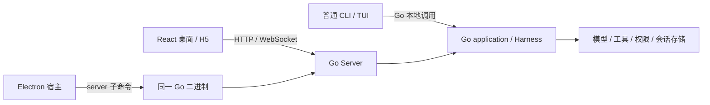

# main → Go worktree 功能同步计划

日期：2026-10-12。实施开始：2026-10-12。状态：**实施进行中，完整目标尚未验收通过。** 当前进展、失败与证据见[实施记录](go-main-feature-sync-progress.md)。

## 1. 需求和目标

用户要的是：跟进 main 已发布的桌面功能，保留 React 桌面与 Go Harness 的分离；从应用图标打开即使用 Go，界面上的操作有实际业务结果；再把 main 的 CLI、Server、Agent、工具和 IM 行为迁入同一 Go 运行时。不能通过重新启动 TypeScript CLI/Server 来获得表面兼容。

本计划初版交付差异调查、实施顺序和验收方案；初版编写时没有修改生产源码或调用真实模型。用户随后授权实现全部目标，正在当前 Go 工作树实施；冻结参考 MAIN 保持不变，不执行 merge/rebase、创建分支或提交。

第一性原理：用户交付物是“能完成任务的产品行为”，不是语言替换、文件同步、API 数量或测试数量。因此每项都按 **用户输入 → UI/native 消费者 → Go API/事件/配置 → 实际运行时/持久化 → 用户看到的结果** 实现；任一环缺失，该项保持未完成。

完成目标：

1. main 当前有效的桌面交互、视觉、H5、设置、市场、轨迹、文件、语音、浏览器、更新和数据迁移可用。
2. 这些功能需要的 Go 接口、事件生产器、设置消费者、存储迁移和进程生命周期同步完成。
3. CLI/TUI、桌面、H5 共享的 Agent 行为一致；普通 CLI 保持可独立运行。
4. 保留 Go 默认入口、权限/凭据边界、旧会话兼容和已有 Go 功能；原迁移未闭环项目继续验收。
5. 在同一最终候选上通过确定性门禁、真实桌面操作、需要模型的真实任务，以及版本匹配的配对 Harness Benchmark。

## 2. 冻结版本与差异范围

本次已执行 `git fetch origin main`；下表以 SHA 为准，后续 main 前进不得悄悄改变本计划的参考版本。

| 身份 | 冻结 SHA | 说明 |
| --- | --- | --- |
| 共同基线 BASE | `6b9d2aec1d9321a4dfff90d16b51f10c1ab984c8` | 两边的 merge-base |
| Go 工作版本 WORK | `64c2fa1c7213e8f39c10e2cba8d7361625449b7e` | 当前 detached HEAD；调查开始时工作树干净 |
| 上游 MAIN | `6d21316ec4635f29ecbaa43e1a5574bfd31d7155` | fetch 后本地 main 与 origin/main 相同；最后提交 #1532 |
| WORK 独有历史 | 4 个提交 | `6bc30cad6` Go runtime；`3ddab590b` 桌面/CLI Go 入口；`88f6b5b62` Go 门禁；`64c2fa1c7` 文档 |
| MAIN 独有历史 | 71 个提交 | 2026-10-02 至 2026-10-12；完整归属见提交台账 |

使用 BASE→MAIN 查新增需求、BASE→WORK 查迁移改动，再逐项比对 MAIN 与 Go。直接查看 WORK→MAIN 会把整个新增 backend 显示为删除，不能用作功能缺口清单。

MAIN 最终净差异：**986 个路径，92,483 行新增、23,164 行删除**。目录统计包含测试、资源和文档，并不表示 986 个功能。

| 区域 | 路径数 | 处理方式 |
| --- | ---: | --- |
| desktop | 619 | 首要同步范围：React/native/宿主/测试及其 Go 契约 |
| src | 268 | 参考实现与对照测试；业务语义迁入 Go |
| adapters | 25 | Go adapter 生命周期、附件和迁移控制 |
| scripts | 23 | 对照、性能、市场目录和质量工具适配 Go 入口 |
| docs | 30 | 跟随最终实现更新，不能搬入错误的 TS 使用说明 |
| .github | 3 | 质量策略单独评估，保留 Go 门禁 |
| .agents | 5 | 发布技能及其测试；独立工具同步 |
| site | 5 | 说明/宣传资源同步，不算 Harness 实现 |
| release-notes | 3 | 保留上游发布记录；不据此发布 Go 版本 |
| README 三个路径 | 3 | 中文默认、英文入口、图片/说明变更 |
| package.json / bun.lock | 2 | 合并 Go scripts 与上游依赖变化，禁止整文件覆盖 |

双方同改 **25 个路径**（见冲突清单）。这只是文本重叠；新 React 调用旧 Go 接口、旧 Go 读取新数据库也会发生语义冲突。

已撤回的 `1443e22d4`（session header）和 `9b1523124`（切换 session 保留 side chat）分别由 `cdf3f6835`、`bbd819356` 撤回。以 MAIN 最终树为准，不重新实施这些已撤回方案。

## 3. 当前架构：分离已建立，完整兼容仍未成立



准确结论：**Electron、React/H5 与 Go 业务已分离；普通 CLI 直接调用 Go 运行时，并不强制经过 HTTP Server。** 两端共用 Go application/clibootstrap/Harness，界面通过 API/事件耦合，仍须同步契约。

当前证据：

- `desktop/electron/services/sidecarBackend.ts` 只接受 Go，解析 `claude-sidecar-go-<triple>`；`sidecarManager.ts:createServerPlan` 运行 `server`，并将 `CLAUDE_CLI_PATH` 指向同一 Go 文件。Adapter plan 也使用同一文件的 `adapters` 子命令。
- `desktop/scripts/build-sidecars.ts` 与 `go-sidecar-build.ts` 编译 Go，并清理旧业务 sidecar；`scripts/cli/launch.cjs`、`bin/claude-haha` 只转交原生 Go 命令。
- `backend/cmd/claude-haha/main.go` 分派 server/CLI；`application/command.go` 与 `application/session.go` 使用 `clibootstrap.NewMainPrint`；`application/desktop.go:DesktopFactory` 使用同一 `NewSession`。
- **遗留 Tauri 缺口**：`desktop/src-tauri/src/lib.rs:1789,1934` 仍 `.sidecar("claude-sidecar")`，`tauri.conf.json:51` 仍 `binaries/claude-sidecar`。Go 构建已清理这个旧名称。现阶段不能把所有仓库桌面入口都称为已接 Go；保留的 Tauri 入口须一起改名、接线、打包与验证。

同步必须保留这些 Go 入口，也保留现有 Owner/Controller、SDK、凭据分流、进程关闭和 Go 特有测试。前端更新不授权把原业务切回 TS。

## 4. 调查前已有的验收债务

本计划跟进 main 增量，不替代[总迁移清单](go-migration-worklist.md)或[SB01–SB16 清单](go-server-boundary-work-checklist.md)。既有缺口会被新功能触发；必须显式完成，不能把它们归因于这次同步。

| 基线 | 已有结果 | 本次如何使用 |
| --- | --- | --- |
| P1116 Go unit/race | 各 14,011 tests passed；build/vet 通过 | 历史证据；代码同步后按新候选重跑 |
| P1116 `check:go` | **failed**；改动行覆盖率 60.27%，门槛 90% | 独立整改项；不得降门槛宣称完成 |
| P1115 parity | 63 corpus 文件、3,150 pass、0 fail | 有限语料与历史快照；未覆盖之后测试/文档字节，也未覆盖新 MAIN |
| `bun run verify` | 尚未整体通过 | 最终候选仍须完整验证，不能用局部绿代替 |
| CLI core policy | 历史 impact 显示需维护者 label/approval | 实施时按实际最终 diff 重新选 lane，记录策略结果 |
| 全 UI / SB01–SB16 / Benchmark | 尚未整项闭环 | 既有真实模型和 UI 收据只证明记录中的限定范围 |
| Computer Use / 语音 | 有部分签名候选实测；另一次 ad-hoc helper 被拒；录音 noSpeech | 最终签名包复验；noSpeech 不算有声识别准确率通过 |

最新可追溯范围在[当前验证记录](go-migration-current-validation.md)。本轮未重跑上述门禁，不改变这些状态。

## 5. 同步方法与实施批次

推荐按功能批次做受控三方同步：React/native 可复用 main 最终实现；涉及 TS 业务的提交同时移植到 Go，并新增 main→Go 对照。不能以 71 次盲目 cherry-pick 或整个 desktop 目录覆盖替代这项工作。

在用户授权的当前工作区实施，不创建或切换分支。每批保留上游 SHA、同步路径、Go 对应实现和验收收据。提交台账全部落实后，才整理 main 合并 ancestry；合并仍要独立授权、处理冲突并在最终集成树复测，不能仅靠已回移补丁认定 merge 安全。

| 批次 | 工作与依赖 | 出口条件 |
| --- | --- | --- |
| B0 · 冻结和入口 | 保存 BASE/WORK/MAIN；对照 25 个重叠路径；明确 Go 默认入口；修复保留的 Tauri；建立新契约缺口测试 | 新包所有支持的入口启动 Go；没有 TS fallback；完整任务/接口台账可追溯 |
| B1 · 桌面基础同步 | 先做 Porcelain/主题/组件、五种语言、布局、菜单和既有协议上的 UI 修复；保留 Go 独有 team/Subagent 修复 | 桌面焦点、布局、各主题、已有聊天/设置入口可运行；没有新增悬空入口 |
| B2 · 桌面功能逐条闭环 | 市场、工作区/CSV、浏览器、轨迹、编辑重跑、H5、语音、新设置、更新、数据迁移；每条新增 Go 契约先补齐再接 UI | 每条路径有实际结果与持久化/事件证据；界面不出现 capability/404 或假状态 |
| B3 · 桌面所需 Harness 增量 | 压缩、普通 SubAgent 上限、后台任务收敛、Team 恢复/依赖、Fast mode、流式结束/失败；与 B2 对应功能一起交付 | UI 操作影响真实 Go Agent；负向、Stop、重连与下一轮恢复通过 |
| B4 · CLI/Server/IM 余项 | CLI side-fork、Bash/进程/MCP回收、索引性能/大小写、provider/OAuth、IM 附件及空闲回收；更新文档与质量脚本 | CLI 独立可用；跨桌面恢复一致；各平台与 adapter 生命周期有对应证据 |
| B5 · 最终候选验收 | 最终门禁、签名安装包、真实模型任务、旧 session fork、新场景和配对 Benchmark | 所有任务达到完成定义；原迁移开放项另有明确状态；不再混用版本证据 |

“桌面先同步”表示以桌面用户路径安排顺序。一个按钮依赖 Go 新 API 时，先完成该 API 的最小完整实现，再接按钮并验收；不先展示不可用按钮，再把后端推迟到最后。

## 6. 桌面同步需求与逐项验收

以下 ID 是本计划的执行单位。每项拆成实现、确定性验证、实际入口验证三步；需要模型的项再完成 live 验收。下表为冻结需求；当前状态单独维护在[实施记录](go-main-feature-sync-progress.md)，不能把复用代码或局部测试直接当成该项完成。

| ID / 批次 | 用户需求及上游依据 | 同步范围与依赖 | 完成目标与负向校验 |
| --- | --- | --- | --- |
| D01 / B1 | Porcelain 桌面、主题与组件统一；#1452 | `theme/globals.css`、`components/ui`、布局/设置/聊天组件、全部五份 locale；可直接复用多数 React；同步组件 AGENTS 索引 | 六主题 white/paper/warm-classic/celadon/dark/ink-blue 可切换；新默认聊天 15px/800px，旧 14px 偏好保留；弹窗/焦点/键盘/缩放/窄窗正常；删除未使用字体及导入，回归可达性、翻译/a11y |
| D02 / B1–B2 | `+` 菜单重组 skills/connectors/运行模式，连接器 logo；#1462、#1472、#1477、`1c7815452` | `ComposerCapabilityMenu`、`capabilityMenuModel`、`useCapabilityMenu`、Model/Permission/Effort 控件；精选市场依赖 D03；默认新会话 effort=low | skills/plugins/agents/connectors/workflows/CU 各入口能实际加载/执行；某数据源失败不清空其他项；permission 菜单不越窗；保留旧设置；CU 仍只使用统一应用授权，不新增 per-app 授权 |
| D03 / B2 | 精选技能、分类与完整详情；`4097fc650`、#1434 | `api/market.ts`、market store/页面/组件；Go catalog、scope/category、total、locale、安全报告/changelog；**owner 身份贯穿 detail/file/install** | 精选离线可浏览；来源失败可解释；分类/搜索/分页一致；同 slug 不同发布者不混淆；安装→设置/菜单→真实 Skill 执行→卸载目录同步；失败安装不留下假 installed 状态 |
| D04 / B2 | 浏览器合成进桌面、picker 改善；#1437、#1472 | React `<webview>` guest、Electron/preload/native IPC、preview-agent 一批同步；`workspaceBrowserGuest.ts` 和 guest contract；不属于 Go REST | 多标签/导航/find/zoom/截图/PDF/下载、picker/annotation、菜单层级可用；foreign guest、伪造 webContentsId、恶意 preload、错误 partition/nodeIntegration/导航被拒；renderer/guest 销毁后能恢复；Go CU 链路独立复验 |
| D05 / B2 | 文件必须有磁盘证据，CJK/缺图、CSV/TSV、workspace 更新；#1429、#1431、#1444、#1450、#1505、#1517 | output targets/hooks、workspace content store/watch、`SpreadsheetSurface`；Go `workspace/stat`、checkpoint.startedAt、NFC/NFD 路径匹配、目录恢复/重连失效通知；Go 文档类型表补 CSV/TSV→xlsx viewer、正确 MIME 与 10MiB 上限，再复用 raw bytes | 真正生成的新文件显示为本轮产物；只提及、旧 mtime、缺失文件不误展示；中文最长文件名正确；CSV 转义引号/换行/中文/BOM/超限与 TSV 正确；行号链接开源码；漏 watch/重连/撤销后树、搜索和预览刷新；越界与无权限不误当缺失 |
| D06 / B2 | 编辑已发 prompt 并从该处重跑，不能编辑时解释；#1432、#1456 | `useUserMessageEditResend`、`userMessageEdit`、`turnRewind`；Go checkpoint/rewind dryRun、conversation/both 语义、reload 与下一轮真实发送 | 完成轮次编辑→预检→确认→rewind→重载→真实新轮；附件/context 保留；失败 rewind 保留草稿/文件；rewind 成功但发送失败回填 composer；切 session 不误发；side chat/Agent tab 不误编辑；父原会话不污染 |
| D07 / B2 | 会话内全高轨迹替代 Settings trace list；#1443、#1507 | 新 trajectory API/type/store/components；Go journal/byte locator/snapshot producer+read model/trace-near；UI schema 5→6 | chat↔trajectory 定位、主/子 Agent scope、load older、live tail、搜索、原始调用/快照差异与 Stop 可用；旧 trace tabs/设置迁移且去重；损坏/大记录/缺源/过期 locator/取消有明确结果；不拿旧 trace 列表代替 |
| D08 / B2 | H5 手机/平板触屏壳、新任务 sheet、审批 dock；#1460、#1461 | MobileShell/navigation/session browser/composer/diff sheet；Go live-status、H5/pairing/权限/会话既有契约 | 手机+平板实际进入项目、新建任务、聊天、审批/停止、切换、查看产物；新任务取项目根，缺目录跳过；键盘弹出/返回/旋转/长按正常；断网保留状态、隐藏页面停轮询；H5 脱敏/禁用能力与 main 一致 |
| D09 / B2 | 默认录音栏、桌面前台快捷键、Windows compiled worker；#1457、#1510、#1427 | voice features/store/settings shortcut、Electron microphone；Go 下载/ready/worker/转写/取消；`uipreferences/normalize.go` 缺省 enabled 从 false 对齐 true、保留显式 false；设备快捷键 localStorage | 模型未就绪引导设置，不擅自下载；真实有声输入准确回当前 composer 光标；tap/hold/stop/cancel、blur/keyup 丢失/IME/切会话/权限拒绝可恢复；Windows 实包启动 compiled worker。普通 HTTP H5 不展示语音入口，这是 MAIN 的支持边界 |
| D10 / B1–B3 | 长会话/工具流保持响应、cold history 去重、fractional zoom 稳定；#1428、#1476/#1478、#1503 | chatStore/history merge、MessageList/ActivityGroup/ToolCallGroup/virtualization、hidden-session release；Go 事件/任务收敛依赖 R05 | 700+ live tool rows、10k+ 历史消息下仍可切标签/新建/打开 sidebar；流与历史不重不漏；不同缩放滚动稳定；断连/隐藏会话释放不取消仍活动工作或审批；错误显示真实证据 |
| D11 / B3 | Teams 长跑恢复、Stop/失败状态、流线不卡；#1426、#1446、#1459、#1504 | AgentTeams 面板、teamStore/SubagentRunPage；保留 Go 用户 echo/idle 修复；依赖 R07/R08 | 工作台/任务/成员/归档一致；stopped、lastError、autoRetry 实时显示，恢复以 null 清旧错误；Stop 不被 timer 偷偷续跑；新指令恢复；失败成员、依赖任务和未连接 lead 可继续；成员 echo 不重复 |
| D12 / B2–B3 | 普通 SubAgent 上限、ChatGPT Fast、effort 与官方登录设置；#1506、#1502、#1439、#1526 | settings/runtime selection/UI ACK/metadata/index；Claude/ChatGPT/Grok 登录组件共用 OfficialLoginRiskDialog；Go R09/R10/R11；CLI 同消费者 | 缺省/null 不限，正安全整数生效，其他 400；普通前后台/嵌套 Agent 共用对应计数域，团队成员本身不占普通名额；满额立即拒绝，取消/失败释放一次，避免嵌套排队死锁。Fast 只对官方 OpenAI OAuth 有效，切换/重连/恢复不漂移，不影响 DeepSeek；旧偏好保持。三家登录确认前不调用 login/openURL，取消无副作用，确认一次仅触发一次登录；五语言回归 |
| D13 / B2 | 安全迁移数据目录与失败恢复；#1433、#1473 | Electron dataMigration/journal/credential/ACL/native IPC/startup；Go migration controls、maintenance 和 R12/R13；自动任务、watcher、adapter 全部纳入 | 临时 profile 的会话/provider/设置/附件迁移后实际可用，源保留；非空/重叠/symlink/空间不足/外部进程/ACL或凭据失败/Windows锁/源更改安全失败；崩溃恢复 journal；仅验证成功后发布 startup pointer，迁移期间不接受新任务 |
| D14 / B2 | 自动更新开关/延期、Windows helper 错误/安装图标；#1482、#1495、#1499 | settings+Electron updater lifecycle、installer NSIS/helper、app identity、Windows smoke；保留 Go sidecar 打包与错误诊断 | autoUpdate 默认 true、关闭后不后台检查下载、手动仍可；Later/关窗/正常 Quit 不自动安装已延期包；helper 被阻止或写失败可见，正确回退；Windows 安装/升级/任务栏图标与 Go server 启停正常 |
| D15 / B1–B2 | 导航/折叠偏好、side chat 入口与已有界面修复；#1522、#1455、#1450 | sidebarProjectPreferenceStorage、Sidebar/AppShell、持久化与 localStorage migrations | 项目折叠跨重启；空会话无 side chat 入口；旧/损坏/写满 storage 能恢复；Pin/Archive/Restore/搜索/全部设置等原可见操作按原迁移清单继续完整验收，不以新 UI 替代业务 |

界面能力台账要以 MAIN 最终入口重新生成，更新既有 `go-desktop-full-api-inventory.json`：每个按钮/菜单/设置配置记录消费者、API/native 操作、Go 生产器、状态、验收任务和证据。新增页面不能靠隐藏入口绕过验收；MAIN 本来有平台/远端限制的入口保留相同限制。

## 7. 必须先对齐的 API、事件和持久化契约

调查中的“明确缺口”有路由/生产逻辑依据；“需重验”表示已有类似实现，不据此判定当前已经错误。任意 JSON 能保存未知字段，不代表该设置被 Agent 消费。

| 契约 | MAIN 要求 | WORK Go 证据/状态 | 实施与关键校验 |
| --- | --- | --- | --- |
| trajectory page/row/snapshot | `/api/sessions/:id/trajectory?cursor&after&agentId`、`/rows/:rowId?loc&agentId`、`/snapshots/:hash` | 明确缺口：当前 server 无这些资源 | 移植 bounded read/projection，保留字节 locator、tail/history/sourceMissing/oversized 字段；主/子 scope、坏 cursor/loc/hash、截断/超大 JSONL、读取取消/预算与 main 对照 |
| prompt snapshots 生产 | `prompt-snapshots.jsonl` 记录实际发出的 system/tools/user context | 明确缺口：未找到同输出路径/生产者 | 在实际 Go 请求边界捕获；blob 先于 marker；写入不阻断或改变模型请求；多 writer/失败/恢复与 scope 正确，不伪造空快照 |
| trace near/locator | `/trace/near?from&to`、`/trace/calls/:callId?at=` | 明确缺口：没有新 near/at 消费 | ≤1h、最多50条、旧调用可定位；时间格式、倒序、坏范围与 callId 不匹配拒绝；不扫描全文件拖垮聊天 |
| live-status | `GET /api/sessions/live-status` | 明确缺口：`server/sessions.go` 无 collection 特殊资源 | 返回真实 running/waiting，idle 缺席；包含 UI 未打开的工作；Stop/退出/重连/错误后收敛，不用数据库旧状态伪装 live |
| workspace/stat | `?path=` 可重复，去重最多20条 | 明确缺口：现有 workspace 只识别旧资源 | file/missing/unavailable、mtimeMs；中文/越界/symlink/不存在/无权限；checkpoint.startedAt 与 server 时钟一致 |
| market catalog/owner | scope/category/total/categories/catalogGeneratedAt；owner 贯穿详情/文件/安装 | 明确缺口：`marketapi/http.go` 仍旧 query/slug 契约 | 冻结离线 catalog 资产；来源/locale/security/changelog；发布者身份贯穿真实安装与设置消费者 |
| 新 user settings | maxConcurrentSubagents、autoUpdateEnabled | 明确缺口：`server/settings.go` 仅补旧 agentTeamsEnabled；无新增消费者 | 默认值/校验/旧配置兼容/未知字段保留；PUT 后运行时与 native updater 实际消费；无关的旧配置错误不解除已保存合法上限，并发字段自身非法时按 MAIN 读取为不限，PUT 非法值仍拒绝 |
| Fast runtime | openAIFastMode 进入 selection、requested/applied ACK、summary、fork、恢复/索引 | 明确缺口：生产 Go 无对应字段 | 官方 OpenAI OAuth 请求实际改变；无权 provider 不生效；切换/plan批准/side chat/恢复/跨端配置完整传递 |
| 压缩进度 | `status.compactProgress.outputChars` 与内部 compact progress | 明确缺口；自动压缩阈值目前仍 capability error | 实际 summary 流驱动进度，retry 归零，完成/停止/失败清除；不能用 UI timer 制造进度 |
| 任务终态 | session_state_changed、task_*、background_task_stop_failed | **已有对应 Go 事件**；新 Stop/runtime-loss/断线回收语义需重验 | 保留事件；对 main 的 epoch/ownership/宽限与 resource release 逐项对照；busy/审批/活动任务不误关，已终止任务不永久 running |
| Team 状态 | stopped、lastError、autoRetry{attempt,max,nextAt}，恢复以 null 清除 | 当前 Go 无完整新监督器/状态生产 | UI 与真实 supervisor/Inbox/任务状态来自同一生产器；停止不自动唤醒、显式指令恢复、错误可见 |
| migration controls | `/api/runtime/migration/{preview,quiesce,validate,activate,recover}` | 明确缺口：server 无 runtime migration route | loopback+本地 host credential、无 Origin/转发头；GET preview/validate，POST 其他；冻结新写入、drain、验证模式、恢复、激活与实际后台生命周期贯通 |
| adapter migration | stdin `migration_quiesce`，回复 quiesced/quiesce_failed/adapter_inactive | 当前 Go adapter 无这组管道协议 | 确认真正退出/暂停，不靠 kill 后假 ACK；请求失败和非活动平台准确；验证期间禁止 adapter 自动重启 |
| 桌面 UI 存储 | schema 5→6 | 当前 UI 仍旧版本 | 旧 trace tab→session chat，settings trace→general；原偏好/重复tab/缺session fixture；迁移后新 UI 可启动 |
| local index | schema 6→7，openai_fast_mode；parser 9→10 | **确定阻塞**：`localindex/database.go:105` 最大仍6 | 前向 SQL/row projection/query/解析版本同步；能开 v6 升级与 main v7数据，重启/中断/未知更高版本安全拒绝；禁止删除 DB 绕过 |
| managed 路径迁移 | storage-relocations 与 migration metadata 消费 | 未找到 Go 对应完整消费者 | 只迁移应用管理附件/插件/connector 路径；transcript/project 原路径不改；旧相对/绝对记录与未知字段保留，坏映射/重叠/链接拒绝 |
| browser native IPC | create(storageId,url,webContentsId)，替代 bounds/visible native view | Go REST 无需移植；React/native 要成套更换 | 同步 guest ownership/security/lifecycle，删除无消费者的 setBounds/snapshot 契约；保留实际 Go CU helper 安全边界 |

持久化变更全部要求 forward migration、旧 fixture、未知字段保留和 `check:persistence-upgrade`。调试/测试使用隔离配置与可丢弃目录，不能碰真实 `.claude`、keychain、providers/transcripts。

## 8. CLI / Server / Harness / IM 行为移植

复用现有 Go 底座，再移植 MAIN 最终行为。不要复制 TS 的 Bun worker/子进程结构；Go 原生生命周期须满足同样用户结果。调查覆盖 src 268 与 adapters 25 个净变更路径，149 个为生产/数据/指令路径，其余为回归测试和 fixtures。

| ID / 批次 | MAIN 增量与当前 Go 证据 | 要实现的行为 | 校验与模型需求 |
| --- | --- | --- | --- |
| R01 / B3 | #1449、#1496：stream commit/retry 与终帧容错。Go `modelyield/native_stream_retry.go` 仍以 CrossedSideEffectBoundary/固定小重试；non-stream fallback 有拒绝分支 | 按“已提交 assistant/server 工具副作用”判重发；未提交 local tool 可安全重试；API/transport/watchdog 预算及 backoff/cancel；stop_reason 完整且无 open block 时可接受缺 message_stop；真正中断带 event/stop/open/retry 证据 | loopback 注入空 EOF、中块 EOF、只缺末帧、429/5xx、backoff Stop；counter 无重复、失败 partial UI 回滚；正常真实模型回合再验收，fault injection 不能靠 live 偶遇 |
| R02 / B3 | #1500、#1517、#1527：完整压缩/lean/进度/预算。Go `querypreflight/service.go:158` 达阈值仍 active-autocompact capability error | **先补完整 manual/auto/partial compact 执行**，summary、hooks、文件/技能/后台上下文恢复；共享 attempt budget贯穿 fork/fallback/PTL；默认 lean，control 开关保留旧 prompt；接近窗口必要时限制 fork 输出至20K；进度和 local command ACK/Stop 恢复 | 对照 prompt、PTL、重试总数、进度归零/节流、取消/重启/message顺序；旧 session fork 正常触发压缩→真实工具任务，桌面/CLI 均测 |
| R03 / B3 | #1506：普通前台 Agent 转后台保持同一 iterator。Go `native_foreground_independent.go:292` promote→restartAfterReturn→导出prompt/重新启动 | 改为同执行流/同 in-flight next 继续消费，skills/summarizer/transcript/tool 状态不丢；后台权限/catalog/abort 独立，计数名额不重复 | 已开始 Write/Bash 时 promotion side effect=1；最后一条消息不丢；父取消与显式 stop 合适；真实长任务从正常入口转后台 |
| R04 / B4 | #1529：tool_call 尚无 result 的 fork。Go `sessioncontroller/owned_activation.go:75`、admission/load-error 在过滤后的历史找 ResumeAt | 将截断下沉 load：持久化链先按边界截断，再 filter/deserialize；truncated 分支不加 interruption sentinel/continuation/SessionStart context，hooks 本身仍执行；CLI/sidechat/fork 同语义 | UUID不存在、unresolved tool_use、metadata-only/坏旧记录、hooks 与原 transcript 不改；真实历史 fork 续聊，不重放原工具 |
| R05 / B3–B4 | #1441、#1471、#1493、#1501：Stop、runtime loss、孤儿/后台状态及进程回收。Go 已有 Close/join、任务事件、native MCP shutdown | 对齐 agent/non-agent 终态、持久化 notification、bookend清理、未打开session的幽灵task、永久SDK拒绝回收；Go owned 结构复用；Windows CLI/MCP shell wrapper 整树、绝对 System32 taskkill/超时 | Stop/断线宽限/delete/restart/替换 runtime 分别测；无晚写复活、无 owned 孤儿，不影响其他 session；Windows npx/process tree 实机。Go Bash 在非正常 runtime 退出时是否仍收 child 需调查，不能把 graceful Close 当证明 |
| R06 / B4 | #1430、#1498：查询早退出、同物理文件大小写。Go sessionlocator 找到 conversation 仍扫 EOF、单 candidate 也读内容 | 首个真实 conversation 后早退出；仅多候选内容rank；保守处理oversized；dev/inode/平台同file identity避免大小写/hardlink误用placeholder | 大转录 read bytes有界；APFS大小写、同SID元数据/真实转录竞争、写入中变化与retry；原 live 文件不重置，无需模型 |
| R07 / B3 | #1426/#1446：mailbox可靠性。Go `teamstore.Mailbox.Write` 有锁/写失败只log且nil路径；leader inbox Unread→MarkAll 可吞新到消息 | 全consumer按ID/legacy身份claim accepted batch；append-only history与bounded inbox；Windows rename/lease/损坏恢复；SendMessage/broadcast/审批/shutdown/direct@写失败可见；XML attrs escape/unescape | 并发到信不吞、双consumer不重、write fail不success、final drain/旧ID/特殊字符；shutdown approval写失败不退出，direct失败留草稿；真实成员汇报再验收 |
| R08 / B3 | #1426、#1446、#1479：Team supervisor与未连接lead审批。Go teamworker有launch/materialize/poll/stop，无完整pause/retry状态，lead断连直接Stop | pausedAt/resumeAllowedAt/stoppedByUser、失败分类/autoRetry/10分钟最多3重启、显式用户消息解除crash loop；本人transcript恢复；Stop暂停、delete/end终止；lead不连接时批准能启动lead；UI stopped/error/retry真实生产 | fake clock/fault精准验证timer；真实多成员任务 Stop→重开lead→新消息继续；原approval/member/workspace不丢，归档恢复；审批前无执行、恢复null清旧错误 |
| R09 / B3 | #1506：普通SubAgent并发上限。Go没有同名设置/消费者，tool-use并发不是此能力 | 校验正安全整数/null；动态读设置，创建/恢复/嵌套/前后台原子reserve；无上限也计数；释放仅一次；满额立即错误。计数域对齐原CLI进程运行上下文，不能机械变成整个Go Server共享全局计数 | 嵌套不会排队死锁；满额失败、降上限、创建失败、取消与promotion；独立运行域隔离；团队成员本身不占普通名额，in-process成员发起的普通子Agent共享lead域；真实并行任务不重复工具/漏名额 |
| R10 / B2–B3 | #1502/#1439：官方OpenAI Fast、effort默认low。Go无完整Fast链，localindex最大schema6 | selection→env→实际 official Responses请求 `service_tier:priority`→ACK→meta/index→resume/fork全部接；仅官方OpenAI有效；settings默认和模型catalog统一，新会话low不覆盖旧显式值；schema7/parser10升级 | 捕获物理loopback请求、provider切换env无泄漏、plan批准/重连/跨端恢复；官方OpenAI live单列，DeepSeek不替代；索引旧fixture/主仓v7兼容 |
| R11 / B4 | #1526：官方OAuth wire identity/account metadata。Go client_options/requestcontext仍2.1.281，使用internal entrypoint/account UUID不完整 | 对齐MAIN兼容2.1.288与wire entrypoint=cli；internal desktop identity保留；exchange/profile/roles/apikey/header/proxy；best-effort account UUID、3秒timeout/60秒失败backoff/scope、切provider清env；autoQuestion原SDK身份 | 各路径UA/billing/user_id/header/body/401刷新loopback对照；Claude/ChatGPT/Grok 三家桌面登录风险确认/取消无副作用与单次触发；官方账号登录→回调→实际请求live；第三方API key不混OAuth身份 |
| R12 / B2 | #1433/#1473：数据迁移事务，当前Go只有schema migration | maintenance admission、跟踪已提交工作/drain、所有服务quiesce、外部CLI inventory、验证模式禁止自动启动；真实validate→activate/recover；managed relocation接Read/localFile/filesystem/ImageGen/connector/plugin技能再生成 | 一半写入/断电/取消/drain失败/外部CLI/rename锁/旧附件/未知metadata/链接；源snapshot与旧transcript字节保留；迁移后旧session真实Read附件/续聊 |
| R13 / B2–B4 | #1433/#1441：25路径IM变化。Go launcher/imruntime无migration stdin协商或idle-release状态；attachment store仍按home/.claude；image watcher仅POSIX路径 | 所有平台 migration token/requestId、quiesce/drain/失败ACK/退出；队列/媒体/credentials写入纳入；30min无traffic且无turn/background/approval释放，下一条恢复stored绑定；ConfigDir/relocation附件目录；Windows盘符/UNC | 全平台fixtures，坏token无ACK、inflight写入drain；pending/background不误idle释放；同SID恢复；Windows附件与临时迁移后Read；真实平台消息仅用获授权测试账户，不能以配置页通过当IM全通过 |
| R14 / B4 | #1458：OpenAI Chat图片实际拒绝后降级。Go proxy_request:256仍按DeepSeek/OpenCode名字预设text_only | 默认发送vision；只有含图且400明确unsupported-image才text_only重试，成功后 endpoint+model 30min缓存；401/429/500不禁图；CLI/proxy共用分类、错误说明 | loopback首传图、降级仅一次、TTL/模型隔离、非拒图错误不误缓存；真实支持图的provider验收vision，真实不支持图的provider验收拒绝恢复 |
| R15 / B3 | #1459：task依赖与handoff。Go存blockedBy，但TaskUpdate直接Update，无完整in_progress门禁/唤醒 | 未完成blockedBy禁止in_progress；approved brief带依赖/handoffTo；仅ready task唤醒，延迟3秒给收尾；失败/取消不误放行 | A→B，B不能先start；A产物交付B，完成只一次唤醒；成员idle/failed与新消息；真实依赖团队任务产物完整 |
| R16 / B3–B4 | #1426/#1446：CLI in-process teammate长生命期、Goal等待 | 恢复checkpoint/AgentMetadata/UUID增量、auto-continue/eviction后唤醒；lead busy时结束回合等mail，避免模型sleep轮询；与R07/08共同接线。实施核对发现MAIN的协作bridge/WaitSessions相对BASE无净差异且没有team guidance，保持其实际原协议，不新增推断规则 | CLI/TUI+桌面长时恢复同history不重复写；goal等待不额外模型busy-poll；普通协作WaitSessions保持原语义；真实恢复/汇报 |
| R17 / B4 | #1493：索引commit worker内存与停止 | 复用Go SQLite结构，对齐claim/cancel/commit权、关闭/迁移drain；不搬Bun线程实现；bounded history/trajectory 与快照预算一致 | 取消未获commit权不写；持续append下内存/连接/线程不无界；Close/drain一致，断开等待不取消已提交副作用；离线性能+故障测试 |

Source重组本身不额外制造Go架构：`nativeConnectorSkill.ts` 提取渲染逻辑，Go复用现有技能生产器并增加迁移后再生成能力；SenseVoice的Bun URL heuristic不搬到Go，只验收Windows包内Go worker结果。

关键依赖：D07→真实request快照/轨迹服务；D12→R09/R10；D11→R07→R08/R15/R16；D13→R12/R13/R17；D10→R01/R05；D06/side-fork→R04；压缩界面→R02。共享运行时行为同时用普通CLI和桌面消费者验证。

### 8.1 分离架构带来的一个重要语义适配

MAIN 的普通 SubAgent counter 是 JS 进程全局；`conversationService.ts:801` 为每个桌面会话启动独立 CLI。Go 多会话同进程后，直接复制成 Go package-global counter 会让无关会话争抢额度，改变原版行为。

| 运行者 | 要保留的计数域 |
| --- | --- |
| CLI root、桌面主会话A/B、独立side chat/fork | 各 root runtime incarnation 独立 |
| 普通前台/后台/nested Agent、普通已结束Agent恢复 | 继承原root同一limiter；每个普通Agent占名额 |
| 前台转后台 | 同执行流保留同lease，不再reserve |
| 桌面 process TeamWorker / CLI pane worker | 各自新root域；成员本身不占，普通子Agent占worker域 |
| CLI in-process teammate | 成员本身不占；发起的普通子Agent与lead共享域 |
| compact/内部fork/workflow直接runAgent | 按原入口判断，不能把所有模型调用一律计数 |

Go `MainPrintOptions` 在普通 child 中复制，是传递共享limiter的现成边界。域跟随运行时实例，不按 Go PID/工作目录/持久化 SID 机械分配；同运行时切session保留，实际重启root则新建。root关闭须先终止/join任务，晚完成不能减新域counter。

必测：A/B各limit=1均可起一个；A第二个拒绝而B不受影响；A nested与后台共享、sidechat独立；两个process workers独立、in-process成员的子Agent共享lead；无限降为1仍计已有任务；失败/取消/promotion/resume/晚完成释放恰好一次。

## 9. 合并边界、质量工具与文档

### 9.1 25 个双方同改路径

这些文件必须逐段合并两边用途，不能取一侧整个文件。此列表是实际路径重叠，**没有运行 merge-tree，未断言每个都会产生文本冲突**。

```text
.github/workflows/nightly-quality.yml
.github/workflows/pr-quality.yml
desktop/electron/main.ts
desktop/electron/services/quitLifecycle.test.ts
desktop/electron/services/serverRuntime.test.ts
desktop/electron/services/serverRuntime.ts
desktop/electron/services/sidecarManager.test.ts
desktop/electron/services/sidecarManager.ts
desktop/electron/services/windows.ts
desktop/src/pages/SubagentRunPage.test.tsx
desktop/src/pages/SubagentRunPage.tsx
desktop/src/stores/teamStore.test.ts
desktop/src/stores/teamStore.ts
package.json
scripts/pr/change-policy.test.ts
scripts/pr/change-policy.ts
scripts/pr/impact-report.ts
scripts/pr/pr-quality-workflow.test.ts
scripts/quality-gate/agent-flow/live.ts
scripts/quality-gate/modes.ts
scripts/quality-gate/package-smoke/index.test.ts
scripts/quality-gate/package-smoke/index.ts
src/cli/print.sessionMessage.test.ts
src/server/services/sessionCollaborationService.test.ts
src/server/services/workspaceWatch.test.ts
```

必须保留的工作版本语义：

- Go launcher/build/binary name、`CLAUDE_CLI_PATH`、Go adapter 入口及无 TS 生产 fallback。
- `serverRuntime.closeAndWait`、`closed`、`shutdownWaiters`：退出期间的恢复请求不能重新启动服务；与 MAIN 的 migration quiesce/recover 合并。
- 隔离 smoke state、窗口销毁/renderer lifecycle、single-instance/quit 行为。
- teamStore 中 `teammateFrom === 'user'` 的 echo 对账与 SubagentRunPage 的 idle 显示；与新 stopped/error/retry 状态一并回归。
- Go quality runner 的显式 target、Go package smoke/native attestation、`check:go` 和 `check:go-parity` 及其路由。
- preview-agent 资源须由同步后的源码重建并校验，不能覆盖 Go 分支的有效接线后只验证旧资源。

### 9.2 工具与非业务增量

| ID | 工作 | 验收 |
| --- | --- | --- |
| Q01 | 合并 path/import routing、package scripts、quality runner 与 Go lanes | `check:impact` 选中正确 surface；source、Go、native、provider、chat、persistence、adapter 变化都能被路由；错误/取消不转 success |
| Q02 | 复用 MAIN 新 scripted-loopback Agent E2E 场景，改实际入口为 Go | MAIN `agent-flow/live.ts` 原直接启动 TS server；通过 WORK `backendLaunch.ts` 选择 Go；核对实际 exe/hash/子进程，真实工具写临时磁盘、nonce 输出回模型、权限拒绝回传、Stop 断上游、失败后下一轮正常；该结果只证明管线 |
| Q03 | 更新 Source↔Go oracle、corpus 和 manifest | 固定 BASE 与 MAIN 两套 Source snapshot；扩展 manifest 记录外部 Source 的实际字节哈希和依赖，现有仓库输入快照不能自动证明外部 oracle 冻结；列入 corpus 的实际 tests/inputs 与 SHA 可追溯；失败不因改 fixture expected 被隐藏；不得降低覆盖率或放宽时限换绿 |
| Q04 | 对齐 TS SDK/axios 和 lockfile，评估 host/对照测试影响 | 上游 SDK `^0.80.0→^0.128.0`、axios `1.15.2`；Go request 不会自动更新，协议行为按 R01/R10/R11 明确移植；安装使用 frozen lockfile |
| Q05 | 同步 README 中英文入口、site/图片、release-notes 和发布技能；更新 Go 使用/架构说明 | 链接/文档测试通过；CLI/桌面指令启动实际 Go；说明只覆盖已验收行为。保留 0.6.8/0.7.0/0.7.1 历史，不自动发 Go release 或仅改版本号宣称迁移完成；发布技能海报变更单独测试 |
| Q06 | provider preset/赞助信息去旧与新 endpoint | ApiSmart preset 不再提供新建选择，已保存 provider 不删除；AruHub 指向新 agent endpoint；README/site/preset/Go catalog 一致 |

### 9.3 CI 策略差异单列

MAIN `f38deae01` 新增 main push 验证、scripted Agent lane，将 coverage 变为 advisory，并加入每日 nightly。MAIN 文档记录了其维护者策略；WORK 当前 `.github/AGENTS.md` 要求覆盖率不弱化、nightly 仅手动，Go 改动行覆盖率仍要求 90%。

本计划采用新场景和 Go 接线，**保留当前 Go 的 90% 和阻塞失败语义**。定时触发、coverage advisory、仓库 required checks 等策略单独形成明确决策和对应测试；“跟进 feature”不等于自动授权调整仓库设置或门禁。该差异不会阻塞纯 React/Go 功能批次，不用靠削弱 gate 解决已有覆盖率失败。

## 10. 验收设计：从用户入口证明行为

### 10.1 每项的完成定义

1. MAIN 最终行为与当前 Go 缺口有具体源码/调用链依据；实现需求不能只来自名称搜索。
2. 实际 production producer 与 consumer 接通；不是只有 struct、route、factory、配置保存或 HTTP 200。
3. 正向任务有可核对结果；失败/Stop/重连/重启/撤销/下一轮至少覆盖该项相关边界。
4. 持久化升级有旧 fixture 和恢复验证；副作用只发生于授权动作。
5. 相关确定性检查通过；需要模型的项完成真实官方模型任务；不需要模型的项用真实 API/native/存储结果验收。
6. 证据属于最终同一集成候选。记录 commit/tree、Go 与 host/helper/assets hash、OS/平台、模型/协议配置、命令、结果、原始失败和未测范围。

状态只用 `todo / implemented / deterministic-passed / live-passed / accepted`，另记 `failed / blocked / skipped / not-run`。implemented 和单项 passed 都不直接关闭整个功能。

### 10.2 验证层级与命令

| 层级 | 验证内容 | 实施时命令/入口 |
| --- | --- | --- |
| 聚焦回归 | 对应 React/native/Go 的真实行为、负例与生产工厂接线 | 同区域测试；Go unit/race；Source↔Go 对照，临时目录与 loopback |
| 变更影响面 | 根据最终 diff 与 import graph 选择必需 lane | `bun run check:impact`；运行实际选中的 checks |
| 跨端确定性 | HTTP/WS、provider、设置/存储、工具/审批/恢复、native host | `check:desktop`、`check:native`、`check:chat-contract`、`check:agent-flow`、`check:provider-contract`、`check:persistence-upgrade`、`check:adapters`、`check:policy`（按 impact 选择）；新 Go Agent E2E |
| Go 整体验证 | 构建/vet/unit/race/覆盖率与对照 corpus | `bun run check:go`、`bun run check:go-parity`；保留原门槛，manifest 冻结输入 |
| 最终质量 | 最终集成树所有选中 lane | `bun run verify`；历史通过仅能复用未改变代码的适用结果 |
| 实际安装候选 | 签名 host+Go+helper+assets、启动/ready/升级/退出、桌面/H5/CLI | 按仓库构建/签名/package smoke 入口；实际应用图标启动；ad-hoc 包不充当 CU 签名验收 |
| 真实模型 | 自然对话→默认完整工具→实际产物/权限轨迹→恢复 | 已授权官方 DeepSeek 的有效冻结配置；按下面 session 与新场景方案运行，不把 loopback 测试充当模型能力证据 |
| Harness Benchmark | BASE 回归与 MAIN 目标分开；版本匹配的配对任务与成绩 | 固定模型/协议/参数、数据与工具权限；保留原报告和非预期差异，见下一节 |

表内命令是实施时的计划，**本轮未执行这些测试**。不能把没有被正式 corpus/index 选中的临时测试当作最终 gate 覆盖。

### 10.3 真实 session fork 与新场景

按用户建议，用隔离副本中的历史 `/tmp` 项目 session 验证真实继续工作。源 transcript、project、parent hash 冻结；保留父会话不变，创建 fork 后将工作目录绑定到隔离副本，通过正常输入框/CLI 与 Agent 对话。没有模型响应、工具回传与实际结果不能标 live-passed。

至少覆盖：

- 桌面 fork 一段完整历史，真实 Read/Edit/Write 完成新任务；退出重启恢复原 SID；再由普通 Go CLI resume，回到桌面能看到同一轮。
- 对正在运行、缺 tool_result 的历史边界创建 side chat/fork；真实续聊不重放旧工具、不污染 parent、不附加意外 interrupted-turn/SessionStart 上下文。
- 编辑已发 prompt 重跑，核对物理文件、附件、checkpoint 和新轮；失败后的草稿/恢复路径保持可用。
- 长上下文普通工作触发压缩；真实 summary、进度、Stop、重试、压缩后的工具与恢复可核对。
- 多个普通 SubAgent 前后台任务：限额、满额错误、前台转后台、取消、额度释放、下一任务；默认完整工具目录，不靠四工具简化；嵌套任务不新增排队死锁。
- Teams：提交/审批、依赖任务、成员失败/退场、Stop、新指令唤醒、工作台/归档、Inbox 回复与 lead 断开恢复。
- Tool/权限/Provider 流失败：允许/拒绝、写工具错误、连接截断、Stop、重连待审批、切 provider/effort 的计划恢复，以及下一轮。
- 市场真实安装技能后执行任务并卸载；CU 截图/操作授权测试应用；有声录音转写；文件产物/CSV/轨迹快照与模型请求对应。
- H5 正常开始任务、审批、停止和断线恢复，与桌面/CLI 的共享会话行为一致。
- OpenAI 专有 Fast 与 Claude 官方登录用各自有效测试身份验证；DeepSeek 成功不证明这些专有能力。没有该服务访问条件时明确 blocked，完成其内部对照并保留未验收项。

纯视觉/菜单、CSV 预览、更新、迁移、文件/stat、settings 校验不必为每个按钮付出模型请求；它们验证真实 UI/native/磁盘结果。麦克风、CU 按已有授权范围和平台权限执行。浏览器交互验收使用 Ego Lite `ego-browser`，原生应用按用户授权使用电脑工具。

### 10.4 Benchmark 的两套基线

MAIN 自己包含会改变 Harness 请求/成本/轨迹的行为：lean 压缩 prompt 与预算、Teams/Goal 等待而减少 busy-poll、截断流的提交/重试边界、默认 effort 等。跟进这些行为时，参考版本必须从 BASE 明确推进到 MAIN；不能同时承诺原 BASE 的所有请求字节和随机模型分数绝对不变。

执行方案：

1. **保留 BASE 回归语料**：只对有上游需求依据的预期变化做逐项差异记录；其余行为保持。不要直接把所有 old expected 改成 Go 现状。
2. **新增 MAIN→Go 对照**：冻结 MAIN Source snapshot、依赖、fixture inputs、所用环境与 corpus。现有 fixture 多为同仓相对 import，同步 TS 会自动改变 oracle；先固定参考，再更新。manifest 要额外盘点两套外部 Source 的实际字节哈希与依赖，开始/结束均核对，不能只引用现有工作仓库输入快照。比较实际模型请求结构、system/tool schemas、顺序、permissions、产物/文件历史、状态/恢复、错误与取消。
3. **明确允许归一化的变量**：随机 ID、时间、临时路径等单列；不允许排序隐藏工具顺序差异，或丢弃 tool output、错误、重复副作用。确定性对照要求 **0 个未解释差异**。
4. **冻结真实模型条件**：官方 endpoint、实际 model ID（不能只写“Flash”）、Messages/其他协议、thinking/effort/Fast、context/output 上限、temperature、tools/skills/MCP、权限、依赖和数据都写 manifest。旧暴露凭据不用作后续测试；有效轮换凭据只经隔离测试配置注入，不写入 Git/报告。
5. **配对运行**：同一历史 fork/新任务在冻结 MAIN 原版与 Go 上运行，核对产物正确性、任务完成率、额外工具错误/拒绝、重复操作、tokens/费用、耗时、Stop/恢复。交换执行顺序、重复采样，区分 provider 波动和运行时变化。
6. **先冻结判定再看成绩**：任务必须全部达到预期产物；新增非预期失败为 0；成功率不能下降。统计结果按预先设定置信区间与非劣条件判断；样本不足标“证据不足”，继续采样。性能/费用变化与 MAIN 的有意变更分别报告，不能看完结果再放宽阈值。

通过有限 parity 或一次对话只形成该范围证据。正式 Benchmark 未完成前，不宣称“Benchmark 没有任何变化”或“全部 Go 迁移完成”。

## 11. 执行清单与交接记录

- [ ] B0：冻结版本、台账、Go 入口与所有公开 desktop build 入口。
- [ ] B1：基础 UI/六主题/五语言/导航同期回归。
- [ ] B2：D03–D09、D13–D15 各完成 producer→consumer→结果；API/存储矩阵逐行闭合。
- [ ] B3：D10–D12 与核心 Harness 项逐项完成确定性和实际模型验收。
- [ ] B4：CLI/TUI、Server、IM 与质量/文档剩余项。
- [ ] B5：最终候选完整质量、签名安装全 UI、跨端历史恢复与配对 Benchmark。
- [ ] 对照原 D01–D35/115 项与 SB01–SB16；新 main feature 全部同步不自动关闭旧迁移开放项。
- [ ] 所有界面入口实际可用、支持平台实测和原迁移清单闭合后，才给“全部迁移完成”结论。

每项收据至少包含：任务 ID、用户输入/目标结果、MAIN 来源 SHA、Go/tree SHA、入口/平台/有效配置、实际产物或状态、正负测试、live 请求/工具轨迹（脱敏）、原失败、未测范围及下一步。不用过往长日志替代当前状态。

本轮验证：三个 Agent 按桌面、Go runtime/IM、契约/质量独立只读调查；root 核对 frozen refs、最终净 diff、目录计数、重叠路径、启动链、关键路由/存储/压缩生产代码和历史验收状态。计划经独立复核，修正了官方登录台账归属、并发配置语义和外部oracle哈希要求。71个提交台账与实际历史逐行一致、38个任务ID/本地链接/代码围栏/空白校验通过。未跑 UI、模型、build、unit/race 或 Benchmark。

## 12. 上游 71 个提交归属台账

以下按上游时间顺序列全。ID 是实施归属；同一提交跨 UI/Go 时必须闭合全部对应行；撤回与元数据有明确处理，不漏记也不误实施。

| # | SHA | 上游提交（原文） | 实施归属 |
| --- | --- | --- | --- |
| 1 | `4097fc650` | feat(market): curated skills catalog with categories and redesigned detail | D03 |
| 2 | `6d8071be8` | release: v0.6.8 | Q05（release元数据） |
| 3 | `fd42b0ca0` | fix(agent-teams): keep long-running teams recoverable (#1426) | D11/R07/R08/R16 |
| 4 | `363e59dda` | fix(voice): start the compiled recognizer worker on Windows (#1427) | D09 |
| 5 | `fa28fb8b2` | fix(desktop): stabilize virtual spacers at fractional zoom (#1428) | D10 |
| 6 | `3a9cf1073` | fix(desktop): keep CJK file names whole and stop flagging guessed images (#1429) | D05 |
| 7 | `66f9938f3` | fix(sessions): stop full transcript parses on every session lookup (#1430) | R06 |
| 8 | `54a77db95` | fix(desktop): read CJK file names in prose whole, settled by the disk (#1431) | D05 |
| 9 | `c144148d2` | feat(desktop): edit a sent prompt and rerun from there (#1343) (#1432) | D06 |
| 10 | `795ff9d4d` | feat(desktop): add safe data directory migration (#1433) | D13/R12/R13 |
| 11 | `3c84b4748` | fix(market): keep the skills market home on one page surface (#1434) | D03 |
| 12 | `aff55ff38` | docs: show Agent Teams and the promo film in README and on the site (#1435) | Q05 |
| 13 | `8a94f0966` | docs(readme): make Chinese the default README and keep only the film (#1436) | Q05 |
| 14 | `7e50c3198` | fix(desktop): composite the workspace browser with the app UI (#1437) | D04 |
| 15 | `195b406e9` | docs(site): switch the promo film to the 62-second no-narration cut (#1438) | Q05 |
| 16 | `5ae39d670` | fix(desktop): default reasoning effort to low for new sessions (#1439) | D02/D12/R10 |
| 17 | `3754d1f2a` | feat(desktop): replace the settings trace list with an in-session trajectory view (#1443) | D07 |
| 18 | `4e1417877` | docs: update README.md | Q05 |
| 19 | `5dc59c589` | fix(desktop): show files as outputs and links only on evidence (#1444) | D05 |
| 20 | `9623064b1` | fix(agent-teams): keep a stopped team stopped and wake members after any failure (#1446) | D11/R07/R08/R16 |
| 21 | `5d61feee2` | fix(api): explain interrupted provider streams with evidence (#1449) | D10/R01 |
| 22 | `9aaa53cbe` | fix(desktop): silence missing images and translate hardcoded text (#1450) | D01/D05/D15 |
| 23 | `760ee4e48` | feat(desktop): redesign the desktop UI on the Porcelain visual system (#1452) | D01 |
| 24 | `06e797d6d` | fix(desktop): hide side chat entries until a session has a conversation (#1455) | D15 |
| 25 | `72d6db6db` | fix(desktop): explain why a prompt cannot be edited instead of hiding it (#1456) | D06 |
| 26 | `76af3f0e5` | feat(desktop): turn dictation into a recording bar and offer it by default (#1457) | D09 |
| 27 | `d0ba3d3bd` | fix(server): send images to OpenAI Chat models until the upstream rejects them (#1458) | R14 |
| 28 | `8b2f9102a` | fix(runtime): converge background tasks on Stop and runtime loss (#1441) | D10/R05/R13 |
| 29 | `8ddf67390` | fix(agent-teams): enforce task dependencies in approved teams (#1459) | D11/R15 |
| 30 | `4fb4784b8` | feat(desktop): rebuild the H5 phone and tablet shell around touch (#1460) | D08 |
| 31 | `50f784114` | feat(desktop): start H5 phone tasks from a new-task sheet (#1461) | D08 |
| 32 | `b99bd1fb3` | feat(desktop): reorganize the composer + menu around skills, connectors and run modes (#1462) | D02/D03 |
| 33 | `1c7815452` | fix(desktop): show connector logos in the composer + menu | D02 |
| 34 | `0a3b549d5` | fix(desktop): settle background tasks from sessions the desktop never ran (#1471) | D10/R05 |
| 35 | `b95f9f771` | fix(desktop): polish provider presets, composer menu, browser picker, token usage and Agent Teams header (#1472) | D02/D04/D11/Q06 |
| 36 | `a2d2ca15a` | fix(desktop): retry Windows data migration publication locks (#1473) | D13/R12 |
| 37 | `4fa568462` | release: v0.7.0 | Q05（release元数据） |
| 38 | `439d34492` | fix(desktop): keep the settings permission menu inside the window (#1477) | D02 |
| 39 | `e024ca424` | fix(desktop): stop cold history merges from duplicating streamed thinking and replies (#1476) (#1478) | D10 |
| 40 | `4c41cf473` | fix(server): start a disconnected team lead on approval and explain Windows Bun startup crashes (#1479) | R08/R05 |
| 41 | `e6e9ffa52` | docs: README 新增国内 AtomGit 托管地址 | Q05 |
| 42 | `103b730d0` | docs: AtomGit 挪到 README 致谢区 | Q05 |
| 43 | `0d295d0ec` | fix(desktop): respect update deferrals and add automatic update control (#1482) | D14 |
| 44 | `1f9ffad81` | fix(provider): point the AruHub preset at its general agent endpoint (#1484) | Q06 |
| 45 | `dbdb9e0b0` | fix: stop Bash commands from being killed and the server from growing (#1493) | R05/R17 |
| 46 | `29f814c31` | fix(desktop): keep Windows upgrades going when security software blocks the installer helper (#1486) (#1495) | D14 |
| 47 | `879bfb502` | fix(api): accept a reply whose final message_stop frame was dropped (#1481) (#1496) | R01 |
| 48 | `709f8aa90` | fix(server): keep the live transcript when the project folder differs only by case (#1498) | R06 |
| 49 | `1cc033969` | fix(compact): make context compaction faster and show its progress (#1500) | D10/R02 |
| 50 | `2d7f14bd7` | fix(desktop): preserve Windows installer helper write failures (#1499) | D14 |
| 51 | `c787cabd3` | fix: reclaim the CLI and MCP processes of closed sessions (#1501) | R05 |
| 52 | `f50eb82af` | fix(desktop): stop Agent Teams flow lines from stuttering (#1492) (#1504) | D11 |
| 53 | `44cec5c28` | feat(workspace): preview CSV and TSV files as tables (#1505) | D05 |
| 54 | `8a78f96f1` | fix(desktop): stop long runs from freezing the window while they stream (#1480) (#1503) | D10 |
| 55 | `0ae7b906a` | feat: add Fast mode for ChatGPT OAuth sessions (#1502) | D12/R10 |
| 56 | `bd4eb89d6` | feat(desktop): add ordinary SubAgent concurrency limits (#1506) | D12/R03/R09 |
| 57 | `ec68b0155` | fix(desktop): give the trajectory view the full height instead of the composer (#1507) | D07 |
| 58 | `fc9bc45bf` | feat(desktop): start dictation from a keyboard shortcut (#1510) | D09 |
| 59 | `f38deae01` | fix(ci): make the PR quality gate trustworthy and add a mock-LLM agent lane (#1511) | Q01/Q02/Q03/Q04；CI策略单列 |
| 60 | `1443e22d4` | feat(desktop): replace the session tab strip with a session header (#1513) | 已撤回；不实施session_header |
| 61 | `9b1523124` | fix(desktop): preserve side chats across session switches (#1514) | 已撤回；不实施该sidechat保存方案 |
| 62 | `a547c5ce1` | feat(skills): redesign the release poster in a Swiss bold layout | Q05（发布技能） |
| 63 | `bbd819356` | Revert "fix(desktop): preserve side chats across session switches (#1514)" | 撤回9b1523124，以最终树为准 |
| 64 | `cdf3f6835` | Revert "feat(desktop): replace the session tab strip with a session header (#1513)" | 撤回1443e22d4，以最终树为准 |
| 65 | `8e3611902` | fix(desktop): recover compaction and workspace file updates (#1517) | D05/D10/R02 |
| 66 | `b0ed7f553` | release: v0.7.1 | Q05（release元数据） |
| 67 | `92c7ca4b3` | fix(sidebar): persist project group collapse state across restarts (#1522) | D15 |
| 68 | `66a91c702` | fix(oauth): send the Claude Code CLI identity upstream and confirm official login risk (#1526) | D12/R11 |
| 69 | `ca2cc6b4f` | fix(compact): keep the cache-sharing compaction fork within the context window (#1527) | R02 |
| 70 | `5ae544d51` | fix(cli): fork side chats at a tool call that has no result yet (#1529) | R04 |
| 71 | `6d21316ec` | chore(sponsors): retire ApiSmart sponsorship and provider preset entry (#1532) | Q06 |
