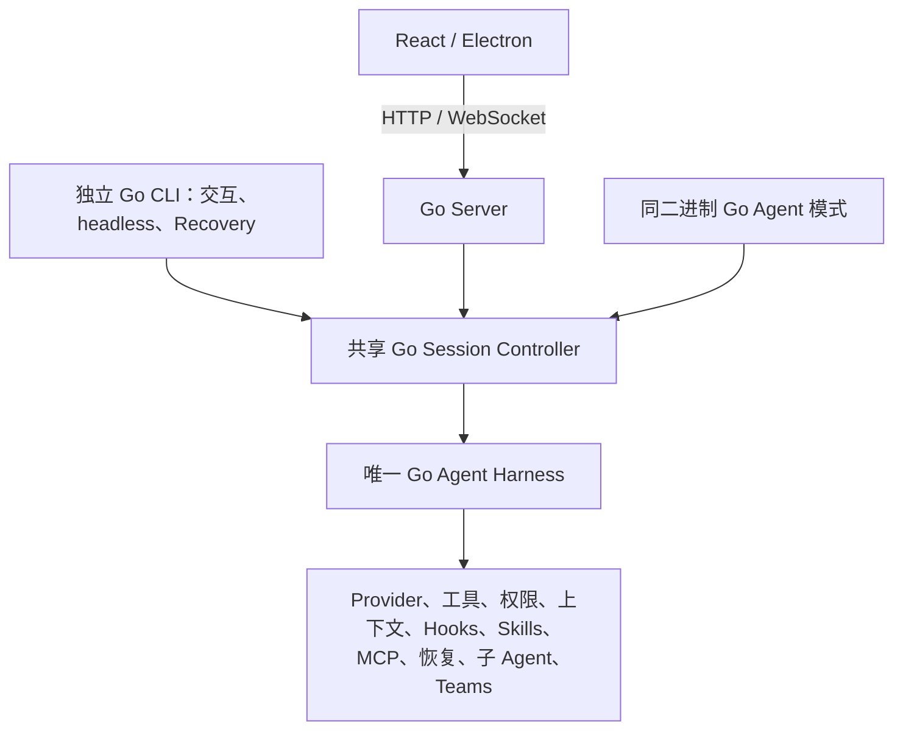

# CLI、Server 与 Agent Harness 全量 Go 迁移计划

范围已经确定：**全部已支持的 CLI、Server 和 Agent Harness 迁到 Go；React 桌面界面和文档前端保留。** CLI 包含交互终端、headless/SDK、全部子命令与 slash handlers、Recovery、会话恢复、独立安装和桌面 bundled launcher。此前排除 CLI 的范围已撤销。

当前工作区正在按此计划实施全量迁移。默认 CLI 和桌面构建启动入口已按用户要求切到 Go，生产调用链不再自动回退到旧 TS。保证等价的依据仍是逐项能力清单、可信原版基线和验收门禁。固定响应下的 Harness 行为要求零语义差异；在线模型得分有随机性，必须报告配对评测和置信区间，不能提前承诺每次运行得分完全相同。

**当前桌面完整待办以[原版桌面等价清单 D01–D35](go-desktop-parity-todo.md)为主；[逐 API/WS/native 索引](go-desktop-api-checklist.md)和[结构化静态盘点](go-desktop-full-api-inventory.json)保留原版调用、Go 缺口及源码位置。** 全项目依赖与关闭条件见[下一步 To-do](go-migration-next-todo.md)。当前验证记录优先于下方保留的历史窗口证据。

## 2026-10-10 当前实施状态

**全量迁移尚未完成。** 最新签名 Go 候选已在隔离原生桌面和公开 CLI 上完成真实 DeepSeek 父子 Agent、动态 MCP、Skills、文件读写和 Workflow 执行的部分验收；这些证据不能代表全部桌面功能或最终 Benchmark 通过。真实桌面 Workflow 执行后的实时完成通知、计划审批时的模型切换，以及动态命令元数据差异仍在修复。

最新完整验证 P795 为 12 条通过、2 条失败；全 Go 重试 P797 也失败。已逐项修正所见测试调用边界和覆盖率映射，但最终冻结候选尚未重跑完整门禁，90% 覆盖率、原版配对官模 Benchmark 和其他支持平台仍开放。每项原始失败、候选 SHA、修复与限定范围的通过证据见[当前验证记录](go-migration-current-validation.md)，完整待办保持开放。

## 2026-10-06 历史实施窗口

- 按桌面完整待办继续实施的最新窗口：Task 的五处管理调用已接真实文件、锁/重置与 Agent 工具状态；配置落盘已补首轮前关闭及 native CWD 别名。普通二进制 HTTP/reset、Source TaskService、相关 race、聊天契约和升级检查通过；完整桌面未验收。当前 `check:go` 6,218 unit/race 通过，但 78.54% 改动覆盖率和 8 个映射缺口仍使门禁 failed。当前普通候选及全部证据见[执行进展](go-desktop-parity-progress.md)。后文为历史窗口。
- 2026-10-06 的桌面静态盘点：544 个生产文件、240 处 HTTP 调用、35 组原版核心资源；Go 明确拒绝其中 25 组。加上已接通资源的缺失子接口和 public-access 专用路由，确定有 175 处调用缺少入口。全部声明的 89 个 Electron IPC handler 仍有注册，但依赖的 Go 能力与原生整包还要联调；原生 17 个设置页未被此前简化 H5 聊天测试覆盖。本轮只梳理待办，未执行运行复现或实现修复。
- 公开 `bin/claude-haha`、npm 启动器和桌面 sidecar 的源码默认执行 Go；缺少 Go 文件会报错，旧 TS backend 选择与自动 fallback 被拒绝。公开 CLI 已实际构建并执行 `--version`，这不是发布或替换用户已安装的应用。
- 真实 React 页面已连接同一个 Go HTTP/WS 进程。六个实际基础工具、权限批准与拒绝、等待审批时刷新/重连、进程重启续轮，以及 Agent 子会话、实际文件和差异展示已有本地固定响应服务商证据；不能换算为真实模型通过。
- TaskV2、TodoWrite、Notebook Read/NotebookEdit、检查点预览与恢复、仓库文件服务、原生文件监听、模型选择和费用统计已有各自限定范围的原代码对照或实际磁盘/进程测试。TUI 编辑、粘贴、快捷键及宿主 action 分发已有真实 macOS PTY 证据；完整交互宿主和所有命令仍未迁完。
- Ego Lite 的真实 UI 已保存并选择 DeepSeek 官方服务商。生产 Go 可执行文件使用普通构建，没有 fixture tag，也没有源版 TS Harness fallback。首轮实际聊天暴露 HTTP 代理能力缺口；已补 HTTP CONNECT/目标 TLS、默认端口和取消清理，原版实际代理请求对照与 provider/application 全包竞态检查通过。下一轮暴露 `[1m]` 日志能力守卫；已改为读取实际构造出的请求参数并通过原代码与真实本地请求对照。随后真实官方模型已通过显式工具子集的 Web UI 文件任务与子 Agent；完整模型场景尚未验收。
- 用户已授权真实模型调用并提供密钥。独立官方认证诊断访问 `/models` 与 `/anthropic/v1/messages` 均得到 401，Messages 返回 `authentication_error` 并明确密钥无效。以上诊断属于前一把凭据；最新密钥已从实际 UI 保存并完成真实模型工具闭环，凭据不进入仓库或报告。真实 Web UI、公开 CLI 与 macOS TUI 已有任务产物证据；DeepSeek 配对 Benchmark 尚未执行。
- 用户提出以 `/tmp` 旧 session fork 续跑作为主要 E2E 样本；只读盘点找到 182 个 session。已接通公开 Go CLI `--fork-session`，三个真实历史副本通过恢复和本地 `/cost` 检查，原始日志不变；其中论文历史的真实 CLI fork/重启续聊、私有导入后的 Web UI 同 SID 续聊及 macOS TUI 审批/写入/exit0 已通过。三端正常对话与产物验收采用[真实 session E2E 计划](go-live-session-e2e.md)，不能用本地命令通过替代模型任务成功。
- 前一候选 `check:go` 的构建、vet、单元和 race 通过，但改动覆盖率 78.53% 与 8 个 coverage mapping 缺口使门禁失败。完整差分 3116 项通过、23 项失败；Source-enabled whole race 另有 Git 分支原契约读取差异。具体候选、范围和原始证据保留在[当前验证记录](go-migration-current-validation.md)。
- 本轮真实旧 session 测试修复了非交互 `-p` 无 responder 时的权限挂起；原版无 prompt tool 的决策返回路径已接通，交互审批保留。最新 `check:go` 6209 unit passed，但 race 暴露运行配置元数据未落盘；门禁仍 failed，不能因为真实模型样例通过宣布全量迁移完成。
- 本地私有 Electron 候选已实际构建、打包并加载 React 窗口，真实 Go Server PID、HTTP 200、应用退出与 Go 进程退出均已验证。该包早于最新代理、内存会话和 IM launcher 修复，仅证明窗口与 Go 生命周期。原打包日志中的 IM adapter 参数失败已保留；新入口接受原参数并通过 Source 输出对照，已配置 IM 平台的 Go 业务仍未迁移，不能称为全桌面 E2E 通过。
- 默认工具全集、Skills/MCP/活跃 Hooks、复杂 Agent/后台/Teams、完整 CLI/slash handlers、Windows 原生执行及全部平台安装升级仍有缺口。当前 `check:policy` 461 项通过，`check:desktop` 8090 项通过、4 项跳过，provider/chat/persistence/docs/adapters/agent-flow 各限定范围检查通过；`check:server` 保留 4 项公开 Go CLI 失败（`--bare`、部分输出、session inbox 与后台通知）。完整 `check:impact` 所选门禁、最终同一候选的 `verify`、发行与 540 对在线 Benchmark 仍未完成。全量迁移状态保持未完成。

## 架构与不变条件

独立 CLI 直接使用共享内核；桌面以同一份签名 Go 二进制运行 Server、Agent 和 bundled CLI。交互式 `query()` 与 SDK/headless `QueryEngine` 各自保留旧版宿主配置、权限、队列和持久化时点。React/Ink 终端界面的业务迁到 Go TUI，React 桌面继续通过进程协议交互。必要的 JS 执行器、平台 SDK worker 和原生 helper 保留其语言，只承担执行或平台操作。最终生产链路没有旧 TS CLI、Server 或 Harness 业务 fallback。

迁移期间冻结 Prompt、模型参数、工具 schema、权限、预算、超时、评分和数据格式。行为优化另开任务。Go 的 map、零值、JSON、goroutine、context 和 defer 不能直接代替原版的顺序、缺省字段、错误和异步语义。

## 实施顺序与退出条件

| 阶段 | 交付 | 通过条件 |
| --- | --- | --- |
| P0 可信基线 | 冻结发行源码、依赖、构建特性、实际模型配置；盘点命令、动态能力、宿主与平台 | 每项已支持能力关联实际调用链、负责角色和验收用例；原版自回放可信 |
| P1 差分设施 | TS/Go 隔离运行；采集完整请求、工具、副作用、状态、协议、持久化和终端记录 | TS 自对照零语义差异；比较器能检出主动注入的语义变化 |
| P2 Go 基础 | 共享模块、CLI/sidecar 入口、codec、进程生命周期、离线 CI | 参数/帮助、无模型命令、mock SDK/Server 和资源清理通过 |
| P3 服务与数据 | 配置、会话、索引、工作区、任务、文件服务、HTTP/WS API | API、重启、旧数据互读和恢复后的下一次模型请求等价 |
| P4 Provider 与工具 | 请求/流式/重试、认证、工具、权限、Hooks、Skills/MCP | 模型可见请求、工具轨迹、错误和实际副作用次数一致 |
| P5 Harness 与宿主 | 循环、取消、压缩、恢复、队列、子 Agent、Teams；两类宿主接线 | 实际入口完整对照通过，共用唯一内核；保留 result、finally、落盘和退出时点 |
| P6 全部 CLI | Go TUI、所有已支持命令/slash handlers、SDK control、Recovery、独立与 bundled 启动 | 实际二进制的 stdio、PTY/ConPTY、信号、终端恢复和命令业务通过 |
| P7 桌面与平台 | React 协议接线、IM 核心、原生能力、签名和各平台包 | 每个支持平台完成实际 native/package/desktop smoke、安装和升级 |
| P8 最终验收 | 完整确定性验证、真实 Benchmark、交叉回放、跨版本恢复与回退 | 同一候选全部硬门禁通过，才形成统一切换的发布候选 |

关键路径是 **可信基线 → 共享内核的完整链路 → CLI/Server 实际入口 → 平台候选 → 最终验收**。契约稳定后，无模型命令、外围 API、终端 renderer 和安装设施可以并行推进。先交付“输入 → 两轮模型请求 → 工具副作用 → result → 落盘 → 重启恢复”的完整链路，再扩大能力。

每个工作项记录 Source/Go 入口、原始输入、断言、负责角色、实际结果和剩余边界。分别标记未实现、组件通过、入口通过、平台通过、最终验收通过。P0 清单完成后按调用链、平台与外部依赖估算工期；代码量、注册节点数和覆盖率不表示迁移完成比例。[详细工作包与依赖](go-migration.md)保留 W0–W7 分工。

## CLI 完整验收清单

| 部分 | 必须保持的行为 |
| --- | --- |
| 启动与参数 | 命令/别名、默认值、重复/变长参数、help、错误/退出码、TTY、调用目录与环境优先级 |
| 非交互与 SDK | print、text/json/NDJSON、分片 stdin、EOF、partial events、用户 replay、control、预算、取消与 finally |
| 终端交互 | 中文/emoji、多行粘贴、编辑器、历史/补全、Vim、undo/stash、权限/问答、模式切换、后台通知 |
| 命令业务 | 发行构建实际支持的 auth、MCP、plugin、agents、doctor、install/update、所有 slash handlers 和动态注册 |
| 会话与恢复 | continue/resume/fork、选择器、worktree、额外目录、文件历史、CLI/桌面交叉恢复 |
| 终端生命周期 | Ctrl-C/Ctrl-D、Esc、resize、挂起/恢复、raw/echo/光标/alt-screen 清理、信号和子进程退出 |
| 分发与 Recovery | standalone、bundled launcher、PATH、Windows 启动、签名、安装、升级与整版本回退 |

每项 CLI 能力必须从真实入口走到业务结果：参数解析 → 启动/配置 → 注册与可用性判断 → handler → 权限/工具或模型请求 → 输出与落盘 → 退出/恢复。help、注册名单、组件测试和拒绝未实现分支分别记录，不能据此关闭命令业务。动态命令名称是运行时输入，清单要覆盖创建、编辑、删除、重载、冲突和优先级。

Skills 的展示与激活分别验收。内置或无条件 Skills 非空，不能直接判断存在待激活的条件 Skills；按原版 `paths` 匹配、文件访问、缓存及会话状态决定激活，并验证激活后的 Prompt、权限和工具行为。增加 metadata 必须同时检查真实消费者，防止注册完成后反而阻断 Write 等工具。

P0还须明确运行时专属能力的迁移契约。例如V8 heapdump的诊断对象和文件格式不能直接用Go heap profile冒称等价；先记录真实发行能力、旧用途及验收要求，再确定实现。此类差异保持待决，不从全量清单删除。[命令/Skills调用链与文件归属](../../artifacts/go-parity/normal-print-command-skills-registry-source-map-next/successor-design.md)给出这部分的具体实施边界，属于静态计划。

终端验收比较解析后的屏幕、提交内容和行为，允许等价 renderer 的 ANSI 绘制序列不同；机器 stdio 保持严格字节契约。macOS/Linux 使用真实 PTY，Windows 使用真实 ConPTY，交叉编译不代替平台执行。feature-gated stub 与发行能力分列。[CLI 清单](go-cli-readiness.json)和[Server 目录](go-server-capability-catalog.json)目前仍标记完整盘点未完成。

## Harness 不变的验收方法

| 边界 | 比较内容 |
| --- | --- |
| 模型输入 | 完整 system/history、工具 schema、参数、缓存标记、模型 ID 和请求顺序 |
| 工具与权限 | 输入/验证错误、权限与 Hooks、结果、提交顺序、真实文件/进程副作用次数 |
| 运行状态 | 队列、取消/超时、重试/fallback、压缩、预算、子 Agent、终止状态 |
| 宿主输出 | HTTP/WS/SDK、stdout/stderr、退出码、终端提交与清理、诊断时点 |
| 持久化与恢复 | 原始历史、checkpoint、未知字段、重启与跨入口恢复后的下一次请求 |

先冻结原始输入和比较域，使用 fake 凭据、临时 HOME/config、私有文件及 mock/loopback，不访问真实用户状态。模型响应回放只接受匹配的请求；请求或工具轨迹首次分歧立即失败，不能盲目继续回放。规范化仅限事先明确的非语义字段，不重排数组、JSONL 或工具轨迹，不忽略模型可见内容、错误或预算。现有六个评测任务不代替完整 Harness 覆盖；另补长上下文压缩、并行工具、权限等待、取消、预算耗尽、子 Agent/Teams、崩溃与恢复的确定性用例，保持原六题及评分不变。

原版自身不稳定的用例保持未通过，先修正观察或查明环境。保留首次失败和原始证据，不挑有利样本、不用固定等待或 Source 内部阶段驱动 Go、不把所有未 await 的工作强制排空。组件证据只能关闭其有限范围，不能代替完整入口。

Go build、format、vet、unit/race、完整变化生产域至少 90% 覆盖、跨语言差分、CLI stdio/PTY，与既有 React/provider/chat/persistence/native 门禁统一接入 `check:impact` 和 `verify`。覆盖率衡量测试范围，零语义差分才是行为等价门禁。

## 真实 Benchmark 与统一切换

使用 **DeepSeek 官方 `deepseek-flash`，Anthropic Messages 协议**，基址 `https://api.deepseek.com/anthropic`；2026-10-05已重新核对[官方协议文档](https://api-docs.deepseek.com/guides/anthropic_api/)和[模型公告](https://www.deepseek.com/en/news/deepseek-v4-1-flash/)。先让现有 TS 版本在该配置下建立基线，再比较 Go，避免把更换模型与迁移语言混在一起。保留旧版实际 wire 参数，服务商忽略的字段也不擅自改变。模型名存在自动映射，评测前冻结显式 ID、实际解析、请求与响应 model 信息；服务商路由变化时暂停并重新建立基线。DeepSeek 是本次真实评测的唯一模型；现有其他已支持 Provider 的协议与认证仍须按清单做离线兼容验证。

保留现有六个任务的 prompt、fixture、评分、180–300 秒超时和预算。分别通过桌面 HTTP/WS、CLI headless/SDK、CLI 真实终端评测：**6 任务 × 3 入口 × 30 对 = 540 对、1,080 次 Agent 运行**。每个任务/入口先 5 对试评，共 90 对，包含在总数内。试评不能单独判定通过；只有规则、候选、fixture、评分器和采集口径在试评前冻结且保持不变，试评才并入最终 30 对。条件改变时重建受影响的统计基线和窗口，保留原始结果及已用额度，补样计划另行冻结并授权。现有六题均为 WebSocket 场景，CLI/PTY 驱动须按相同业务条件映射完成事件，同时保留原桌面断言。

每对 TS/Go 从相同初始条件分别重建干净状态，均衡交错执行。分别报告各入口、各任务与总体成绩，以及新增失败、成本、延迟和配对置信区间。试评前冻结原评分类型对应的区间方法、零退化容许量和多指标整体 95% 置信水平。计分指标为 18 个任务/入口、3 个入口汇总与1个总汇总：令 Δ=Go−TS，全部预注册指标的同时单侧下置信界均须 ≥0，且没有新增可复现失败；不能用总平均抵消单项退化或用“不显著”判定等价。30 对是首轮计划量，证据不足仍未验收，补样方案、序贯误判率控制和额外额度须事先确定，严格零容许量可能需要更多证据。确定性轨迹交叉回放要求零语义差异。真实模型额度已由用户明确授权；目前已有范围明确的真实工具与旧 session 续聊任务证据，配对 Benchmark 尚未运行。

切换绑定同一候选二进制、资源、依赖和构建摘要。实际验证 TS→Go、Go→TS、CLI↔桌面恢复，安装、升级、PATH、签名链和回退；切换前结束旧写入进程，保证一个用户状态写入者。CLI 与桌面统一发布，失败整版本回退，避免单次请求 fallback 重复执行工具。当前源码入口已按用户要求切到 Go，旧 TS 仅保留为冻结基线/对照代码；正式发行候选仍须完成全部门禁。

## 当前证据与下一里程碑

全部 CLI、Server 和唯一共享 Go Harness 继续完整迁移，React 保留。命令、TUI、headless/SDK、Recovery、分发、跨端恢复及整版本回退仍是必须通过的范围，生产尚未切换。

新的共同938候选完整合并调度/max-turns与agents组件：两组实际差分24与26项交集为空，累计生产域47项未裁剪。Root预检21,471项、封存后独立284项无错误。12个冻结命令全部PASS；普通whole unit/race各5,450通过、0失败、39跳过；offline whole unit/race各5,451通过、0失败、39跳过。原SDK普通finish-after-stop unit/race各2项通过，普通/offline build与vet、modverify和全量gofmt通过。历史强制native-stat SDK物理顺序反例独立保留，尚未关闭。

同一938源码的两个新whole coverage原始profile完整保留：累计47项语句4405/4840＝91.01%通过，完整block行5704/6476＝88.08%仍FAIL90。agents组件15项分别89.24%/85.77%，也未通过。Windows identity无当前平台执行profile；零block与所有变化文件保留，不能把缺失证据当豁免或借用旧profile。12个私有HOME/telemetry分配已清理，24个已知mode/command PID已退出；间接进程不作完整声明。

实际Source→Go请求对照使用精确旧916候选与原53ae输入，在同一canonical坐标通过公开入口完成Write→自身SID恢复：Go PIDs79449/79457自然exit0，2进程、3POST、0HEAD，真实66B文件仅写一次，恢复后inode/mtime/bytes/mode不变，自身JSONL前缀扩展。三个完整签名UTF-8模型请求分别2490/3001/3258B与Source既有两链逐字节相同，CCH、路径、metadata、参数和顺序均未规范化；Root独立184项通过。这是916有限请求域证据，不能自动转移到938、新候选或全部Harness。

完整stdout与JSONL严格FAIL，stderr相同。诊断发现真实能力差异：Source17个slash commands而Go4个，Source内置Skills为update-config/debug/simplify/batch而Go为空。Source共享sdkBetas默认undefined，在JSON.stringify时省略；Go多出betas:[]。真实getter/setter/caller和registry生产器已有原文件及精确行引用，后续迁移须从生产器实现，不能硬编码Source输出或加入忽略字段。各Go子进程5个deny:outside与8个external frozen ENOENT保留；Source每进程1HEAD与Go0、FD3只在Run后观察及完整原生等价缺口均未关闭。

新的保存NativeDate.now墙钟方案完成76次Source-free原生控制、11,036断言：52 clock/576，原full8/9256，FD4/356，seed4/160，完整IDE assembly8/688；12次实际跨进程边界严格增长27–32ms。32个原生产器、原39 fake-absence对象及33/34完整IDE options保持不变，仅5个事先声明的fixture producer改动。81个已知native/driver PID、28个own roots及8个listener已清理，原24私有loopback请求精确匹配。Root独立whole审计包含该1146文件；墙钟仍非monotonic，20个纯数学拒绝case不代表OS回拨试验。Source P1/P2/P3及未来2个anchor helpers尚未启动。

输出比较器已实际实现严格UTF8/token offsets、未知字段与原始字节间隙检查、28个UUID birth/alias/reference图及Source严格timestamp>选择器/parentwalk；9个单元测试与30个离线数据mutants通过，Root与时钟合计独立1,509项无错误。旧chain2 P2后仍选择P1 FILE_CREATED的真实数据反例被拒绝，不能删除timestamp来接受。UUID图与三签名请求可通过，四组完整raw及排除已证明UUID后的字节间隙仍FAIL；API时长加法/read-cut、原生slug效果、EOF/取消/终止与真实Write因果mutants仍UNPROVEN/NOT RUN。数据变异拒绝不冒称原生因果验证。

本窗口只把已封存和独立审计的结果写入六份计划。默认normal CLI betas字段存在性修复已产生私有组件封包：新增回归先复现2项失败，focused unit/race各51项通过；组件完整生产文件覆盖率未通过，whole/public对照尚未运行，不能转为共同候选验收。新Source P1→ownP2→ownP3仅准备静态driver；完整命令/Skills、真实第三次恢复、完整覆盖、forced SDK顺序及全平台仍是下一门禁。Root Source3063/backend457及原16项tracked改动保持原样，旧失败和旧计划历史保留。

真实评测仍是DeepSeek官方deepseek-flash／Anthropic Messages：六任务×三入口×三十对＝540对／1,080次Agent运行，22个计分指标整体95%同时单侧下界≥0，零退化容许量。all-ties不能凭零宽bootstrap通过；证据不足不验收。本窗口真实额度0；selected quality lanes与verify未运行，全部完整readiness及goalComplete保持false。

详见[本窗口事实](../../artifacts/go-parity/planning-checkpoints/2026-10-05-cli-core938-and-signed-request-progress/checkpoint-facts.json)。

## 首个实施迭代的具体交付

| 顺序 | 负责角色与交付 | 完成条件 |
| --- | --- | --- |
| 1 | 集成、CLI、Server负责人补齐发行能力账本和两类宿主调用链；冻结DeepSeek配置、六题与比较域 | 全部发行能力有Source入口、Go归属、依赖、测试和负责人，动态及平台差异显式列出；完成工期三点估算 |
| 2 | 验收负责人关闭原版自对照与比较器缺口：跨进程恢复、退出/EOF/取消、完整请求、输出和副作用 | 从原始输入运行，保留首次失败；原版自对照可信，真实因果变化能被检出，不能靠忽略字段通过 |
| 3 | Harness与CLI负责人从真实producer迁移命令/Skills及消费者，完成共享内核的完整纵向链 | 输入 → 请求 → 工具 → result → 落盘 → 进程退出 → 自身SID恢复 → 下一请求，在实际TS/Go入口零语义差异 |

这三项完成后，按P2–P8扩大到全部CLI、Server、交互终端和平台发行。当前交付是完整计划与剩余门禁；真实DeepSeek评测、生产切换和发布尚未执行。
