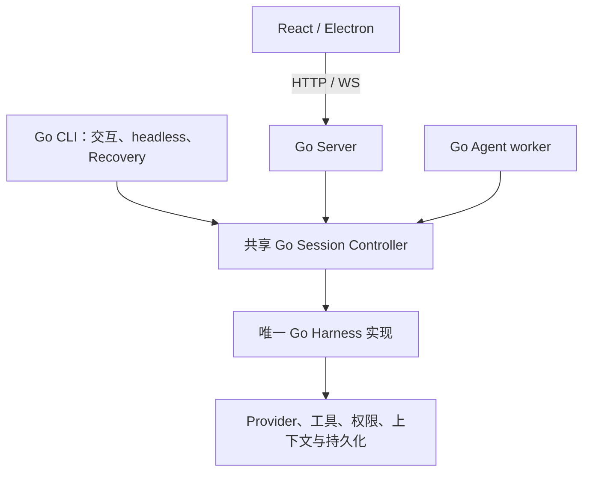

# CLI、Server 与 Agent Harness 全量 Go 迁移

目标是迁移全部已发行的 CLI、Server 和 Agent 业务，保留 React 桌面及文档前端。生产切换以完整行为验收为条件，开发期间用现有 TS 实现作对照。本文件是实施计划；通过某个组件的测试不代表整个系统已经完成迁移。

最新范围决策：CLI 全部迁移，包含交互终端、headless/SDK、全部已支持命令与 slash handlers、Recovery、独立安装和桌面 bundled launcher。此前“可以不考虑 CLI”的范围已撤销。评测服务商使用 DeepSeek 官方，模型为 `deepseek-flash`，协议为 Anthropic Messages。

本轮交付是全量迁移计划和有限 Source 基线证据；计划形成不表示迁移完成。可审阅的架构、阶段与硬门禁见[迁移总览](go-migration-overview.md)。P0清单、完整入口、平台、发行与真实Benchmark仍保持未验收。

生产仍使用TS；CLI全量、Server、React接线、完整Harness、发布和真实Benchmark尚未验收。当前共同候选938与有限请求对照的事实见[总览当前证据](go-migration-overview.md#当前证据与下一里程碑)；后文各日期窗口保存历史候选及首次失败，不把历史组件证据自动转为新候选或完整入口通过。完整能力盘点、输出/恢复/退出差分、变化生产域覆盖和各平台执行仍未关闭，候选未应用Root。

“Benchmark 没有变化”分成两个可验收目标：固定响应下的 Harness 行为严格等价，以及真实模型评测没有可证明的退化。在线模型的随机性、服务商更新和网络波动使每次得分完全相同无法预先保证。上线依据实际差分和配对评测证据；不靠相同 API、测试覆盖率或总平均分给出保证。

## 范围与架构

独立 Go CLI 和桌面 Go Server 共用一个 Session Controller 与唯一 Go Harness。独立 CLI 不依赖先启动桌面 Server。桌面使用同一签名 Go 二进制承载 Server、Agent worker 和 bundled CLI，延续原生能力需要的进程链。

CLI 命令树以 [Cobra](https://github.com/spf13/cobra)、终端 UI 以 [Bubble Tea v2](https://github.com/charmbracelet/bubbletea) 为方案（2026-10-03复核官方文档，尚非本项目完整兼容验收）；先用真实发行入口和 PTY/ConPTY 做兼容性验证，再冻结版本和适配方案。框架默认的解析、帮助、退出和终端行为必须服从现有发行构建的契约。所有支持的子命令、slash commands、启动参数、stdin/stdio/SDK 控制协议、Recovery、continue/resume/fork、终端交互和安装升级都在范围内。feature-gated stub 不能当作已经支持的能力。

共享 Harness 保留两类宿主策略：交互 REPL 的 `query()`，以及 SDK/headless 的 `QueryEngine`。分别固定 query source、提示词、权限、输入队列、预算和持久化时点，不用统一默认值覆盖原有差异。

SDK 调度还要保留原版等待与对象所有权：网络等待期间，持久化队列和定时 drain 必须能推进；流式消息更新、生成器恢复后的接受、共享 ID/时间分配及 live message 序列化须由同一执行者串行处理。整个 Harness 放进一个同步 owner 会阻塞队列；仅把输出回调放进 owner，又会让消息更新与写入并发。P5 须实现唯一消费循环的协作式 I/O 等待边界，并用延迟流、写入完成屏障、取消和 race 验证实际 SDK 时序。组件 writer 的通过不能关闭这一门禁。

P5 分别验收原始 Record 完成、独立 transcript drain 和 ASK 消费者恢复三个边界。headless 输出先同步进入 FIFO，不能把它改成等待物理 stdout 排空；RemoteIO/WS 各自保留实际 transport 策略。模型 AbortSignal 与 owner 生命周期也要分开：模型取消后，owner 仍须完成原版 partial message 排空、checkpoint、result/accounting 和 cache finally。这些约束已有真实调用链的只读设计，尚不能替代完整 SDK 执行证据。

必要的 JS 语言执行器、平台 SDK worker 和原生 helper 可以保留原语言，职责限定在执行及平台操作。最终生产链路不能保留 TS CLI、Server、Agent 业务 fallback。React 当前直接导入的后端业务需迁到进程协议边界，前端仅保留展示和交互。

## 分阶段执行与退出条件

| 阶段 | 工作 | 退出条件 |
| --- | --- | --- |
| P0 基线 | 冻结 Source commit、依赖锁、构建特性、发行命令和两类宿主配置；建立逐项能力清单 | TS 离线基线可复现，每项能力关联 Source、负责人和验收用例 |
| P1 差分设施 | TS/Go 独立启动目标；完整请求、流事件、工具、副作用、状态、历史、协议、stdio 和终端记录 | TS 自对照零差异；主动注入 Prompt、工具参数、顺序、错误和持久化变化时比较器确实失败 |
| P2 Go 基础 | 共享模块、CLI/sidecar 入口、参数/配置 codec、进程生命周期、Go 原生 CI | 参数、帮助、无模型命令、启动/退出、mock SDK/Server 用例通过 |
| P3 服务与数据 | settings、Provider 配置、会话索引与定位、分页/恢复、工作区、任务、外围 API | 真 API 差分、取消/重启、旧数据互读、恢复后下一次请求通过 |
| P4 Provider 与工具 | 完整请求构造、流式、鉴权、重试/fallback、工具、权限、hooks、Skills/MCP、平台调用 | 模型可见内容及完整 wire 请求一致；工具轨迹、副作用及提交次数一致 |
| P5 Harness 与宿主 | Agent 循环、压缩、恢复、取消、子 Agent、Teams、interactive 与 SDK/headless 策略 | 两类宿主各自对照 Source 通过，真实入口共用唯一 Harness |
| P6 全部 CLI | Go TUI、全部发行子命令/slash commands、Recovery、会话选择与分发 | 命令/stdio、PTY/ConPTY、终端恢复、独立与 bundled launcher 通过 |
| P7 桌面与外围 | React 协议连接、Electron、IM 核心、原生能力、资源和签名打包 | 每个支持平台完成 native、package、desktop smoke 及升级/回退 |
| P8 最终验收 | 完整确定性检查、真实模型 Benchmark、轨迹交叉回放、发布候选 | 所有硬门禁通过后统一切换；失败时整版本回退 |

阶段有依赖，组件可并行推进。迁移期间固定 Prompt、模型默认值、工具 schema、权限、预算、超时、评分及数据格式。行为改进单独安排。日历排期应在 P0 的完整清单和依赖图形成后估算，不把组件数量或覆盖率当作全量完成百分比。

## 工作包、依赖与交付方式

每个工作包建立逐项账本：发行能力、实际 Source 调用链、Go 入口、原始测试输入、比较范围、负责人、当前结果和未覆盖边界。状态分别记录未实现、组件通过、真实入口通过、平台通过和最终验收通过。代码量、注册节点数量和覆盖率都不作为迁移完成比例。

| 工作包 | 实施内容与负责角色 | 可验收交付 |
| --- | --- | --- |
| W0 基线与协议 | 集成负责人冻结发行构建、依赖、命令、动态 registry、配置与宿主差异；验收负责人维护比较器 | 原版自回放、能力清单、请求/事件/持久化/终端契约及可捕获语义变化的差分设施 |
| W1 共享内核 | Harness 负责人迁移 Controller、Provider、上下文、工具、权限、hooks、压缩、子 Agent/Teams 和宿主调度 | 从原始输入独立生成请求；interactive 与 SDK/headless 各自完整运行，并证明进入同一套 Go 内核 |
| W2 Server 与数据 | Server 负责人迁移实际 HTTP/WS 服务、任务、配置、索引、工作区和持久化 | React 继续接受原有协议；连接关闭/重连、重启、旧数据恢复及下一次请求等价 |
| W3 CLI 命令与 SDK | CLI 负责人迁移启动/preAction、全部真实 handlers、动态 slash/Skills/plugin/MCP、Recovery 和 stdio/control | 每项从实际 Go binary 执行到业务结果；独立 CLI 不依赖桌面 Server，完整 stdout/stderr/退出/副作用通过 |
| W4 交互终端 | 终端负责人迁移 React/Ink 终端 UI、编辑、补全、权限、模式、后台通知和 session picker | 原始用户输入产生相同 Agent 行为；真实 PTY/ConPTY、信号、resize、挂起/恢复和退出后终端状态通过 |
| W5 React 与原生集成 | 桌面负责人保留 React 展示/交互，将其直接使用的后端业务移到协议边界；平台负责人接入原生 worker | HTTP/WS、流式展示、权限、重连、持久 UI 和实际父子进程信任链的桌面 smoke 通过 |
| W6 分发与恢复 | 发布负责人完成同一签名 Go binary 的 standalone、Server、Agent、bundled CLI 模式以及安装/升级/回退 | 每个支持平台实际安装候选并运行；跨入口、跨版本恢复不丢历史、不重复执行工具，整版本交换和回退通过 |
| W7 最终评测 | 验收负责人绑定候选摘要，运行全量确定性门禁及获授权的真实模型配对评测 | 能力账本无未关闭项、零语义差分、预先约定的统计门禁和平台/发行门禁全部通过 |

关键依赖是 W0 → W1 的完整宿主 → W3/W4 与 W2/W5 的真实入口集成 → W6 候选 → W7。W2 的外围服务、W3 的无模型命令、W4 的 renderer 和 W6 的安装设施可以在契约稳定后并行推进；它们的最终验收仍依赖共享内核和实际候选。先跑通“输入 → 两轮模型请求 → 工具副作用 → 结果 → 落盘 → 重启恢复”的完整纵向链，再逐项扩大能力，避免只得到大量相互未连接的组件。

P0 完成后，依据每项能力的调用链、回归用例、平台数和外部依赖作三点工时估算，并单列调度兼容、TUI 和签名/更新风险。没有完整账本前不承诺固定完工日期。每个迭代交付可运行的有限链路和剩余清单；生产切换仍以全部硬门禁为条件。

CLI 执行状态清单见 [go-cli-readiness.json](go-cli-readiness.json)：当前已冻结构建的 36 个 normal 注册节点、别名及 16 类 bootstrap 路由分别记录参数组件与实际 Go 入口状态。注册成功不能标为命令业务完成；正常入口目前仍守卫，单参数 version 和独立 Recovery 另记。slash commands、完整交互状态、feature-gated stub 与各发行构建的能力分类仍需补齐，清单明确标为未完整盘点。

Server/IM增加独立[能力目录](go-server-capability-catalog.json)，原始静态账本为 `artifacts/go-parity/server-im-dispatch-catalog-next/handler-map.json`：35个REST资源分为33个case组，绑定34个实际handler调用；11个客户端WS分支，8个IM平台入口。models/effort、agents/tasks为共享分支，sessions/chat转入Conversations；previewFs/localFile由Server主入口直接导入，必须独立盘点。每项后续验证真实path/method/auth/body/错误/abort、副作用、持久化、重启及共享Harness调用。该JS静态AST位置属于保存的转换JS，不能当原TS行号；另区已解析中央11Client/30Server及9nestedAgentRun的原TS声明和156顶层字段位置，完整SDK/control类型图、动态分发、构建/平台差异仍未完整盘点，`completeInventory=false`。373个直接测试import信号仅供选用回归，不计已执行或已覆盖。

补充的 [CLI 能力目录](go-cli-capability-catalog.json) 将 argv、bootstrap、slash/dynamic providers、终端、control 和安装路径关联到实际 Source，区分发行能力、构建门控与 stub。已补上独立的 Workflow command provider，以及公开 keybinding schema 之外的 11 个滚动/选择动作；三个磁盘 Skills 场景共六次原版运行验证了有限 loader 和 prompt factory 行为。Workflow 原版调查验证了真实文件、settings 与 prompt factory 的 19 对程序。解释执行 fixture 的原生 `.js require` 返回空导出，而按发行选项编译的私有helper能正确加载；四组真实command cache程序已有限验证编辑、删除、清缓存及设置切换。真实merged入口目前只编译未运行，不能把helper当正式发行验收。plugin结构差异在两种模式都使namespace workflow缺席；迁移应保留实际Source行为，行为修复另行验证。动态 plugin/MCP/workflow/connector 与完整cache生命周期、全部 slash dispatch、终端状态转换、完整 stdio/control 和各平台运行仍在未关闭清单中，`completeInventory` 保持 false。

P6、P7、P8 还需逐项关闭以下验收记录。每行关联原版调用入口、负责人、实际候选程序、原始 fixture、执行结果及未完成边界；参数解析或组件通过不能代替运行入口验收。

| 验收记录 | 必须通过的实际行为 |
| --- | --- |
| 运行时命令清单 | 分别记录发行 argv 命令、slash/Skills/plugin/MCP registry，以及 Commander 之外的 sidecar/voice/CU worker 路由。验证真实 handler、可用性变化、别名与名称冲突、reload/cache invalidation；help/parser 不关闭业务项。 |
| 完整 stdio/control 生命周期 | 用实际 TS 和 Go 可执行程序接受相同原始参数、分片 UTF-8/JSON、CRLF、最终无换行 EOF 和各类发行 control。比较独立 stdout/stderr、退出码、请求与 ID、transcript；覆盖重复/孤立响应、permission+EOF、运行时 env、result 后晚到事件、backpressure、EPIPE、信号和父进程退出。 |
| 安装后的终端拓扑 | standalone、sidecar CLI、已安装 wrapper 分别走真实 PTY/ConPTY，包含现有 macOS `/usr/bin/script` 嵌套 PTY。验证提交内容、解析屏幕、resize/挂起/恢复、后代进程清理；退出后执行 shell sentinel，核实 raw/echo/光标/alt-screen/key/focus 状态。Windows 原生执行不能用交叉编译或 FakePty 替代。 |
| 跨入口与版本恢复 | 由实际 interactive/headless/desktop producer 写入、结束进程，再由各 consumer 进行 TS→Go、Go→TS、Go→Go 恢复。覆盖 SID/continue/picker/title、fork/checkpoint、worktree/portable、空会话及 crash-before-flush；比较 hooks、parent/session ID、metadata、缓存/Skills、前两次请求、receipt 去重及工具副作用次数。 |
| 候选签名与进程链 | Server、Agent、bundled CLI 和保留的平台 worker 使用实际发布候选布局，记录路径、摘要、版本和父子链。验证同一 Go binary、相同签名/Team/leaf、app-root/env、原生资源、relocation/quarantine 与拒绝未授权链；旧 Bun sidecar、fixture broker 或 ad-hoc directory build 不关闭发布签名门禁。 |
| 安装、整版本交换与回退 | 分别验证 standalone installer 和桌面 updater：初装/旧版升级/portable/同版修复、PATH 冲突及保留、Unicode 路径、Windows in-use exe 与旧 cmd/exe 优先级、下载/签名/校验/移动失败、staging 中断和整版本回退。实际测量旧进程、待写入队列与锁已静止，再交换 binary/wrapper/resources/protocol；旧版恢复 Go 数据后不得重复执行工具。 |
| 绑定最终验收对象 | 最终确定性门禁、Benchmark、安装与 package/native smoke 都绑定同一候选可执行程序、资源、依赖锁和构建特性摘要。审计 CLI/Server/worker 的实际依赖图与黑盒入口，确认两类宿主进入同一 Go Session Controller/Harness；现有 merge policy 保持生效。 |

真实 stdio、PTY/ConPTY、签名链、跨入口进程恢复和安装回退是独立硬门禁。真实模型分数不能覆盖这些未执行的检查。

CLI全量范围的完成定义还包含每项能力的实际调用链：argv或终端输入 → preAction/配置 → 注册和可用性 → handler → 工具/权限/模型 → 输出/持久化 → 退出及恢复。执行状态必须逐段关联测试，不能用metadata、help、typed未实现拒绝或局部组件通过替代命令业务。安装后的standalone和桌面bundled入口都须执行同一套共享内核，但保留interactive与SDK/headless两种宿主策略。

命令/Skills迁移同时验证注册生产器及消费者。Source的条件Skills按`paths`、文件访问、待激活集合和会话缓存匹配；参见`src/skills/loadSkillsDir.ts`的分流与激活函数。当前私有Go入口曾用`len(Catalog().Skills)>0`推导`ConditionalSkillsPresent`，这是必须修正并回归验证的消费者缺口，不能通过删除内置Skills或只补展示名单完成迁移。内置技能、Workflow、plugin、MCP和磁盘技能各自保留真实来源、优先级、可用性及执行路径。

最新[normal命令/Skills静态实施图](../../artifacts/go-parity/normal-print-command-skills-registry-source-map-next/successor-design.md)把已观察profile的17命令/4技能从真实定义推导到业务handler和依赖，明确初次headless过滤与refresh、system-init与control投影、用户slash与模型Skill调用各自边界。17/4不是全发行清单，完整动态与feature/profile仍需P0补齐。heapdump等运行时专属能力须先明确诊断对象及输出契约，不能用Go heap冒称V8 heap等价，也不能悄悄删去已支持能力。

首个实施迭代按[总览的具体交付](go-migration-overview.md#首个实施迭代的具体交付)收敛到完整账本、可信原版自对照与实际入口的纵向链。该迭代不能关闭P6完整TUI或P8最终评测；其结果用于P0后的工期估算和后续集成排序。

## 行为与性能验收

固定初始文件/配置快照、模型响应、时钟、ID、工具环境和控制输入，逐轮比较完整模型请求、流事件、工具输入与结果、权限及 hooks、队列、重试、压缩、终止、持久化和恢复后的下一次请求。首次语义分歧必须失败；不能忽略模型可见文本、数组顺序、错误或预算。仅对明确非语义的字段作有说明的规范化。

跨语言兼容在 P1/P2 建立独立契约：缺字段、null、false、零值和空数组不得被 Go 的默认序列化或 omitempty 混同；保留对象属性与数组的实际顺序、数字表示、未知配置字段，以及原版 UTF-16 索引、Unicode/字节预算和错误分类。Go map遍历、goroutine调度、context取消和defer不能直接代替原版JS语义。分别用原始输入、实际编码结果、Promise/反应/恢复时点及副作用验证，尤其比较下一次发给模型的完整请求；通用codec单测不替代消费者的真实入口验收。

stdio 比较实际 stdout/stderr 字节、退出码、分片 stdin、EOF、信号及 SDK control；机器输出不得混入 TUI。macOS/Linux 用 PTY，Windows 用 ConPTY，比较解析后的终端屏幕、提交内容、行为及退出后的终端状态。等价 ANSI 绘制序列允许不同，关键布局和操作方式保持兼容。

确定性检查必须用临时 HOME/config、fake credentials、私有文件和 mock/loopback transport。真实 Source SDK 的外部凭据能力单独替换为可观察的空 adapter；系统受管设置在明确的空策略用例中由外部 FS adapter 返回 ENOENT，不改变 Source 解析/合并逻辑。这些有限 profile 不能外推 OAuth、managed policy 或一般宿主配置。

固定时钟和随机 ID 本身也须验收。新的真实 CLI 原始五场景，在相同私有路径、端点及显式 Date/crypto 输入下，完整产品自对照已有限通过；但独立 native filesystem 用例证明，固定 Date 与真实 mtime 不一致会触发原版配置 watcher 的自身写入刷新。实际 PID 注册文件仍是产品数据，不能当作诊断字段剔除。P0/P1 要同时关闭这些输入与生命周期差异，才能把有限样本提升为完整可信基线；所有物理时间、真实 PID 和原失败继续保留。

上述文件tree比较覆盖已捕获的所有路径、内容、类型、mode和大小，不包括尚未采集的mtime/ctime/UID/inode或全部瞬态。独立审查重算五组字节相等并验证比较器的相同输入、实际HEAD/POST和完整framing门禁；这不构成对未观察原生状态或完整调度的证明。

Go build、gofmt、vet、unit/race、变更可执行行覆盖率、TS/Go 差分接入现有质量路由，保持原有 90% 门槛和 React/provider/chat/persistence/native 检查。支持平台的原生执行证据与交叉编译证据分别记录；未支持的 race 目标不能写成已通过。

真实模型评测固定 DeepSeek 官方 `deepseek-flash`，使用 Anthropic Messages 协议，base URL 为 `https://api.deepseek.com/anthropic`。2026-10-05重新成功读取[官方协议文档](https://api-docs.deepseek.com/guides/anthropic_api/)与[模型公告](https://www.deepseek.com/en/news/deepseek-v4-1-flash/)，仅是文档核验，真实API运行仍为0。兼容协议有被忽略的字段及模型名自动映射：离线门禁继续逐项比较旧版实际发送的cache_control、beta/header、thinking budget等值，不能因服务商忽略而改变请求。正式执行前冻结旧版实际解析的endpoint、wire model、参数、能力及同一候选；底层路由/模型或配置变更时暂停配对并重新建立基线。模型额度单独授权，不在普通PR必需检查中调用。

现有 6 个任务分别通过桌面 HTTP/WS、CLI headless/SDK、CLI 交互终端评测。每个入口/任务先 5 对试评，再补至 30 对，共 540 对、1,080 次 Agent 运行。分别报告三个入口、每个任务及总体结果，固定原有桌面评分口径，附 95% 置信区间和重复性证据。不能承诺随机模型输出逐字相同；要求各入口/任务成绩不退化、无新增可复现失败、确定性轨迹交叉回放零语义差异。置信区间不足以排除退化时，记录未通过而非用“不显著”当作等价。

每一对使用同一原始任务、评分器、预算、私有初始文件及工具环境，分别重建干净状态；均衡随机安排 TS/Go 的执行先后，并记录服务商响应标识、完整请求及轨迹，减少执行顺序和服务商变化的影响。5 对试评只检查协议、数据采集、成本及原有 TS 波动，不能单独作为最终通过证据；规则、候选、fixture、评分器和采集口径在试评前冻结且未改变时，其数据并入各任务/入口最终30对。条件改变则重建受影响的统计基线和窗口，保留原结果及已用额度，补样方案和额度另行冻结并授权。30 对是首轮计划量，验收用配对成绩差及适合实际评分类型的区间；若样本不足则保持验收未通过，额外真实调用仍须获得额度授权。确定性 TS 自回放和跨实现回放先通过，才执行真实评测。

真实评测沿用 `scripts/quality-gate/baseline/cases.ts` 的六个任务：failing-unit、multi-file-api、failure-recovery、workspace-search-edit、permission-artifact、cross-module-refactor。保留各自原始 prompt、fixture、180–300 秒超时、测试及文件限制。为 CLI 添加入口驱动时，按相同业务条件适配完成事件，不删掉现有桌面 HTTP/WS 断言，也不改题目或评分来使新入口通过。

在试评前冻结统计通过规则，避免看过结果才选择口径。默认退化容许量为零；对 Go−TS 的配对分数差报告置信区间，并要求预先列明的入口/任务与汇总指标都排除退化。多个指标同时判定时控制整体误判率，不能把每项独立 95% 区间当作整体 95%。通过数量、置信结论、逐项新增失败和轨迹分歧分别记录。30 对没有自动验收资格；严格零容许量在真实模型随机性下可能无法得到充分证据，此时保持未通过，不能事后放宽标准或宣称“没有显著差异就是没有变化”。确定性行为门禁始终要求零语义差异。

DeepSeek 官方文档已核对 `deepseek-flash` 与 Anthropic 基址，见 [兼容协议说明](https://api-docs.deepseek.com/guides/anthropic_api/)。这个模型 ID 仍是服务商维护的名称，不能当作不可变权重版本。冻结清单记录显式 ID、原版实际上下文后缀/别名解析、thinking/effort、重试、压缩阈值、预算、提示词、依赖与构建摘要，以及响应中的 model/版本信息（若提供）。不把当前官方推荐配置覆盖到旧版基线；供应商在评测窗口变更模型或协议时，该窗口结果须重新审计，不能与历史分数直接合并。协议核对没有使用真实模型额度。

## 基线不稳定及高风险边界

原版自回放是差分验收的前置门禁，两个相同输入的成功样本只证明这两次执行。2026-10-02 的新鲜原始 `full-headers-body-held` 重放已观察到实际 timer 先触发、fetch 随后返回已取消响应并产生 `SyntaxError`；此前相同 profile 有 fetch 先返回并清 timer 的成功记录。原始输入和运行时未作补时或期望修改。服务器写入 callback 不证明客户端 native fetch 已就绪，因此不能把现有样本解释成唯一的调度契约。保留两类原始记录，继续定位客户端 readiness、运行时和调度条件；该 profile 在原版自身尚未稳定前保持未关闭，不能挑选有利期望、放宽允许输出集合或计为 Go 等价通过。新记录见 `artifacts/go-parity/provider-owner-timer-composition-next/source/runs/2026-10-02T19-45-31-010Z/full-headers-body-held-0.json`。

完整 SDK 的另一项实际红例是异步 Record。`recordTranscript` 返回的 Promise、Project 已追踪写入、物理 append 完成和 ASK 消费者 receipt 是不同边界。原版 EOF-first 两轮请求可与 Go 的输出和模型请求一致，但 JSONL 顺序仍不同；preflight-blocked 中原版未完成的外层 Record 也不会被 Project.flush 自动全部 join。同步化 Record 或退出时等待所有 Record 都可能改变旧行为。该项退出条件是实际 headless 入口的原始输入、完整 JSONL、Record 返回/完成、checkpoint、取消、result/accounting 和 finally 全部通过，不能仅比较最终文本。证据见 `artifacts/go-parity/sdk-full-ask-host-next/record-phase-gap.json`。

晚到的异步错误必须按真实宿主策略验收。实际 Source 的只读 transcript 故障中，成功 result、存储 flush 和 finally 与晚到的 Record 拒绝可以并存；无全局处理器的 SDK 测试进程两次均 exit 1，而调用原版 `setupGracefulShutdown` 后的相同故障两次均记录 `unhandled_rejection`、保持 stderr 为空并 exit 0，声明的聊天、请求、历史和状态域一致。这个有限对照调用了真实 CLI 处理器，但没有执行完整 CLI init/main 或 Server 生命周期。Server 的异常与 Promise 拒绝也有各自策略。P5/P6 须分别比较实际 SDK、CLI、Server 的诊断、退出、清理及晚到写入；不能把异步 Record 改成同步 query 错误，也不能一律 fatal 或退出时 join 所有 Record。原始 readonly 回归红继续保留，新的宿主策略证据不能直接把旧断言改绿。证据见 `artifacts/go-parity/sdk-checkpoint-host-error-policy-next/source-policy-review.json`。

差分设施本身也必须对齐观察时点。只读审查发现，原版SDK fixture在process exit读最终JSONL，而原五场景Go fixture在Shutdown后、物理stdout/background处理前读JSONL；policy子进程同样先读JSONL，随后才等待Writer native refs并快照退出政策。后续独立canonical579共同退出观察的20个真实子进程中，原child捕获与parent实际exit后读取逐字节相同，finish/usage两红保持；静态边界差异并非已证原因。其Source完整观察trace自对照仍4/5，phase换序红保留，不能外推全面调度稳定。新的独立595共同post-exit域已执行20个真实子进程，child捕获与实际exit后JSONL逐字节20/20相同，EOF/preflight两红保留；其Source完整观察trace自对照仍4/5，不能把业务域5/5解释成全部调度稳定。真实print退出先等有界cleanup及输出、随后forceExit；Project cleanup只flush/metadata，不join所有外层Record。自然退出的FIFO/native-ref探针不能直接推导forceExit应等待同一资源。后续把独立post-exit驱动绑定当前同一候选，继续分别保留原child捕获、公共观察域、原始字节和失败；禁止把native waiter移到ASK checkpoint、结果前或JSONL读取前来修绿。

633的最新只读复核确认20次child捕获与实际post-exit文件相同，但发现另一项观察器差异：Source在append完成后的continuation发起不等待的fixture收据；Go观察器在物理Write worker内同步等待同一GET后才返回。这不是产品模型请求，却对Go完成边界增加了网络等待，旧有限model-wire比较未覆盖它。P1须分别保存收据、连接及原始轨迹，按实际物理完成与Owner交付边界修正新fixture，原报告保持不动。观察器形状差异尚未证明是EOF/preflight两红的根因，不能据它插await、延迟或放宽JSONL门禁。

迁移必须保留 live 对象在异步等待期间的可见更新、ID/时间分配、请求签名与序列化时点、取消/超时优先级及资源所有权。I/O worker 只执行物理 I/O；模型消息、状态和业务决策由共享执行者按原有边界推进。JS 的字符串、数字、缺省字段、JSON 顺序、异常和缓存语义也逐项差分，不能以 Go 的零值、map 或默认 codec 自动替代。未实现能力显式失败并留在清单中，不能以空输出关闭任务。

这些风险优先于最终 TUI 和发布切换。通过某个 Provider、writer、恢复 reducer 或单条 CLI handler 的有限测试，只能关闭对应工作项。真实模型成绩通过也不能覆盖 stdio、终端、数据恢复、原生签名或安装回退的未验收项。

## 最新验收状态与下一步

以下为历史隔离候选及后续证据，均未应用到 `backend/` 或TS生产入口。历史累计720在精确718上仅替换access/auth.go并增加同区回归及原始请求头fixture，复用现有Fetch处理；Owner、Protocol、依赖锁和公开plan等待测试均保留。全模块unit4849pass/0fail/36skip，race4847pass/2fail/36skip，本次真实失败是Provider consumer-stop的context canceled分类。旧718 Git race、709 unit失败仍保留，不因本轮未复现而关闭。完整114生产域、当前112文件12548/14682＝85.465195%，FAIL90；foreign2仍未执行。SDK的EOF/preflight落盘、恢复self、真实CLI/Server/TUI和平台门禁仍open。独立分支证据不能拼成同一个候选的验收结果，所有历史失败保留，不计迁移完成比例。

表中Go unit/race的pass/fail/skip数字是实际 `go test` 命名事件计数，包含父测试与子测试；它们不表示独立业务场景或Benchmark样本数。真实Source/Go child及配对评测次数另列。

| 检查 | 当前观察与结论 |
| --- | --- |
| 当前累计730的组合与门禁 | 精确auth720加settings728的20项delta，730模块/5049实际原件，无新glue。原四配置×2有限8/8，16body/path及17mapped headers匹配，raw0/8。affected unit1269/2/10、race1271/0/10；whole unit/race各4864/2/36，保留SDK usage-fields及Git watcher失败。完整Root120生产/当前118文件13404/15634＝85.74%FAIL90，foreign2未run；build/vet/fmt通过，不应用Root。 |
| 实际production query Source92 | 五停止/完成拓扑各两次，caller interrupt quiet done；真实cleanup callerfalse但API error后done；正常finally SDKabort且usage/cost/lastID完成。完整request/body self5/5，完整yields/observation/stdout self0/5；explicit fixture exit、native第二read未证，Go/outer Harness未run。不能用plainSDK、Raw.Next或同步Emit Stop代替真实排队consumer。 |
| 实际Git Source Promise457 | 此457为Source证据文件，三个实际caller×两guard×2自然exit0及六拒绝负例。shared async的20readFile/stat不保留native Promise，兄弟sync的20保留，观察器无adoption；有限self/cross6/6，stdout0/6、非空RecordJSONL0/2。原合法caller adoption保留，FileHandle未逐方法测；Go/QueryEngine/历史唯一原因未证，不全局换guard。 |
| 历史累计720的实际凭据契约 | 4981绑定/4983完整原件，精确718仅1生产替换/2same-area test与ordered Header.Add fixture；未改Source/Root。原Source fixture接受16原始HeadersInit tuple输入，旧Go仅6/16一致、10反例，修复后16/16有限字段与H5回调顺序一致；Source与Go literal self均绿，跨literal stdout仍红。H5 validator沿原fixture受控，尚非真实完整HTTP Server验证。 |
| 历史720完整门禁 | access/httpapi unit/race各60pass/0fail/1skip；compiled首请求头变异先控制各7pass，后各6正常语义fail。全模块unit4849pass/0fail/36skip，race4847pass/2fail/36skip，Provider consumer-stop将消费停止标为context canceled；无DATA RACE/panic，原因未证。完整114生产域、当前112文件12548/14682＝85.465195%，FAIL90；auth完整88/88不能替代整体。45明确PID/39process group/41实际路径消失，8实际release收据保留。 |
| 最新718精确集成 | 4952绑定/4954实际文件、718模块及709→718的12个实际前像/后像经主代理核验。三个受影响包unit/race各302通过；2个compiled原语变异的4控制执行绿、4正常语义失败，不证明producer接线变异。全模块unit4842pass/0fail/36skip，race4840pass/2fail事件/36skip，无DATA RACE/panic。普通/tagged build/vet及非修改fmt通过，未重试挑绿。 |
| 最新718完整覆盖与资源 | Root457→718完整113变化生产文件，当前111文件12458/14594＝85.363848%，FAIL90；foreign2 required/notrun。两个tagged观察文件明确非生产，不代替完整分母；局部3完整文件148/154仅有限细节。16个真实Copy/plan receipt最终ref0，原future成功/身份保持、closed release为ErrClosed；证明eventual回收，不证明Owner.Close立即ref0或完整Source退出。35明确PID/25group/44路径消失，Root未应用。 |
| 新Source中性设置实际ASK | 4个原始文件配置各Source×2，8child自然exit0、16POST/16result；5隔离负例exit1/0HTTP。真实初始化权限结果证明Workflow gate消费，AppState与cache设置reference保持；bare两轮tools均[]，未证明每轮Workflow执行/getter次数。body/path/settings JSON self4/4，完整stdout/HTTP/文件/raw self0/4；原runner日志清单断言失败保留，独立审计同批children通过，无Source重跑或Go运行，Host nonempty guard不变。 |
| Server中央WS结构账本 | 53完整原件/19原Source模块，TS5.9.3 AST保留原TS行与UTF-16 offset；11Client＝11实际case、30Server与9nestedAgentRun，156顶层字段位置由主代理重核。Desktop29主switch加agent_run_event前置分支覆盖中央30类；user_message_replay实际构造collaboration但中央声明缺失，8声明结构差异不视为wire失败。完整SDK/control/动态构建及实际WS/IM仍未执行/完成。 |
| Git Service的有限因果调查 | 5021绑定/5023完整原件，准确718加2观察测试，生产0。原输入Source/Go各×2有限四域4HEAD/3CWD通过，但HEAD-receipt-only Go两次分别4/3与5/4，self及第二cross红。same-Owner Await另暴露Reset后晚到ref更新：Source真实TypeError和Go私有路径拒绝是不同失败。原三包unit477/2fail/4skip、race475/4fail/4skip；其中sessioncontroller receipt环境缺失单独修环境后unit/race各372/0/1，Git race原红不重试。实际Record已用ThenOwner，不能据旧fixture off-Owner Wait归因整个生产调用。 |
| 独立凭据审查与Provider停止设计 | 凭据720只读复核7原件、Provider静态设计8原件已主代理独立核验所有嵌套maps/tools摘要；Source/Go执行0、生产写入0。关闭lease的beginRead拒绝返回context.Canceled可能被Raw.Next错误分类，尚非原race因果证明；实际modelyield使用OwnedIterator，不能把Raw兼容路径红推至全Harness。下一包按原拓扑分别验证queued return、yield return、caller abort、resource cleanup及normal tail，禁止统一Close或抹去原因。 |
| 独立中性设置SDK消费者728 | 10352绑定/10354实际原件、准确718的20目标（13完整生产/6同区test/1fixture）；原四配置Go各×2，8child/16POST/16result，Settings/cache/AppState身份与真实权限初始化有限8/8，16body/path逐字节及17明确header字段值一致。旧Host/legacy guard保留，新OwnedNeutral只接bare/default有限范围；其它active已知设置仍拒绝，完整raw0/8。3compiled production变异unit/race共6控制绿/6正常断言fail，旧6timeout不计kill。 |
| 设置728完整门禁仍失败 | 受影响unit1005pass/2fail/9skip，race1007pass/0fail/9skip；unit原finish-after-stop及父事件红保留。whole unit/race各4859pass/0fail/36skip，build/vet/fmt绿，不覆盖旧调度失败。Root完整119生产文件，117native 13315/15546＝85.649042%，FAIL90，foreign2未run；本包13完整文件2013/2316＝86.917098%也FAIL90。184记录PID/group、95HOME消失。Source未重跑，未应用Root，尚未与凭据720组合，不关闭normal CLI/Server/full SDK。 |
| Provider实际SDK Source程序159 | 157绑定/159完整原件，5原程序×2实际SDK0.80.0/fake HTTP1/cleanupStream：observation literal与完整request self各5/5，whole stdout0/5；只有caller-abort有原caller=true/interrupt，其它return/cleanup caller=false，SDK AbortError独立。3隔离负例0POST；初13setup/watchdog红保留、只修新fixture FD1输出。26实际child PID/HOME消失，父runner PID未记录，fixture explicit exit非自然drain。queued第二value由原receipt释放tail产生，不证明native read admission；Go/queryModel sibling未运行、原race因果未关闭。 |
| Server/WS/IM静态清单 | 94完整文件/435Source读取绑定/62转换模块经主代理核验；35资源/33case组/34handler绑定、11客户端WS、8IM和2个直接文件服务入口。第一版遗漏factory export被审计检出，旧生成保留后只修静态提取器重生成；没有运行Source业务、Go入口或真实平台，完整清单/协议仍未完成。 |
| Git差异只读因果审查 | 8原件/8460实际读取绑定核验。原709第三次serial branch真实cache miss，多一次HEAD/CWD，返回值及clock相同；初始missing-ref通知是候选原因，HEAD回调/ref更新与原observer Promise边界仍未唯一归因。不得更改原断言、补固定等待或允许输出集合；先独立实测实际native注册/回调，再从完整Service链证明修复。 |
| Git原生注册顺序探针 | 精确709仅加1个testdata入口，production0，710模块/4962原件主代理核验。最终Source4/Go4自然child、4负例：missing文件的Source callback在register返回后，Go在Watch栈内；existing→parent实际unlink控制一致。有限域各self2/2、cross1/2，完整stdout各self0/2。首窗口输入post-binding限制和全部原结果保留，新窗口只增强parent前后SHA收据；native两项unit/race及build/vet/fmt通过，不证明完整Service因果/修复或提升全90门禁。 |
| 父579的针对性回归（历史） | unit/race 各 279 通过、0 失败、5 跳过，build/vet/gofmt 通过。包括取消后原始错误、checkpoint/next 拒绝原因、零额外业务 checkpoint、真实 native headers/timer。首轮测试依赖循环失败保留；移到外部测试包并保留精确原断言后通过。 |
| 最新595五场景 SDK 业务差分 | 每项Source×2/Go×2，共20次。finish-after-stop、empty-first、usage-fields七个声明业务域一致；EOF-first/preflight-blocked完整JSONL仍失败。最终自对照一致，但首次同生产595组合的preflight Go自对照红原样保留，较早565的EOF自对照红也保留；不能靠后来的绿例关闭调度门禁。 |
| 最新595全部 Go 包 | unit/race各3969通过、0失败、35跳过，build/vet/gofmt通过，无本次观察到的panic/data race。原readonly旧测试被真实Source证明错误地要求同步ASK失败；现以实际晚到EACCES、ASK成功及finally为断言，观察wait仅在测试中。原测试/失败保留；丢弃detached通知的编译变异在unit/race各语义失败一次。native通过不能覆盖实际SDK/stdio/平台失败。 |
| 最新595完整生产变化覆盖 | 与Root457比共67生产文件，Darwin活跃65、两个其他平台文件未执行。完整可执行行7843/9137＝85.84%，低于90%。不用新增路径、历史五文件、父579覆盖或局部90%以上代替完整组合。 |
| 宿主错误策略与 native refs | 封存policy私有589：六场景各Source×2/Go×2，三种宿主的退出码及EACCES错误字段12/12一致；完整stderr仅8/12、JSONL仅6/12、物理请求头0/12，完整差分未通过。两包unit/race各403通过、4失败事件、1跳过，build/vet/gofmt通过；完整八生产文件1153/1547＝74.53%，失败。Writer只对实际native工作持有ref到owner completion receipt，纯未完成Promise不持有；实际CLI init/Server诊断持久化、一般错误/资源和强制退出语义未验收。 |
| CLI 输出排空依赖 | 封存 private582 新增一个生产文件，unit/race 各14通过，五个原版注入回调/drain场景各 Source×2/Go×2通过声明差分，52个比较器语义变异和3个已编译变异被捕获。新增文件完整覆盖111/119＝93.28%；整个61文件变化域7662/8943＝85.68%，失败。全模块各3928通过、4失败事件、35跳过；这是回调依赖，实际 Go 管道、完整 stdio/终端及宿主接线尚未证明。 |
| 实际正常 CLI 的早期配置错误 | 封存私有 Root457 派生候选：四类原始 bare/settings 错误各 Source×2、普通 Go main×2 和委托 os.Exit observer×2，输出、退出码和配置文件副作用一致。两包 unit/race 各27通过；两生产文件全行覆盖73/76＝96.05%，20个比较器变异及两个编译变异被捕获。help 仅有原版对照，成功 init/preAction、普通命令和 TUI 仍守卫；未升级命令就绪状态。 |
| 共同actual post-exit观察 | 原579历史证据保留。新独立驱动复用准确封存595二进制，Source/Go各五场景×2，共20个child捕获与退出后实际JSONL逐字节一致。共同disk3/5，EOF/preflight两红，Source/Go磁盘自对照5/5；Source完整观察trace自对照4/5（usage phase换序保留）。113文件已独立重哈希，20 PID及26已知临时路径不存在；静态观察时点差异不是已证原因。 |
| 最新private600真实文件输出 | 精确595新增3生产文件及2验证文件，unit/race各3976通过、0失败、35跳过，build/vet/gofmt通过。四个原始pipe profiles各Go×2与封存Source×2的完整stdio字节/退出/ready-admission-flush预算4/4一致，完整观察trace0/4（native drain/close及destroyed生命周期未等价）；两次去SIGPIPE政策的编译反例真实信号退出，两个回调变异unit/race各语义失败。最新完整70生产文件（Darwin67、foreign3）7919/9217＝85.92%，失败90；上一测试快照85.94%也失败。generic FileStream永久销毁/关闭FD，不适用完整stdio，未接生产入口。 |
| stdio断管后第二次写入 | 原Source-only10 profiles各×2，自对照10/10、12guard通过。新独立专用stdio603复用真实FileStream与同一Owner，6 profiles各Go×2对封存Source×2，有限字节/退出/budget6/6、FD仍开放2/2；两文件完整覆盖107/111＝96.40%。unit/race各63通过、1 helper入口跳过，build/vet/gofmt通过；两个compiled native变异分别证明永久destroy和closeFD会违反对应门禁。全变化域7948/9249＝85.93%仍失败，且是父600未变覆盖加新63测试的组合，不称fresh全模块603检查。完整观察结果0/6保留；原Source等待真实close，Go程序未对齐该cutpoint，native callback/drain、瞬时destroyed及captured-budget/forceExit仍未证明。 |
| 最新595退出/Record因果调查 | 原五场景20child的退出后字节与child读取20/20相同，EOF顺序及preflight磁盘权限/内容继续红（Source2行/0644，Go11行/0600）。独立诊断预检stat/mkdir已fulfilled，4个prepare-open Promise退出时仍pending；EOF首轮void StopFailure，第二轮才成功StopHooks。Project flush→metadata顺序相同，但Go缺实际registry/debug pendingWrite、SessionEnd、analytics、输出及forceExit外层延续。四包unit/race各477通过、2 fixture跳过；未修改生产，完整85.84%失败沿用准确595。诊断EOF/finish native回调自对照红保留，不当作调度oracle。 |
| 正常agents与真实headless入口 | 封存agents602的三个即时bare命令，实际Source/Go main各×2有限通过，unit/race各53通过；4生产文件235/296＝79.39%失败。原版handler直接process.exit不await HEAD；旧Go join10s红保留，fire-and-forget有限绿不关闭held Source HEAD接收0/1自对照不稳定或全部wire，normal保护入口不变。独立真实CLI Source入口执行4 siblings与desktop sidecar Source成功，共10child，无query/Record/fetch/flush业务spy，guard-clean10/10、6前置负例；完整原始自对照0/5（UUID/Date/CCH/private path）与立即ioreg子进程检查10/10红保留，随后实际PID消失。尚无Go整入口或签名binary证明。 |
| 原版cleanup registry与独立Go API | 20个原始控制程序各Source×2严格原始自对照20/20，6guard通过；独立registry603执行Go×2，完整共同五字段/exit/stderr20/20，Go raw self20/20，3编译变异在unit/race共6次语义失败。Registry unit/race各11通过；实际Project flush→best-effort metadata和caller取消回归各12通过，3编译变异共6次语义失败。Callback身份与函数值不可变，沿用已有Owner/Future；不新增Harness，不join所有Record。注册表93/105＝88.57%，Project/Flush两文件61/65＝93.85%，三新生产文件154/170＝90.59%；局部门禁不能替代完整变化域。 |
| registry603完整native与新SDK复核 | unit3990通过、2失败事件、35跳过；race3992通过、0失败、35跳过，build/vet/gofmt通过。同一usage-fields失败是first assistant与second enqueue/dequeue交换顺序，继承测试仍调用旧Shutdown，新增API未参与；不重排golden或重复选绿。完整70生产文件Darwin68/foreign2，7997/9307＝85.92%，失败90。新五SDK场景20child仍finish/empty/usage有限通过，EOF/preflight完整JSONL失败，preflight Go自对照红。完整Source观察trace自对照4/5（finish phase换序）、Go完整自对照4/5；child捕获与实际post-exit JSONL逐字节20/20一致，不外推调度稳定。新API尚未接实际退出registry。首次24 TLS失败因缺精确父测试support，复制原件后重跑，旧报告保留。 |
| 实际入口的确定性输入前置条件 | 只读设计55输入稳定；新entropy原语验证UUID、同步4/32字节分配及原生绑定，原actual main两profile crypto/产品ID有限一致，完整stdout/config仍0/2。原语先安装，已捕获的native旧引用不能被追溯控制；Math.random仍为真实passthrough，含profiler与业务旁路。恒定Date的17原始组件program/34child严格自对照14通过、3红：2023/2000真实cache mtime与lastRead变化；2050红仅native observer mtime，缓存reference稳定。所有原mtime保留，不外推一般cache/lock/timer等价。 |
| 新声明的真实CLI有限产品域 | 不改fresh启动、原argv/global/response，父进程独占同一真实私有HOME与端点，在物理退出后确认main/native PID不存在才复用。显式2023 Date与seeded crypto是新输入；实际main五profile各Source×2，完整stdout/stderr/exit、全部原始HTTP请求含CCH/header、除三个fixture收据外全部产品文件/mode严格5/5；不剔除实际PID session文件，不归一化字节。11前置guard、25产品及60前置条件观察克隆变异通过。完整HOME收据self仍0/5，旧全raw0/5、固定路径单独0/1与立即ioreg10/10红保留。新58记录真实PID/45路径全消失；无Go入口或签名binary证明，P0/P1尚未关闭。 |
| 真实并发session注册组件 | 未包裹的原版registerSession/runCleanupFunctions与真实native mkdir/chmod/writeFile/unlink，三个明确原始程序各Source×2：先await注册再cleanup无残留；注册与cleanup并行Promise.all后仍有自己的实际PID文件；独立程序追加第二次原cleanup后清除。6次所有权/路径/body/mode/SID/时间性质通过、trace self3/3；完整结果raw0/3保留实际PID/UUID/路径/时间差异。8函数binding identity原样，8guard/29性质克隆变异通过；14记录PID/36路径消失。具体unlink errno/OS完成顺序被原catch隐藏，actual main仅静态绑定，不能把组件交错反例当作整个CLI退出顺序已经证明。无Go实现或覆盖率升级。 |
| 原生stdio callback/drain反例 | 新原始8程序Source×2完整声明结果及两pipe self8/8；Go ordinary×2 self8/8、race×2 self7/8（peer callback phase红保留）。两variant字节/exit各16/16，但完整结果各0/16；Source大write返回false、Go true，Source小peer callback在write返回前同步完成、Go之后，真实held drain后callback与Go预先OnceDrain receipt不等价。直接native callback没有helper destroy/error/close，不能升级旧瞬时destroyed/forceExit门禁。private604精确stdio603只加fixture，生产改动0；63unit/63race各0fail1skip、build/vet/format通过，继承完整85.93%覆盖率失败不升级。 |
| 并发 session 公共 API 的新 Go 候选608 | 精确registry603加2生产、2测试和1实际OS fixture；复用同一Owner/Future/cleanup Registry，不新增Harness。26原始组件程序各Source×2/Go×2，独立性质各52/52，64个best-effort文件字节见证64/64；完整raw cross0/52、literal trace8/52、实际post-exit8/52仍红。SID/name覆盖旧SID与count新SID的4次字面值见证本次一致，不外推普遍调度。组件32unit/32race通过，4个compiled语义变异在unit/race各被捕获。完整候选unit/race各4024通过、0失败、35跳过，build/vet/format通过；72生产变化文件Darwin70/foreign2，8317/9715＝85.61%，失败90。新两文件完整行317/408＝77.70%，不以native适配器局部语句98.59%替代。原os.Remove误删空目录已真实复现并改为unlink，原失败保留。初轮缺父测试证书及修复过程失败保留；最终环境/输入稳定后重跑。尚无真实全局SID信号、实际main注册/清理/forceExit接线、原debug诊断、深JSON/原始lone参数、其他平台或旧三个并发cleanup程序的Go实际证明；行政Join不当自然退出。 |
| Bootstrap live SID 与实际SDK恢复候选618 | 精确608新增3生产、5测试、2fixture，修改10已有生产及4验证文件；同一Owner/唯一Harness，Controller.ActivateOwned、SDK输入/context/ASK与Writer读取同一SID。原30纯组件程序各Source×2/Go×2，有限性质各60/60；11非throwSignal完整business值一致，whole raw/value0/30、literal trace cross44/120仍非全量通过，JS诊断不伪造。旧三个实际OS并发cleanup原程序Go各×2，A删除/B残留/B第二cleanup删除性质6/6通过，产品观察不依赖行政Join。focused unit/race各487通过0失败1跳过；最终全模块各4049通过0失败35跳过，build/vet/format通过。五compiled变异的10个unit/race检查先确认各准确parent通过，再语义失败，无panic/race/timeout。首次SDK helper编译红、旧SID漏读29失败及旧测试FailNow造成的反例timeout/panic均保留并修复重验。首次whole缺第二证书路径14失败保留；最终代码检查通过，遗漏evaluator的not-evaluated报告保留，同一coverage单独重算78生产变化文件Darwin76/foreign2，9001/10594＝84.96%，失败90；新增bootstrap3文件210/355＝59.15%，失败90。实际五SDK20child仍3/5有限通过，EOF/preflight完整JSONL两红，Source fullself4/5/Go5/5。独立审查识别Writer默认目录/CWD/slug仍固定值；新Source消费者已实际验证live效果，但尚未Go消费者差分。ConfigResolver消费、cwd override、背景snapshot owner、actualmain/native refs/cleanup/forceExit仍open，Root未应用。 |
| 持久化 live 消费者与同路径对照633 | 精确618派生633，复用同Owner/唯一Harness，接入live OriginalCWD、CWD/slug及显式异步cwd上下文；真实Git第一次watcher初始化和第二次compute读取各自在原边界取cwd。原13程序各Go×2有限性质26/26，通过5个编译语义变异的10次unit/race反例。进一步在同一物理私有HOME执行Source×2/Go×2，52次完整最终状态、按绝对路径的全部JSONL字节/字段及行顺序/mode/size/路径一致；原始文件枚举列表48/52、完整result/trace/native metadata0/52仍红，不排序原报告。SDK实际记录尚未接这份Git服务，后台snapshot owner和一般上下文仍open，Root未应用。 |
| 633全模块及旧断言修正 | 冻结633初轮unit/race各4126通过、2失败事件、36跳过：旧测试错误要求只读local settings因Git而拒绝。原版相同malformed `.git`输入两次证明安全读取成功；新633精确副本仅修这一测试，生产字节未变。fresh全模块unit/race各4128通过、0失败、36跳过，build/vet/gofmt通过。完整85生产变化文件（Darwin83、foreign2）10005/11702＝85.50%，仍失败90。实际五SDK20child有限3/5，EOF/preflight完整JSONL两红、preflight Go自对照本次也红；不能沿用618的Go self5/5。 |
| 原版动态Workflow边界 | 60个实际Source child中50 exit0、10 exit1；19对真实文件/settings/factory程序通过声明域，12个child揭示native command/require缺口，command Workflow cache关闭0。失败的sandbox rg和悬空symlink隔离错误保留；30对完整raw self0/30、原始操作trace及stdio/exit self30/30。100观察复制变异与12隔离负例通过；这是Source-only解释器拓扑证据，尚无Go handler、正式编译入口执行或全量cache验收。 |
| Workflow编译拓扑对照 | 同发行Bun选项编译私有helper并绑定实际磁盘Mach-O：四原cache程序各解释器×2/helper×2，共16 child，literal完整commands/prompts/属性顺序self8/8、全raw self0/8；另原plugin四child两模式均enabled1而namespace workflow0。14隔离负例、48观察复制变异通过；真实merged只compile-only，无scanner/stager/签名/发行运行或Go handler声明。BuildArtifact的bundle blob误标为binary摘要的初次审计失败保留，改为每次spawn核实际磁盘binary后重跑。 |
| 实际SDK Git原版输入 | 新四程序各Source×2：bare regular/FIFO共4 child干净通过，2真实ASK/POST/result；FIFO两次首POST均在原HEAD释放前创建，最终四条message branch来自原regular compute HEAD。normal4 child虽exit0及有HTTP/result，但各117隔离拒绝，仍unsupported；不补假ENOENT或扩大真实用户读取。完整raw/stdout self0/4保留；仅证明实际runHeadless组合，未证明完整main/preAction、读者身份或cache hit。新的同Owner SDK Git消费者645已完成有限bare原程序差分，仍受后述完整字节、覆盖率和foreign绑定时点限制。 |
| 长路径实际消费者与哈希原语 | 原五程序Source×2真实创建16个JSONL，完整绝对路径/字节/顺序/mode/size及最终状态self5/5；完整observer/trace/native metadata仍0/5。独立Go原语按Bun1.3.14默认Zig标准库实现，对原75输入的hash、200-unit截断及完整sanitize结果75/75，unit/race/vet/build通过。默认工具链源码不证明实际release编译参数；原语已在新641候选接入实际Writer；有限物理产品域通过情况和完整门禁失败另列如下。 |
| 长路径Writer候选641与独立全模块 | 精确test-aligned633派生，11目标无删除、3生产变化；同一Owner、完整Bun hash/200 UTF16边界、live setter/reset及显式目录。原五程序Source×2/Go×2，共20真实child，30比较对完整绝对JSONL keyset/全字节、字段及行顺序/unknown/mode/size和最终状态通过；literal observer/trace/native tree均0/30保留。五compiled变异×unit/race共10正常断言失败，父控制先绿。组件unit/race各389，三完整新生产文件339/374＝90.64%；Root对准确641 fresh全模块各4210通过、0失败、36跳过，vet/build/gofmt绿。完整87生产变化文件Darwin85/foreign2，10049/11747＝85.55%，FAIL90；other consumers/node fallback/raw lone参数/实际全CLI仍open，Root未应用。 |
| 实际SDK Git候选645与独立全模块 | 精确test-aligned633派生26目标、14生产变化，显式Owned profile/live CWD/Git及默认AppState fastMode=false消费；旧组件显式Legacy profile另域。两个原bare程序各Go×2，4实际child均2POST/2result，13有限性质匹配Source4/4，FIFO首POST先于HEAD释放2/2；literal raw/stdout/body/header/JSONL均0/4保留，cache hit未直接证明。7包unit/race各802，4compiled变异×两mode共8正常语义失败。Root准确645 fresh全模块各4164通过、0失败、36跳过，vet/build/gofmt绿；完整89生产变化文件Darwin87/foreign2，10267/12008＝85.50%，FAIL90。Normal Source每次117隔离拒绝仍unsupported。构造foreign Git service可成功，实际Branch边界才拒绝，虽在Git IO前却迟于Record prepare/materialize；不能称whole零effects。Root未应用。 |
| 准确645历史五SDK再验 | 原五输入Source×2/Go×2，共20实际child，finish/empty/usage有限3/5通过，EOF/preflight完整JSONL继续红。按原绝对路径keyset的child JSONL字节与真实post-exit读取20/20一致；child未捕获mode，mode仅退出后证据。本次Go投影自对照5/5不覆盖较早633 preflight self红；比较器raw别名含HOME/origin映射，不能称literal raw。原Source void GET/Go native Write GET instrumentation不同，不能推断生产cause。准确二进制、全部输入、脚本、Module和Root前后SHA稳定；不拼接为actual bare Owned profile的完整SDK通过。 |
| 私有组合653的实际复核 | 从准确633组合641的11目标和645的26目标，共37不重叠目标；保留唯一Harness和父生产字节，不改Root，不包含仍开发的Workflow。fresh全模块unit/race各4246通过、0失败、36跳过，vet/build/gofmt绿；完整91生产变化文件Darwin89/foreign2，10318/12053＝85.61%，FAIL90。组合再次执行原长路径Source×2/Go×2共20child，产品完整30/30；actual bare Owned SDK Go4child有限13性质4/4、FIFO首POST先于HEAD释放2/2，literal raw0/4。历史五SDK20child仍3/5有限通过，EOF/preflight JSONL红，child字节与post-exit20/20但无childmode。全部精确SHA/keyset/已知PID/HOME/thread核验，1689绑定封存；fullCLI/Server/TUI、完整wire/JSONL、foreign绑定、background snapshot与90仍open。 |
| foreign Git绑定实际反例 | 冻结645原生产不变，仅新fixture配置foreign Service Owner；两个真实child仍各2模型POST/2成功result、已fresh激活，Record各4拒绝，0600 transcript已创建且只有4 queue行。errors空及runError null说明Detached observer未把它变成whole错误；这是新Go非法配置反例，不是Source foreignOwner等价场景。680绑定独立核验通过；新候选将以immutable Service Owner身份和private typed binding在Owned factory/Controller/Host构造拒绝，合法Git调用原时点不移动，bare Record不改await。 |
| typed Git admission候选655与Root独立复核 | 精确653的9目标、3生产变化，factory-produced私有State/Service绑定在创建Writer前校验，Controller私有value snapshot防止调用方zero overwrite；已有Host/PendingWriter的Owner guard继续有效，不新增第四生产guard。原bare4实际child×13有限性质全匹配，literal全raw/stdio/JSONL0/4；foreign2 child构造期typed拒绝、0模型请求/无transcript，但前置配置FS不算零。7包unit/race各813、4compiled变异8次control先绿后正常语义FAIL。Root准确655 fresh全模块各4254通过、0失败、36跳过，vet/build/gofmt绿；全91变化生产文件Darwin89/foreign2，10336/12074＝85.6054%，FAIL90，三owned完整文件670/794也FAIL90。历史五SDK实际20child（16exit0、4preflight exit1，Source/Go退出相同）仍有限3/5，EOF/preflight JSONL红；child/post-exit字节20/20，无childmode。候选868绑定和Root验证767绑定已封存，未应用Root。 |
| 原版resume文件历史公共边界 | Source-only20原始程序×2共40 child，helper及公开LogOption recovery分别执行；完整实际绝对JSONL path/bytes/size/mode自对照20/20，whole raw/trace/physical0/20。原17完整backup map自对照17/17；late3只有每child原backup B的bytes/mode/inode性质6/6，未把它计为额外backup-map自对照。捕获backup SID B与晚到append SID C分离；cached B文件直到reset，reset后无C文件不能证明丢snapshot，新C用户Record才独立materialize。3891绑定/manifest已复核，40实际PID及HOME再核，已知59PID/13路径清理；跨卷成功fallback、完整REPL/print/CLI未执行。Go helper候选670的实际结果另列，真正async恢复caller仍typed未实现。 |
| 同Owner文件历史候选670 | 精确655增加15文件、替换8文件，670完整模块/23应用preimages及11335原件主代理核验；copy、原生FS、预激活唯一PendingWriter与真实snapshot Record在同Owner，100ms实际drain timer引用保留。17原程序Source34/Go34，15helper备份字节/mode/目录mode匹配15/15，JSONL13/15，含一项Source-self行序红；完整Claude/observer/metadata0/15。2public程序的4Go child typed cap，late3未执行。最终unit4296/0fail/36skip；race4281通过、2失败事件及真实SDK package guard panic，未观察DATA RACE；build/vet/gofmt绿。完整99生产变化文件的当前目标10796/12662＝85.263%，FAIL90；local16也FAIL90。原失败、317实际PID/42路径清理已核验，未应用Root。 |
| normal SDK隔离拒绝分类 | 原四normal each117是Source捕获的guard拒绝，分布108祖先memory/rules、5managed、3native ripgrep/codesign、1CCR fallback，不是117个终止错误；即使exit0/2POST/2result也仍unsupported。只读22实际bindings已复核；原四红例不改。尚无normal Go通过。 |
| 新声明的normal Source有限域 | 显式external-empty只读操作/path快照与独立native-file-search原env程序，真正读取private文档/rule/SKILL/settings。最终四实际child中native-search两次guard-clean、exit0/2POST/2result；原regular两次仍有3 native拒绝，不算通过。7隔离负例均exit1/0HTTP，全部29实际PID/HOME/server清理；1288原件SHA/bytes/keyset主代理核验。完整raw/stdout self0/2保留；完整request及实际prefix已捕获，skill发现不代表body自动激活。external absence Promise是有限adapter，不证明一般native时序；无Go/fullmain/preAction执行。 |
| 原版normal CLI内部main实测 | 原始preload→CLI main/preAction/init→runHeadless已实际执行，最终两程序各两child均exit0/2POST/2result；完整stdout/stderr/exit、按序完整HTTP字节及产品文件keyset/bytes/mode/size自对照2/2，原JSONL顺序保留，完整raw self0/2。regular每次16、native-search每次12隔离拒绝，干净支持域0/2。1022原件及完整keyset主代理核验，另独立核验362文件字节/size/SHA、53实际PID及2私有HOME清理；21隔离负例与43观察复制变异单列。没有运行standalone bin launcher/.env/信号/install，也没有Go main通过。 |
| 独立Workflow649的失败门禁 | 精确test-aligned633加19目标，649清单与6718原件主代理核验；31原程序Source62/Go62，28有限完整值/业务属性顺序匹配、3typed cap，完整raw self各0/31。138 metadata原程序分6组、Source12/Go12 child，106有限匹配、29cap、3真实body语法false accept。主代理再用冻结实际binary和原始四input执行Source2/Go2，三语法差异每次复现，第四octal诊断cap保留。unit/race各4283/0fail/36skip，build/vet/gofmt绿；parser原库各987测试绿，但原有unreachable vet红。owned backend加完整modified parser两文件90.80%不能代替Root完整域；Root457→649 backend加parser全文件14231/16364＝86.9653%，FAIL90。尚未合入655或Root；纯语言执行器替代方案另区验证，不能把full-body parse错误当metadata能力例外。 |
| 同Owner纯语言解析候选665 | 精确655的12目标，Owner/Protocol不替换；Goja执行固定Acorn8.16.0，用户脚本只作为UTF-16字符串解析，禁用默认sourcemap FS loader，无TS业务fallback。219原脚本语法219/219，完整有序AST/语法结果215/219，4真实RegExp constructor能力缺口保留；八组Source/Go各自完整self通过，跨runtime raw0/8。whole unit/race各4479/0fail/36skip，build/vet/gofmt绿；两新完整生产文件166/181＝91.71%，全Root变化域10505/12255＝85.72%，FAIL90。10781原件/665模块/12preimages及162PID/155私有allocation主代理核验；仅语言组件，Workflow业务与实际消费者另区集成。 |
| 独立原生生命周期反例 | 精确655/670各仅加两个测试文件，生产和原测试不变。1578原件/完整keyset及两模块父清单主代理核验零diff；54路径、40实际子进程清理已核验。16次原finish/usage的输出、历史、请求、cache、状态有限匹配，JSONL仅12/16，四项unit行序红在native/行政Join后仍红；32实际HTTP body原字节匹配。八次均实测行政Pending.Close返回后仍启动Stat，属于关闭准入RED，探针exit0只证明反例成立。252实际open/close/closed-fstat对应；父runner PID和逐连接peer关闭未独立测量。新行政准入修复在独立私有区验证，尚未通过，旧SDK panic准确worker归属仍未证明。 |
| 原版源码启动器有限入口 | 真实copied wrapper→原bunfig/preload→CLI版本或Recovery版本/help，11原程序各两次、22 wrapper和22真实entry自然exit0；完整stdout/stderr/exit与声明的进程边界及private HOME文件域self11/11，完整raw0/11保留。767选定Source原件和全部实际副本前后相同，122封存文件主代理核验；55实际PID（含3实际runner PPID）及29私有allocation清理。父env优先、skip仅1生效、CALLER_DIR及父Recovery先选/子dotenv后加载已实测；BUN_OPTIONS no-env-file与显式env-file的准确Bun行为单列。6原语拒绝负例、5比较器复制变异；无Go/normal init/信号/shebang-PATH/安装或签名通过。 |
| 同Owner Workflow业务684 | 精确665的21目标，7生产文件，纯语言组件/Owner/Protocol/go.mod/sum不改；8372绑定及684模块/21preimages主代理核验。281原metadata输入280严格/1旧RegExp cap，31实际factory/cache消费者29严格/2cap；原lone UTF-16 description/argument到实际prompt JSON及12Bun预算向量匹配。全模块unit/race各4744/0fail/36skip，build/vet/fmt绿，7文件1082/1188＝91.077%绿；完整Root域11587/13443＝86.194%，FAIL90。4compiled变异×unit/race先控制绿再正常语义红；26 guard child单列。旧Git两race红、原预算/schema/setup失败保留，不据新一轮绿声称修好。未执行完整CLI/Server/Harness，未应用Root。 |
| 行政Record准入修复673 | 精确670的5目标，3完整生产文件；17018原件与673/5preimages主代理核验。真实late-Stat原反例正常语义失败保留，fixed受影响包unit/race各365/0fail，vet/build/fmt绿；3compiled变异各unit/race共6控制绿/6正常语义失败。关闭拒绝不覆盖已完成的原fatal/cancel原因，真实同Owner Future身份、finally及legacy observer控制通过；仅Record域，shared Copy/generic后续dispatch未封。3文件700/962＝72.765%，FAIL90；Root全100变化生产清单已列，完整覆盖率及whole unit/race未运行。apply=false/WIP，不关闭原SDK JSONL/退出门禁。 |
| 公开恢复同Owner候选676 | 精确670的9目标，6生产文件；7516绑定/7518原件、676模块与9preimages主代理核验零diff。10原public程序各Source×2/Go×2共40自然exit0，完整备份字节/mode及目录mode10/10，JSONL4/10；Source自对照8/10、Go6/10，完整observer/Claude/physical0/10。原输入磁盘稳定与最终数组别名观察10/10分别核验。全模块unit/race各4316/0fail/36skip，build/vet/fmt绿；完整103生产变化文件11104/13148＝84.454%，FAIL90。3compiled变异被捕获，remove-plan-await第4项未检出，敏感度缺口保留。print/REPL、selectors/Skills/非bare hooks及实际下一请求未验收，未应用Root。 |
| 精确同Owner私有组合708 | 655加665/670/676/673/684五分支delta，70行/66目标逐步前像及最终708原字节匹配；4928绑定/4929实际文件主代理核验。无新业务/测试glue，Owner11/Protocol33/locks不变。fresh focused各1754/0/6、whole60包unit/race各4820/0/36，build/vet/fmt/mod verify绿；完整113变化生产文件12415/14576＝85.174%，FAIL90，foreign2未执行。首轮receipt目录setup红与race额外HEAD/CWD读红保留，fresh绿不是Git修复。实际共同ASK/settings/activation/liveConfig、完整CLI/Server及平台未运行，applicationAllowed=false。 |
| 私有引用回收修复685 | 精确676的3生产替换/9fixture新增，2167原件/685模块主代理核验。实际已queued release receipt拒绝后once行政回收，正常reaction及原future原因/字节身份保留；held物理期间Owner.Close不早释放。三包unit/race各301/0/0，selected build/vet/fmt绿；3wholeprod148/154＝96.104%通过，但完整Root103域缺88active映射，整体FAIL且不报告partial为full。2compiled原语变异4controls/4正常语义kill；没有producer接线变异证明、Source/fullSDK/whole执行，apply=false。 |
| 公开等待回归的组合709 | 精确708仅新增一个same-area测试，全部生产/旧测试不改；4913绑定/4915实际原件主代理核验。新test unit/race各1绿，compiled remove-plan-await各正常语义fail并还原生产；三包unit/race各588/0/1。whole unit4819/2fail/36skip，race4821/0/36skip；unit原Git watcher多HEAD/CWD读取红保留，未重试修绿。build/vet/fmt绿；完整113生产域12424/14576＝85.236%，FAIL90，foreign2尚须实机执行。无新Source/fullSDK/actualCLI/平台/live，apply=false。 |
| 最新只读工作包 | 精确708的完整库存和372read已主代理核验；四优先包为Record/flush、public resume plan/copy/reset、SDK cancel/finally、Provider error-body/EOF。静态未覆盖行预算不承诺实际增益，677/709有限变异检出不并入708数字。共同settings到SDK的55read另区确认Host仍整体拒绝非empty；必须真实消费者接线，不能直接删guard或以Workflow helper绿关闭实际ASK。两区均未运行Source/Go。 |
| CLI 与发布 | Source 能力目录和有限磁盘 Skills 已补充；normal handlers、完整 TUI/stdio/control、Server/native/package、签名/安装/升级/回退仍未全量通过，清单仍不完整。真实 DeepSeek Benchmark 未运行，未消耗 live-provider 额度。 |

断管后的生命周期要求有准确运行时来源：[Bun1.3.14 stdio实现](https://raw.githubusercontent.com/oven-sh/bun/bun-v1.3.14/src/js/builtins/ProcessObjectInternals.ts)对stdio使用保留FD的WriteStream，并在销毁回调后恢复状态。这里只据该源码和真实重复写入验证要求，不据它推导完整Bun事件循环等价；一般文件transport与进程stdio必须保持各自资源所有权。

当前 SDK 声明域比较 stdout、恢复历史、完整 JSONL、请求、cache、app state 和部分应用层 wire 字段；原始 outgoing 默认头、全部协议、平台与完整能力不在有限通过声明中。Source identity observer 的 30 次独立审查没有改变两项 JSONL 红，也没有证明所有观察器或 native 时序无扰动。保留 Source 原件、旧失败、私有 HOME 清理与实际二进制摘要，不改 golden 或重排 JSONL。

封存的后续 SDK 候选定位到 Record 原生 stat 完成后的反应队列差异：先前 Go 使用普通独立任务，Source 则进入 Promise reaction。唯一生产修改为该完成反应使用 Microtask；原版五场景重新执行20次，finish/empty/usage一致，EOF/preflight完整JSONL仍失败，最终Go自对照一致，较早preflight自对照失败保留。全模块unit/race各3917通过、1失败事件、35跳过；完整Record文件346/560＝61.79%，完整变化域7551/8824＝85.57%，均未通过90%。原普通队列的编译变异使通过/失败场景反转，证明这项修改影响真实顺序，不能独立合入来宣称完整SDK通过。真实 StopHooks async cleanup、Git Promise/native watcher、进程 native refs 和各入口宿主策略仍需独立验证。

新的 stream 候选从 21 组真实 Source 自回放中独立执行十九组正常 Go 程序，完整 timeline/结果一致；两组 Source native cancellation exit1 尚未宣称 Go 等价。实际物理 read 结束后的 worker self-join 死锁已复现并修复，四项编译语义变异被捕获。contract 的取消清理与这份唯一原语已在当前私有组合编译验证，但各自单独的 83.705%、76.316% 或 Record-return 58.93% 覆盖率都不能拼成整体通过。Git Promise 候选的完整八文件 75.86% 及 watcher 原始红例仍未关闭，未合入当前组合或 Root。

接下来的集成顺序是：

1. 后续集成以精确封存730为累计父候选；720→730的20项真实前像和728后像已核验，无glue/整目录覆盖。保留受影响及whole JSONL/Git原失败、120完整生产文件85.74%FAIL90、foreign2未执行。Git新Source隔离对照证明共享async guard改变native Promise身份，兄弟sync guard只用于新原程序调查，不替换全局guard、不等于历史唯一原因；分别验证native admission、真实caller adoption、ref更新与Reset责任，保留Source自失败与Go保护拒绝。责任证实后才改生产，控制先绿、编译变异正常语义失败并重跑受影响和完整门禁，不固定sleep/await次数。
2. 四组设置已精确接入累计730的共享Startup/Settings/AppState/权限及两轮ASK，实际8child/16request有限契约通过，Source仅冻结输出在执行后比较；完整raw和JSONL失败保留。继续实现非中性model/env/TLS/proxy/hooks/plugin/权限配置、动态工具与Workflow实际执行、getter调用和settings变更消费者。保留旧Host.New/legacy resume保护；删除guard不能算全量迁移。
3. 按真实消费者关闭Record/native错误/flush/退出资源、public resume plan/copy/reset、SDK cancel/throw/Stop/result/accounting/finally、Provider demanded error-body/EOF/lease。735与737都以准确730为独立父，须先补一般宿主querySource/agent的lastID条件与模型绑定，再核对非重叠delta并形成单一候选。现有737原SDK五场景finite10/10、fullraw0/10，Source95未对Go；不能外推outer QueryLoop、active retry/VCR、ASK或一般记账。Git三个消费者有限3/3不证明旧watcher唯一因果；Source自失败、Go保护拒绝、历史JSONL及Git红保留。禁止固定sleep/await次数、Source phase输入或用Raw.Next组件替代实际消费者。每个累计候选重测完整变化生产域，90及foreign实际执行要求不变。
4. 完成全部发行CLI的动态registry、slash handlers、真实main/preAction/stdio/control、Go交互宿主与TUI；Server按静态映射补实际HTTP/WS/IM接口与重启/恢复/副作用。每条真实入口都接同一Session Controller/Harness，React展示保留。parser/注册/组件通过不得关闭整入口。
5. 完成所有支持平台的真实PTY/ConPTY、native能力、同一签名二进制进程链、实际安装升级、TS→Go/Go→TS/CLI↔桌面恢复与整版本回退。最终完整确定性门禁绑定同一候选，再运行获授权的DeepSeek三入口540对真实Benchmark。统计证据不足继续保持未验收，不事后改任务或放宽标准。

历史595证据：`artifacts/go-parity/sdk-process-cli-composition-next/handoff.json`、其`whole-module-native-runs/2026-10-03T02-32-07.751960+00-00-d8fa01b2/report.json`及`sdk-repeat-wrappers/2026-10-03T02-32-07.748048+00-00/report.json`。各父候选和独立exit观察结果不得拼成所有入口已通过。当前633、test-aligned633、641/645、已封存653/655及Source文件历史20程序的准确摘要、原始失败与适用范围见 [实施证据](go-migration-evidence.md)。此前 `check:policy` 461 passed、0 failed 对未改变的政策实现继续有效；历史 `check:impact` 在私有HOME生成通过，曾识别693个改变路径，后续718最终报告为694个路径，均选择13项检查；最终计划变更后按五份准确SHA另生成当前报告。这里只生成影响报告，未把13项全部执行为通过。第一次影响检查因 wrapper 的 PATH 缺少 Bun 失败，修复隔离 wrapper 后重跑通过。完整 `verify` 尚未通过；影响报告生成不等于全部门禁通过，CLI merge label/maintainer policy 仍需满足，未请求或执行合入。

## 切换与回退

全量能力、行为差分、三类入口真实 Benchmark、数据互读与全平台打包同时通过，才形成一次切换的发布候选。先结束旧写入进程，保持一个用户状态写入者。CLI 与桌面使用同一已验收 Go 核心版本统一发布，失败时整版本回退，避免单次请求自动 fallback 重复执行工具。

第一版沿用现有数据格式，验证 TS→Go、Go→TS、CLI↔桌面恢复；验证安装、升级、PATH/Windows launcher 与回退。未完成这些门禁前，不移除 TS 生产入口，不宣称整个 Harness 或 Benchmark 已保证不变。

<!-- 2026-10-04-query95-actual-cli-help -->

## 2026-10-04新增有限基线与实际CLI入口核验

新的固定原始 Date/entropy 输入已形成实际 query 的95原件 Source 基线：原5程序×2及先行3 guards，共13 fixture exit0/10物理POST。完整请求、yield、settlement、history、最终signals/成本/lastID自对照5/5；完整observation和消费者timeline仅4/5，排队return的真实SDK controller反应差异保留，Math原生随机与完整stdout仍0/5。旧自然92/SDK159原件未改、不重跑；固定ID/时钟是新运行输入，不是输出规范化，也不证明完整Harness或Benchmark。

实际CLI入口的八组帮助/参数错误各Source×2，先行3 guards，共19子进程；完整机器输出及事前声明业务观察自对照8/8，但非bare七组每次两项keychain subprocess拒绝、help mcp实际exit1及原runner失败保留。仅新增73个Bun编译缓存文件，应用数据字节/模式无变。真实Go parser单元/race各40通过、完整机器比较32/32；重新编译的实际Go main八组×2仍全部迁移守卫，机器比较0/16。该731文件私有模块只加一个测试fixture，没有生产delta，未关闭normal CLI或帮助入口。

这三份封包和主代理完整只读审计追加到P1证据；当前累计生产父候选仍为730，Root不应用。实际Go queued query737及Git公开async facade735现已分别封存并只读核验，但尚未相互组合，原始差异、完整覆盖和真实入口门禁均未关闭。Go帮助组件现有注册资源通过有限输出核对，真实启动仍需保留模块评估、eager settings、原生预取和退出时点；不能只把 Parse/helpText 接到入口就关闭迁移项。Go helper runner自身执行前receipt缺口与未逐一测量内部原生worker PID范围继续记录。

<!-- 2026-10-04-sealed-git735-query737 -->

## 2026-10-04封存的共享消费者候选

生产仍使用TS；CLI、Server、React接线、完整Harness、发布及真实Benchmark尚未验收。累计私有父候选仍是730；最新735（Git facade）和737（排队query）是两个独立派生候选，尚未组成同一完整候选，也未应用Root。有限通过、完整raw差异、历史JSONL/Git失败和未执行平台门禁分别记录，不能相互抵消。

Git公开async facade候选735从准确730派生，8项前像逐项核验（4生产/4测试），真实Record直接采用原native Promise FIFO；三个原消费者各两次，声明的值/事件顺序/有序解析JSONL及readFile/stat调用顺序3/3，完整raw0/3。三个阶段共27个Go子进程自然exit0、9 guards；没有新Source执行。whole unit4874/0fail/36skip，race4872/2fail/36skip，保留Git watcher leaf+parent；build/vet/fmt通过。四个完整修改生产文件270/288＝93.75%，但完整Root122生产域13461/15700＝85.7389%FAIL90，foreign2仍required/not run。2个compiled生产变异的unit/race共4次正常断言失败，准确control先绿。

实际排队query候选737亦独立从准确730派生，10项前像逐项核验（6生产/3测试/1fixture）；Run/RunQueued共用真实runOwnedLifecycle与同一Owner，实际yield暂停原Feed/Finish栈，next/return需求恢复；SDK资源controller与caller取消分开，共享记账在原finally边界运行。原五场景Go×2全部exit0/各1POST，请求body/path、16项明确headers、yield事实/settlement拓扑/signals/记账有限10/10，完整Source→Go观察0/10；Go raw自对照2/5、完整stdout0/5，signedbody/完整物理HTTP自对照5/5。Source95未运行Go对照。affected unit/race各1512/0fail/17skip；单次whole unit4877/2fail/36skip（Git watcher leaf+parent），race4879/0fail/36skip，build/vet/fmt通过。6个完整修改生产文件620/754＝82.2281%FAIL90；完整Root123生产域13679/15999＝85.4991%FAIL90，foreign2仍required/not run。3个compiled生产变异的unit/race共6次正常语义断言检出，6准确controls先绿。

独立只读代码审查发现一般宿主接线缺口：modelaccounting.Session只绑定Owner/model/env，不保存原querySource/agent域，正常Finish直接写lastMainRequestID；Source仅main/sdk且无agent才写。RunQueued还未验证Session所用model与input.Options.Model相同。五个原SDK profile不覆盖这些差异，不能据静态反例宣称已经执行失败；后续须以原输入加入interactive/其他querySource/agent及模型不一致边界，复现后修复和验证。VCR/active retry、一般定价、完整SDK/ASK及outer QueryLoop仍未验收。

本轮不重跑已冻结Source或绿色Go窗口；主代理独立核对所有封包keyset、前像/后像、原始比较、完整coverage blocks和实际native日志。帮助入口的独立只读审查1738项通过仍只证明既定有限边界，normal CLI守卫保持。最终check:impact须绑定这五份最终计划；它只生成影响报告，全部selected checks、verify、真实模型和生产切换另记。

<!-- 2026-10-04-query737-readonly-review -->

query737的独立只读审查已封存：8原件、193项原始读取绑定零diff，无Source/Go/Bun/模型执行。另有F3接线义务：当前RunQueued/NewSession的非测试调用只在新testdata fixture，旧SDKHost.charge与新Session尚未共同接实际SDK/ASK；后续必须在原边界选定一个session记账权威，不能把两套charge叠加。F1/F2仅static findings，不是已执行反例。此审查及主代理核验不提升任何full readiness状态。

<!-- 2026-10-04-shared-accounting742-sdk744 -->

## 2026-10-04：真实context provenance与实际SDK唯一账本

范围继续覆盖全部CLI、Recovery、Server与唯一共享Go Harness，React保留。以下是隔离候选的有限证据，生产TS与Root Go目录未改；Git735还未与这条737→742→744组合。

P4/P5的F1/F2已在有限原输入域完成：新增7个实际Source context程序×2及6前置guard，真实runWithAgentContext/AsyncLocalStorage、原querySource、初始lastID、真正return-after-delta均直接执行；Source只允许sdk/repl前缀且无Agent store的正常完成写lastID，finally仍计费。742每请求绑定真实Options.Model/Host.Env/QuerySource及同Owner不可变context，成本在共享Session当时账本合并，支持同Owner多model及交错attempt；模型/定价、上下文准入位于Start/Prepare前。五旧程序Go10、新七Go14有限全绿，完整raw0/24。没有把options.agentId当作Agent store，没有Source值反灌Go。

F3已接有限实际SDK：原737 unit/race各正常对照绿、delta-return/caller两leaf+父费用正常断言红。744由Controller持有一份fresh Session，Host借同账本，queryloop.consume→实际modelyield.Run在原Frame/同一个runOwnedLifecycle做Observe/真正finally Finish；两Host charge删除，result只读Snapshot，每ASK message_stop usage保留。最终selected unit/race各26通过，2 compiled生产mutants×unit/race4个正常语义kills、2 exact controls绿。第二Host borrower原拒绝保持；额外共享producer是两个ASK之间同Run/core的Go-only真实第三请求，不是第二SDK Host或Source e2e。

完整检查：首次whole缺4个ancestor PEM原夹具的24/lane失败保留；固定夹具精确复制后whole unit4904/0/36skip，race4902/2fail/36skip（Git watcher叶+父），build/vet/非修改fmt绿。完整Root125生产域13984/16348=85.5395155%，primary6完整生产文件1288/1669=77.1719593%，均FAIL90；foreign2 required/notrun。742本身whole race继承transport consumer-stop失败保留，不能用744某lane结果删掉。

新的8次Go回放沿用四个原SDK设置程序，未重跑Source；parsed费用/modelUsage/usage/stop/error8/8，signed body0/16、full finite/raw0/8、自然API时长literal0/8。原Source为10月3日，当前Go为10月4日，原native Date constructor未冻结，currentDate模型文本和cch签名改变。Source API成功时长位于finally后getToolPermissionContext().then reaction，Go旧有限PostSampling公式只从charge拆开，未迁移该时点。不能删提示词日期、改Source原件、输出归一化或反向喂Source日期来修绿；P0/P1须建立新原始共同日历/时钟recipe并重新成对取证。

下一门禁：精确共同原始clock/calendar与success reaction；project-config saved cost一次恢复及非fork/fork区别；完整AgentContext继承/一般model和官方DeepSeek配置；同一候选合入Git735并修实际资源/历史失败；整个生产变化90%；完整CLI/Server/React/native/恢复/发布和真实Benchmark。有限F1/F2/F3通过不关闭这些全量项。744只读440/191无静态冲突，primary三份核验通过，所有application/full/goalComplete仍false。

## 2026-10-04：全部CLI范围确认、共同日历与恢复入口policy

用户最新明确“我们的cli也全部迁移”。完整范围继续包括独立Go CLI、Go交互TUI、headless/SDK与stdio/control、全部已支持子命令/slash handlers、Recovery、启动与分发升级、Server及唯一共享Harness；React保留。参数/parser或SDK组件有限通过不关闭实际main、终端或全部CLI。架构仍为两个Go宿主入口共用Session Controller，interactive与SDK/headless保留各自原宿主政策；最后统一切换同一已验收版本。

共同日历已完成一个新的原输入域：原四neutral-settings/two-ASK程序显式声明clock.unixMillis=1700000000000、UTC，Source覆盖真实Date constructor和Date.now，Go只在非生产testdata注入相同原值。各8个实际SDK子进程、16POST和16results。晚读取实际原件，带cch签名body literal16/16；parsed费用/modelUsage/usage/stop/error/恒定duration8/8；有限Source self4/4、Go self4/4、cross8/8。完整stdout/wire/headers/文件/JSONL/raw仍0/8；恒定时钟duration0不是非零success reaction或retry证据。14项离线比较器mutations全部检出，不计编译生产变异。

准确private744全部生产保持不变，只一项testdata delta；Root457、Source3063、父744封区7377、旧Source773和offlinecache4136均完整收据稳定。主代理独立16766项检查无errors；已知26PID/22HOME不存在，但完整compiler/packageworker process tree与每peerTCP关闭未测。原exec4926中断后沿同一次session接收terminal exit0，没有重跑选绿。行政auditor自身before-execution receipt未单独捕获，不能扩大为完整运行入口证明。新[5014项有限封包](../../artifacts/go-parity/sdk-common-calendar-primary-next/handoff.json)不替换历史744跨日signedbody0/16、duration0/8或其他raw/native/Git/coverage红。

Source另以七个新原直接query程序各两次捕获非零成功时长：正常已fulfilled permission为123；held permission在producer完成与立即resolve观察均0，await同一原NativePromise reaction后987；return、caller abort、API terminal、真实generator.throw在finally计费而success duration0；两次正常独立原history累计353。第一次14child调用误用位置参数产生真实TypeError/0POST/getter0，fixture捕获exit0不是业务通过，完整保留；仅更正真实单对象API、原profiles不变的独立第二run14child/16POST取得上述证据。这些directquery children显式process.exit，不证明natural drain、完整CLI或retry区分。Go success-duration同Owner接线及完整门禁另在活动私有候选推进，本计划不能仅凭Source数值声明Go已等价。

恢复设计已从实际Source caller与精确744选读得出三种入口policy：交互启动非fork按matching SID restore；运行中切换先读目标、保存当前、reset，再apply先前票据；print/SDK当前不恢复saved费用，共用switchSession也不自动restore。不能在通用Resume里无条件seed。lastCost独立于models sum；null/omitted与{}、0与truthy wall duration不同；未知project字段保存与model六字段投影分别保留。晚permission reaction在真正执行时给当前累计状态加时长，不能drain或按activation generation丢弃。275项静态检查、40选读前后稳定、16精确744收据和6生产delta已核验；[恢复设计](../../artifacts/go-parity/session-cost-restore-authority-design-next/design.md)17组原输入均PROPOSED_NOT_RUN，未实施或关闭实际CLI恢复、预算和跨入口互读。

下步门禁保持全范围：原success reaction与重试时钟实际Go配对；明确入口policy的同Owner一次baseline恢复及下一请求预算；一般model/真实DeepSeek参数、AgentContext继承；同一候选组合Git与query；完整变化生产文件90%和foreign实际执行；全部CLI/Server/React/native/PTY/ConPTY/签名/安装升级与回退。旧744完整Root85.5395%和primary77.172%FAIL90未关闭。最终三入口×六任务×30对=540对的真实Benchmark未运行，统计不足继续未验收。

Source两组现已封存960owned+2=962actual，handoff `211454756cf29b2c3bb76fa8ed1349532f149ac26ce2b438bdec8812519f01d1`、manifest `9688bcac441dfeda8b7ccf734a0fd1fd57e3003513a93e41816f31f052a918d9`。主代理完整33199项当前检查通过：962收据、31985原件与keyset、53child/56已知PID/53HOME，Source SDK finite self4/4、query7/7，完整raw仍0/4及0/7。第一次行政审计误要求所有guard非零exit而失败，首报告与脚本保留；实际query guards捕获拒绝、emit guard-result后exit0，必须核对真实denied operation、productionImported=false与0HTTP，再修行政判断，不重跑Source。完整native process tree、SDK daemon handler逐一Join与所有平台门禁仍未测。

<!-- 2026-10-04-all-cli-common-calendar-duration -->

## 2026-10-04：权限、流式producer与恢复原件的有限进展

CLI全部迁移范围不变：独立Go CLI/TUI、headless/SDK、stdio/control、已支持子命令与slash handlers、Recovery和分发，以及Server和唯一共享Harness；React保留。全部硬门禁完成后统一切换同一版本。

私有750已完成Root独立11164项native/raw/coverage主审计，unit/race各4927pass/36skip；duration/finally14/14、实际body16/16，但topology10/14、yield facts4/14、完整stdout0/14。完整Root127生产文件（125native+2foreign required/notrun）14063/16457=85.4529987%、九完整生产文件1128/1460=77.260274%，均FAIL90。760从准确750派生，完整5134封区、760模块、16delta/8生产文件和父/Root前像已核验；作者记录topology14/14、yield facts10/14，四synthetic ID差异保留。whole unit SDK usage-fields、race native consumer-stop的叶与父各失败，不能把相同计数当相同原因；独立完整复核进行中，Root尚未重算760全部native/raw/coverage。

新权限Source3040包含19原输入程序×2、6guard、42实际POST；Root43019项完整收据/原始输入/输出/物理请求/observer/当前保守闭包核验无errors，另76项补核42完整原response字节与12项只读设计封区。Source3063、Root457、依赖27316及symlink keyset保持。selected properties19/19、14离线comparator mutations均为事后分析，不是事前完整运行门禁或compiled Go mutants。完整stdout0/19；whole wire2/19仅两个0POST域，实际非空wire0/17；实际对应POSTbody4/21，仅SDK四对相同。native六业务进程OSexit1、其exit回调参数0分别保留，不能以回调字段覆盖实际退出。忽略的dependent与getter返回holder不相同、reason identity相同已有真实观测，但不同unhandled事件的Promise两两identity未直接记录。实际SDK只验证fulfilled AppState getter。

新恢复Source2209已精确封存；Root2661项只证明完整字节/keyset、实际五report的181children=144business+37guards、62POST（含首不完整observer）、五阶段Source3063前后/当前及20seal/17earlier analysis原输入绑定。Root未独立重算完整raw/native/费用与预算属性，不把作者19982项分析替代主审计。作者记录最后80完整业务载体、25直接/helper+8SDK+7provider原输入；14/17组局部原版证据、三组真实caller未执行、完整组0。首直接50 stdout截断、首provider14不完整result、六真实SDK预算exit1泛型runner failed、五malformed getter错误、BrokenPipe与完整raw self红全部保留。

下一步保留真实宿主差异：prequery getter同步失败须在一次Prepare后、任何GetClient/HTTP前传播原错误；两个真实Then及真实query日志队列共用一个Owner。ignored dependent通知/实际native退出不能猜turn checkpoint或使用固定drain。interactive恢复policy与SDK不自动恢复存储费用分别接线，late反应写当前累计账本；repeat restore可再次成功，不能新增同SID全局once guard。真实REPL、branch、跨项目caller及预算还须验证。Root仅做只读核验与计划更新，生产未切换，live quota0，全部full flags false。

首次Root行政判断的50个权限envelope/exit假设错误，以及恢复17对20不同阶段绑定的两错误，原脚本/报告/输出均保留；更正后只重读同一证据，无Source/Go/Bun运行或输出归一化。完整CLI/Server/PTY/ConPTY/React/native/签名/安装升级/跨入口恢复/回退及三入口540对真实Benchmark仍未验收。

历史窗口事实索引：[计划checkpoint](../../artifacts/go-parity/planning-checkpoints/2026-10-04-permission-reaction-restore-source/checkpoint-facts.json)。这部分更新替换总览的当前状态，不改变此前历史段落所属的冻结窗口。

## 2026-10-04 当前组合核验：全部 CLI 范围继续保留

本节记录新的有限原件核验，不替换历史失败，也不构成生产切换。范围仍包括全部已支持 CLI/TUI、headless/SDK、stdio/control、命令/slash、Recovery、安装升级及 launcher，Server 与唯一共享 Go Harness；React 前端保留，独立 CLI 直接调用内核。

Root 在新只读区完成21406项检查，核验760独立review31/494当前绑定、完整candidate5134/module760、763candidate5040/module763/准确父像/六delta/两整个生产文件、原始consumer Source159、当前Root457/Source3063、离线依赖及SDK设计23/112当前绑定。实际Source/Go/Bun/model运行0，Root应用0。760完整原test2json逐Package/Test重组，whole unit/race各4934/2/36但失败身份分别为SDK usage-fields与native consumer-stop；763两whole lane各4945/2/36，Git watch-head-dirty叶/父/包失败保留，不声称其原因已修复。编译控制/正常语义变异分别760六/六、763四/四；删除的临时完整control副本没有独立持久化收据。

760有限body16/16、ordered duration/finally14/14、topology14/14、strict facts10/14、完整stdout0/14；四nested synthetic message ID仍是产品差异。763五原consumer程序只证明值、settlement及caller/SDK abort有限投影，不比较dict键顺序、完整wire、错误stack或全部timeline；Source /v1/messages?beta=true与Go /v1/messages的路径差异保留。完整Root覆盖760为14614/17120、763为14616/17122，变化131整个生产文件/129 native/foreign2 required not run；八文件1155/1394、两文件147/176，均FAIL90。763focused仅41/129映射，88项missing mapping失败保留；4175/4982只是在有映射域的统计，完整分母未测量。

SDK clock/policy只读设计23项、112绑定、334静态+144封存检查通过，十原输入组均NOT RUN。必须经真实SDK Host/queryloop传入唯一modelyield.Run，复用现有NowMillis与保存的AttemptStartMillis；完整原environment必须来自同一registry，三producer策略键独立投影且不进入request Env/HTTP。部分存在仅明确1/0/0有限域受支持；缺省nil策略的未实现分支保留，不能推断默认disabled，也不能声称实际SDK已接线。

恢复Source2209独立复核72项/46916原件检查已完成，Root5819项收据/current主审计通过；Root没有因此宣称独立重算完整raw/accounting。原181子进程=144业务+37guard、62POST、最后80完整业务carrier；20SDK JSONL文件174行、完整NDJSON240行由独立review读取。14provider子进程的98次HOME祖先.git statSync拒绝被Source捕获，有限费用观察不等于原生clean baseline。10早期SDK models map是实际live reference在exit才序列化，不是immutable早期快照。malformed-shape五错误来自fixture对undefined的JSON快照序列化，不证明五个Source getter各自抛错。literal stdin及SDK response raw-wire没有独立capture。完整raw self仍direct0/25、SDK0/8、provider0/7；first50/14不完整observer、六budget exit1、BrokenPipe及审计reader-format失败全部保留。实际main/REPL/branch/cross-project NOT RUN；17组仍14partial/3unrun/full0。

权限773/5605候选已封存FAILED-GATES，独立复核进行中，Root尚未审计最终native/raw/coverage。随后按准确前像整合native关闭与权限delta，在真实SDK原输入下接clock/policy；完整恢复和下一请求预算仍须Root完整重算及实际caller证据。整个候选90%、foreign实际执行、全部CLI/Server/React/native、PTY/ConPTY、Recovery、安装升级、交叉恢复与回退均未关闭。官方DeepSeek Anthropic Messages三入口540对评测仍NOT RUN，额度单独授权。

新主审计：[Root21406](../../artifacts/go-parity/provider-producer760-native763-primary-next/handoff.json)。恢复独立复核：[46916原件](../../artifacts/go-parity/session-cost-restore-complete-readonly-review-next/handoff.json)，Root收据主审计：[5819](../../artifacts/go-parity/session-cost-restore-review-primary-next/handoff.json)。

<!-- 2026-10-04-native-close-producer-binding-review -->

历史窗口事实索引：[该次完整CLI计划checkpoint](../../artifacts/go-parity/planning-checkpoints/2026-10-04-native-close-producer-binding-review/checkpoint-facts.json)。check:impact纠正临时PATH后exit0，只生成最终差分的检查选择；所选检查、verify和真实Benchmark未执行。第一次exit127原件保留；Root readonly主审计没有执行Source/Go/Bun业务，Bun仅用于impact路由。

## 2026-10-04：实际SDK时钟与权限主审计的当前窗口

CLI仍全部迁移，React保留，共享唯一Owner/Harness。权限773完整候选5605/22delta/11整生产文件经独立review69及Root完整24封区核验；Root45339收据/前像与21125 native/raw/JSONL/有限账本/整文件coverage检查均errors[]。这些是证据reader检查，不是执行了同等数量的测试。最终unit4961/0/36，race4959/2/36；Root14900/17467及11生产文件1386/1746均FAIL90，foreign2 NOT RUN。8 compiled controls/8正常assertion kills与4旧Goexit/timeout invalid分开保留。六异步拒绝query退出差异、late-null TypeError文本差异及RuntimeCheckpoint/Authority.Dispatch无actual host consumer仍未关闭。

新actual runHeadless Source1406封区包含7原程序×2、6 before-import guards、28POST，Root独立16封区/2037检查完整读取raw/stdout268值、1288 physical files及28JSONL/308行。原公共I/O时钟程序观察TTFT1770/decode706/API2476与公开API1476/2476；由immutable original clock values和physical POST/public delta/clock receipt推进，不读取内部phase或把Source输出当Go输入。declared ordered self7/7、body/responsewire各7/7，stdout/requestwire0/7；完整JSONL/snapshot仍红。12 ordinary exit0、2 provider-terminal subtype success/is_error true且OSexit1、6guard exit1均无forced；print shutdown可forceExit，不声明自然native drain。缺省、partial、alias、invalid只证明普通成功，fallback/transient/watchdog和默认feature政策仍未迁移/验证。

新的私有Go副本作者报告已按773前像合入native763六目标，初始776模块文件；Root尚未核验最终组合。正在经SDKHost→queryloop→唯一modelyield传clock和专用policy，并补实际message_start保存TTFT、message_stop才累计共享Session generation的消费边界，不能在中断流提前累加。没有最终handoff、whole检查或SDK差分通过声明；不合入Root生产。恢复Root完整raw/accounting、真实interactive/main/REPL/cross-project以及统一native admission仍为下一步。

旧reader/setup/native/runtime/raw/JSONL/coverage失败不被替换。Root本窗口只执行Python reader，未执行Source/Go/Bun业务；隔离Source孩子由agent执行，fake key/loopback/privateHOME，不用真实模型额度。上个impact PATH首127/修复0只选择13检查，所选检查、verify和真实Benchmark均未运行；本窗口最终impact另记录。全CLI/Server/Harness/平台/发布标志仍false。

当前事实索引：[本次checkpoint](../../artifacts/go-parity/planning-checkpoints/2026-10-04-sdk-clock-source-permission-primary/checkpoint-facts.json)；权限主审计：[Root66464](../../artifacts/go-parity/provider-permission773-primary-next/handoff.json)；实际SDK Source主审计：[Root2037](../../artifacts/go-parity/sdk-producer-clock-source-primary-next/handoff.json)。

<!-- 2026-10-04-sdk-clock-source-permission-primary -->

## 2026-10-04：SDK最终候选、Root恢复原件主审计与真实CLI首失败窗口

最新有限事实见 [当前checkpoint](../../artifacts/go-parity/planning-checkpoints/2026-10-04-sdk-clock-cost-raw-pty-progress/checkpoint-facts.json)。全部CLI/Server/唯一Go Harness迁移范围、React保留、宿主区别、P0–P8及统一切换条件不变。

Root的新恢复主审计已经封存44文件，独立重算原始181 children、62POST、5835捕获文件、25JSONL/184行及有限账本，42341+704=43045项断言、errors[]。首次5个SDK guard字段读法错误及原脚本/输出全保留；只修复读取器，没有重跑Source。完整literal self仍为direct0/25、SDK0/8、provider0/7。五个malformed错误属于观察器JSON序列化，98次caught祖先Git拒绝、首次stdout截断/缺结果、预算退出、live model alias、BrokenPipe继续保留。此复核不证明完整native syscall/进程树、实际main/REPL/branch/cross-project、自然退出、通用pricing或Go恢复兼容。

Go SDK作者报告最终实际14 children/28POST，generation/nativeExit14/14、literalHTTPbody28/28；真实Host.ExitCode已连接外层退出，12正常exit0及2终止exit1。最终unit4985/0/36、race4983/2/36，Git watch两项失败保留；完整Root覆盖14945/17510、773后8生产文件898/1158、clock自776后6生产文件751/982均FAIL90，完整stdout/JSONL0/14。候选已封存6063文件/模块781，独立审核和Root全主审计尚待，作者报告不得视为Root验收或已合入。

真实main/PTY首程序作者报告3个preimport guards拒绝、随后--resume Source启动被filesystem:existsSync:/usr/bin/rg缺失外部fixture原语挡住；实际stack为ripgrep.ts:56→sandbox-adapter.ts:452/537→main.tsx:3812。行政runner exit0与业务OS -9区别保留；2659原始PTY bytes，30秒watchdog，HEAD1/POST0，公开提示符未出现，/cost与/exit未发送。repeats/continue停止。前三次观察器/cleanup错误保留，原件已封存74文件，Root主审计待完成；不是旧CLI产品故障或恢复通过证明。

本窗口复用成功check:impact选择13条的记录，因为代码路径和导入未改变；没有执行所选门禁，verify/live NOT RUN。所有完整CLI/Server/Harness/Benchmark/发布就绪标志仍false，私有候选不切换生产。下一步为最终候选独立/Root审核、race与整个生产域90%、准确外部原语下真实交互/跨项目、真实native event-turn、全平台/分发/数据互读/回退，之后获授权的官方DeepSeek三入口540配对评测。

## 2026-10-04：SDK最终账本与真实CLI基线的当前窗口

CLI全部迁移，React保留；独立Go CLI和Go Server共用Controller与唯一Owner/Harness，interactive与SDK/headless保留各自政策。生产仍是TS，所有全量门禁未通过。

SDK781原件的独立复核8175及Root覆盖率/请求478已经完成，旧checkpoint保留该次冻结时点。新的Root原始reader3483读取14对SDK的1360个物理文件、42JSONL/434行，诊断身份图仅用于定位分歧，没有批准规范化；完整stdout/Project JSONL0/14及wire差异仍红。Source14个诊断文件、Go0，需要迁移diagLogs真实调用及同步写入、安全路径、轮转、错误/时长政策。

额外账本观察候选精确保持SDK781的780个其他文件，只修改一个testdata fixture，在原post-cleanup位置读取同Controller/Owner账本。实际14Go/28POST，Source重跑0，focused unit/race各8pass。最终cost、完整modelUsage、API含/不含retry、TTFT及decode六字段14/14匹配，literal beta path/body28/28；独立reader8417及Root完整seal/1590选择绑定核验完成。没有新Await、clock、Prepare、charge、消费者或业务goroutine。不扩大到真实DeepSeek定价、所有native退出时点、late permission、retry/fallback、预算或恢复。

真实native拒绝Source probe为10业务/6guard/10POST，8普通exit0、2原no-listener watchdog OS -9；Go执行0、生产delta0。holder先unhandled再handled、dependent随后另一个unhandled，不能合成一个ignored child。当前RuntimeCheckpoint guard保留，实际host native turn身份/交付原语尚缺；ASK、Project.Flush、Owner队列空或行政Join都不能替代native准入。

CLI系统原语已按实际源码冻结有限exists/which能力。17个编辑器/启动名称各原生测两次，code=null、vi=/usr/bin/vi、nano=/usr/bin/nano；只证明查询，不执行编辑器或sandbox。最新实际--bare --resume main显示旧对话，/cost物理输入及history写入可见，但费用输出和/exit未捕获，30秒行政watchdog后OS -9，HEAD1/POST0。2070B旧any❯规则落在历史行、未完成DEC2026帧与截断UTF-8；2596B才提交空输入框。必须采用另外冻结的公开VT screen/输入回显控制程序，保留历史首次程序红；纯解析或屏幕布局不证明React输入订阅、费用业务或自然退出。main/REPL/branch/cross-project仍未关闭。

新Git783只改变三项测试/控制文件，生产0。控制反例确认旧Future.Wait下一submit与原await链不同，同Owner.Run→Future.Await有限focused74/0/1；compiled先control0、旧Wait宿主变异正常断言exit1，仅为fixture变异。final whole unit4953/34/36、race4955/32/36，unit原Git HEAD4→5/CWD3→4仍红，此race样本通过不删除unit红。32个clistartupenv事件每lane为31叶+父，Root893重读确认35个operation只effects不同，旧whole50个本组test终态确实pass、整区代码/fixture/expectation精确相同。旧TMPDIR /var和新/private/var，加上readContent先EvalSymlinks而fixtureSettingsFS仅精确逻辑key观察，构成可能漏报物理读取的静态线索；双路径真实回放NOT RUN，不定因、不删read副作用或放宽expectation。

完整Root136生产文件域仍14945/17510，parent8整个文件898/1158、clock6整个文件751/982，均FAIL90；foreign2 required/not run。fixture0生产delta为NOT APPLICABLE自身生产覆盖，不替代完整Root分母。build/vet及非修改Git格式exit0不代替whole。四PEM修复前的两setup尝试、bad-cwd compiled control、reader多行格式错误和所有原业务失败保留。

依赖27316→27341现已通过独立54786复核：旧27316普通文件+单列25link，新为合并kind-tagged27341，两个scanner均followlinks=False。普通字节234279068全部一致、25历史link text相同、当前target均旧普通key；不是新增25个普通文件或target-follow变化。历史native元数据及独立target解析原件未捕获，不能宣称完整历史runtime闭包不变。

后续退出条件：先以无条件物理读取和双逻辑/真实路径程序建立可信差分；公开screen/control实际终端自对照与费用/退出；真实native event-turn producer及诊断；同一候选whole与完整90%；全部CLI/Server/React/平台/PTY/ConPTY/Recovery/升级互读回退。之后才是获授权的DeepSeek官方Messages六任务×三入口×30对=540对，保留随机结果无法预先保证逐次相同的限制。

本窗口只新增隔离fixture/证据与五份计划，Root生产未应用。check:impact13条选择复用，没有执行所选检查；verify/live NOT RUN。事实及具体封包见[当前checkpoint](../../artifacts/go-parity/planning-checkpoints/2026-10-04-sdk-accounting-cli-native-progress/checkpoint-facts.json)。

<!-- 2026-10-04-sdk-accounting-cli-native-progress -->

## 2026-10-05 startup观察、真实CLI输入与同步诊断窗口

范围继续是全部CLI、Server及唯一Go Harness，保留React。生产未切换，Root业务源码未应用私有delta。当前事实绑定[checkpoint-facts.json](../../artifacts/go-parity/planning-checkpoints/2026-10-05-startup-cli-input-diagnostics-progress/checkpoint-facts.json)，五份计划的JSON窗口为`latestStartupCLIInputDiagnosticsEvidenceWindow`；此前窗口的NOT RUN是当时状态，由本窗口的具体有限实验更新，其他失败不被覆盖。

双路径实验在/var与/private/var分别运行真实Source和Go，两边都无条件发生8次ReadFile。旧精确路径effects在逻辑别名漏记user/flag/project/local四次读取，9与13的差别已在这四对有限程序中证明来自观察器。旧physical unit/race期待13却收到9的正常失败保留；修正观察器fixture不改生产，Source不为有利结果重跑。下一步必须另行冻结完整observer，覆盖全部49程序及两种别名，不能据四对宣布全部startup或Git失败已解决。

新公开输入程序实际main在2596B完整空输入框后发送`/cost`五字节，完整PTY2604B；没有确认输入回显，未发送CR，未产生费用结果，也未发送`/exit`。Source在30秒被行政OS -9终止，HEAD1/POST0；内存stdin/费用/clock observer因SIGKILL未观测。父runner局部变量遮蔽函数造成行政exit1，原脚本和错误保留，纯reader恢复receipt没有重跑Source。真实输入消费和自然退出尚未证明，不能用屏幕出现作为React订阅barrier，也不以固定sleep修绿。

同步logger786从精确SDK781增加四个生产文件和一测试：动态开关在日期/FS前判断、Source日期/有序JSON、两次完整prepare/rotate/append、目录700/文件600、POSIX nofollow与regular-fstat、1MiB旋转、进程共享序号及JS UTF-16排序保留。初UTF-16排序与悬空leaf append的正常语义红已修，raw/旧代码仍在。最新unit/race各33测试+1package通过，build/vet/只读格式通过，六个当前compiled controls先绿、正常语义kill随后红；v2 unused-import编译失败不是kill。该typed JSONObject/nil API只证明有限JSON域，循环引用/getter/Source任意对象及withDiagnosticsTiming未迁。

原始19程序各重复两次，原Source38、Go38自然exit0，Source/Go各4真实guard。有限日志product38/38、自回放各19/19；完整raw/全物理树0/38、完整outcomes18/38、clock0/38继续保留。比较器八个变异只是reader变异，与六个compiled生产变异分列。Go787仅增加一native fixture，生产delta0；本区无新unit/race，准确复用父33/33。初readonly seed清理PermissionError属于行政失败，使用首次编译字节，不重编译或重跑业务。known42PID/HOME已清理，完整native进程树未证明。Bun cache与Go私有目录仍在raw，不新增批准规范化。

实际SDK日志接线仍未完成。独立caller设计的七项义务须由同一Owner执行：logger先于global Enable及初次settings读取；cache miss的settings/user/git上下文在原时点计数；stdin newline成功await后log再yield，EOF residual不加parsed日志；退出时读取真实run/worker/background/activity晚状态；活动start保持原时点，outer finally即使创建失败也stop并先于资源释放；动态diagnostic env由本进程消费而不进入Provider request Env。不得把Source已观察的13条event当Go输入、拼接常量shutdown、用OnPhase代替实际边界或增加第二业务调度器。

独立core复核和Root当前seal/指定raw reader通过，仅证明原件与有限事实。core handoff的ownedFiles16090包含两seal，manifest-owned16088，metadata finding保留且封包不回写。行策略组件170/193=88.08% FAIL90，statement126/135不能替代。新Root-to-candidate完整变化生产分母NOT RUN，旧SDK14945/17510=85.35% FAIL90仍是历史证据，不与新组件拼成whole通过。foreign/native Windows required/not run；POSIX上的Windows分支测试不等于native Windows。

阶段推进顺序：P0/P1完整observer和真实input基线 → P5真实SDK诊断/outer-finally与native event-turn准入 → 同一候选全部变化生产域90% → P6全部命令/Go TUI/stdio/PTY/ConPTY/Recovery → P3/P7数据互读、Server/React/平台/签名 → P8完整verify、安装升级/回退、获授权真实DeepSeek540对。各入口及任务单独判定不退化；随机分数不要求逐次相等，95%置信区间证据不足保持未验收，不能由总平均抵消单项失败。本窗口实际运行check:impact，exit0并选13条；这是路由检查，所选检查、verify及live均未因此执行。

## 2026-10-05：全部startup程序、真实CLI输入与SDK诊断caller窗口

本窗口继续全量CLI、Server与唯一共享Go Harness计划，React保留；模型固定DeepSeek官方deepseek-flash、Anthropic Messages。当前事实在[checkpoint](../../artifacts/go-parity/planning-checkpoints/2026-10-05-complete-startup-cli-caller-progress/checkpoint-facts.json)，上一窗口与所有首次失败保持原冻结状态。Root源码和backend未修改，私有候选未应用生产。

| 工作包 | 当前证据与限制 |
| --- | --- |
| W0/P0 startup完整观察 | Source196+Go196覆盖原49程序、两别名与两次重复，product cross196/196、Source/Go各98自对照通过。完整native cross0/196；readFile1080/1436、成功各600、错误480/836。缺文件时Source encoding probe可在full ReadFile前失败，不能把Go的ENOENT当作相同原生调用。旧期待268/392、31受影响程序保留；whole失败尚未关闭 |
| W0/W4 终端输入 | 164的真实调用栈证明输入被消费，OS-9 watchdog仍失败，未证明旧69唯一原因。140另用统一native elapsed Date程序，四个公开cost/exit动作与原费用屏幕已观察；原VT清理解析ValueError造成Source最终OS与late capture缺失。新156封包仅修行政观察器，原program/clock字节不变；7guards+唯一main实际公开/exit→OS0、无parentkill、PTY10574、HEAD1/POST0、完整exit/mmap/磁盘保存。147拒绝令原门禁FAILED，第二main/self NOT RUN，termios ENOTTY25未证明恢复；不是Go TUI或Agent评测 |
| W1/W3 同步诊断调用 | 800文件候选从786派生27变化=17生产/8测试/2fixture；同Owner/Process连接global enable、settings真实计数、user context实际UTF16、Git原catch、SDK newline与message loop原输入迭代器。新增两个default elapsed/calendar混绑正常失败后修复。最终focused48/48、core34/34及build/vet/format通过；八个current compiled control→normal semantic fail，无panic/race/buildfail/Goexit修绿 |
| W1/P5 当前SDK有限对照 | 14实际Go子进程，12exit0+2exit1，无forced/errors，28POST与六账本14/14一致。Source13diagnostic/Go11，ordered/raw0/14、SDK stdout0/14；原post-startup七条有限域14/14。startup四条顺序真实不同，shutdown两条缺失，不回放Source13常量或重排结果 |
| W1/P5 async timing Source | 24原始程序重复两次、48actual helper；有限self24/24、full raw0/24。同步前缀、throw、实际Promise reaction、getData覆盖duration/错误与failed写入异常替换均分别保留。4个未处理rejection自然OS1，未await outcome不补造；v2 byte-loader215属显式插件能力域，Go/实际SDK caller未运行 |
| W7 当前完整门禁 | unit5021/32/36，race5019/34/36，startup31叶+父32，race另有Gitwatch叶+父2；无detector race/panic/buildfail。Root149完整变化生产文件/146native15766/18385=85.754691% FAIL90，caller17完整文件2467/3009=81.987371% FAIL90；foreign3 required/not run。const-only append_posix以真实Go AST确认零执行行；旧moduleStable=false覆盖读数不作final候选证据 |

接线必须保留真实业务边界：shared Process身份、第一次enable guard、settings cache发布、memory/error memo、Git logger失败所在catch、newline后的processLine await、EOF残留不记诊断、loop开始错误发生在原next前。不得增加第二个Owner、Session、Harness、Prepare、读取线程或为了等价而等待所有Record完成。同步日志组件不代表async helper或native事件准入已实现。

独立复核与当前完整seal reader的范围见checkpoint：静态前像、有限控制/变异和原始结果有各自收据。它们不证明完整CLI/Server/模型能力；首次binding红的源码副本是posthoc重构，默认clock首红则有实际源码快照，二者不混称。旧完整whole首轮缺四个私有fixture依赖导致的TLS失败、后续startup失败、Git时序失败以及所有行政失败都保留。

下一阶段继续按原硬门禁推进：真实公开终端退出/清理及Go TUI、startup精确native读取、原async timing/activity/shutdown/main preAction/outer-finally、native事件与持久化晚边界；同一候选整个生产变化域90%、所有CLI命令/control/Recovery/分发、Server/React和跨版本/跨入口恢复；支持平台native/package/签名、安装升级及回退。最终verify与三入口540对真实Benchmark仍未运行，live额度另行授权。

当前代码独立复核阶段892/814、最终2771与收口1107检查均errors[]，当前304唯一绑定；其未重复完整19334目录，Root另有32783检查的完整seal reader及5868检查的补充reader。新的exit-capture sealed README将exit.tsx调用行写成35，实际[Source调用](../../src/commands/exit/exit.tsx)第30行；此erratum不修改原封包。两个行政manifest格式reader错误、原始脚本/raw与正确v3均保留。check:impact本次exit0、selected13，仅路由；完整verify及真实模型NOT RUN。

## 2026-10-05 async timing与CLI closure进展窗口

范围继续覆盖全部CLI、Server和唯一Go Harness，React保留。最新[current checkpoint](../../artifacts/go-parity/planning-checkpoints/2026-10-05-async-timing-cli-closure-progress/checkpoint-facts.json)绑定隔离802、8个正常compiled变异、当前whole与完整覆盖率；[原语设计](../../artifacts/go-parity/sdk-diagnostics-async-timing-go-next/design.md)明确类型、原生退出与实际caller限制。

CLI147拒绝已分类但没有原逐次args/stack；[CLI后继输入设计](../../artifacts/go-parity/interactive-cli-denied-effects-review-next/next-original-input-design.json)三组均NOT RUN。原公开退出的empty-blocked门禁FAILED、termios ENOTTY未闭合，第二次/self与Go TUI尚缺。[startup读取设计](../../artifacts/go-parity/startup-native-read-contract-review-next/design.md)保留native0/196与旧32失败，要求实际prefix/encoding/full-read阶段观察；其handoff没有manifest字段，两份原封口分别固定SHA，未补造交叉绑定。[Activity/shutdown设计](../../artifacts/go-parity/sdk-activity-shutdown-runtime-design-next/design.md)的16组输入均NOT RUN，保留同process refcount和reason map各自变化、creationEntered、stop→release→唯一账本finally、执行时getter及原signal/2s cleanup race政策。

原24×2 Source timing helper只作为设计输入，本区Source/Bun业务0、live0；actual Go helper replay、无handler自然退出与真实四caller均NOT RUN。当前whole的20项Timing测试unit/race20/20；此前focused162/162只绑定其旧测试快照。unit/race均5041pass/32fail/36skip，build/vet/format/module verify通过；旧Git race失败保持历史。全变化生产域15832/18464=85.745234% FAIL90；局部两生产文件193/213=90.610329%不能替代全域，foreign3未原生执行。

继续原CLI观察与自对照/Go TUI、真实SDK caller/activity/shutdown/main及outer finally、startup adapter/完整90%与foreign，再完成命令/control/Recovery/分发、Server/React、跨入口跨版本恢复与各平台安装签名升级整版本回退；同一完整候选verify及固定DeepSeek官方Anthropic Messages三入口540对评测通过方可切换，family-wise95%零退化margin及证据不足未通过的规则不变。生产未应用、全量ready/goalComplete保持false。

## 2026-10-05 全部CLI迁移计划收口

本窗口保留P0–P8/W0–W7全量范围，以可信基线→共享内核完整链路→CLI/Server入口→平台候选→最终验收为依赖。新增Source观察只用于明确契约，Root没有新Go实现、生产应用或live请求。CLI全部包含，React保留，独立CLI直接使用共享内核，interactive与SDK/headless政策分别对照。

统计规则同步为22个预注册计分指标：18个任务/入口、3个入口汇总、1个总汇总；Δ=Go−TS，要求整体95%下所有同时单侧下置信界≥0，并且无新增可复现失败。试评须遵守前述冻结与并入规则，90对pilot包含在540对计划内；不足以排除退化时保持未通过。六题原WebSocket断言保留，CLI/PTY完成事件只按同业务条件适配；额外Harness契约用例进入离线回归，不修改六题或评分。先建立TS在DeepSeek官方配置下的基线，再比较Go。

新Source证据：原49startup程序196business+3guard，既有观察196/196不变；真实private open ENOENT356未进入full read，成功184链为open→ReadPrefix4096→close→encoded full read。结构自对照98/98，literal raw0/98、仅文本HOME-anchor96/98；两个base64内HOME首红保留。原23Activity/Registry程序各两次，有限自对照23/23、literal stdout/payload0/23；首loader setup失败原件保留。活动计数与reasonMap不必相等、Date首错在计数变化后、async callback拒绝不阻止后续map启动、直接sync throw则停止；真实SDK/main/signal/2s/30s仍NOT RUN。唯一CLI main公开cost/exit自然OS0只证明该有限流程，147拒绝门禁仍FAILED、TTY恢复未证、自对照与Go TUI NOT RUN。

此前802whole unit/race 5041/32/36及完整覆盖15832/18464=85.745234% FAIL90仍是上一窗口证据，未被新Source观察改绿；完整diagnostic/stdout/startup native分歧、foreign执行及全部入口/平台/安装升级回退仍open。完整verify及获授权的540对live尚未运行。事实与原件见[本轮checkpoint](../../artifacts/go-parity/planning-checkpoints/2026-10-05-full-cli-migration-plan/checkpoint-facts.json)。

本窗口 `check:impact` 实际 exit0并选择13条lane，临时HOME与已知PID已清理；只执行路由，所选检查、完整 `verify` 和live均未因此执行。

## 2026-10-05 startup与SDK Activity同候选实现窗口

范围仍为全部CLI/Server/唯一共享Go Harness，React保留；DeepSeek官方deepseek-flash与Anthropic Messages的540对/22指标/family-wise95%零退化margin保持冻结。事实绑定[当前checkpoint](../../artifacts/go-parity/planning-checkpoints/2026-10-05-startup-activity-sdk-composition-progress/checkpoint-facts.json)，所有旧封包与首次失败不回写。

真实prefix适配803从802修改2生产/4测试观察文件：cache miss先外层resolve，helper入口与native full read分列，内层resolve后OpenReadFile→4096定位sample→close→独立full read，按sample编码解码；missing停止于open。首次480/34/5原始red与803完整代码前像保留，修正原生read-fault seam和Source原/var路径别名后focused514/0/5。whole5091/0/36；首覆盖环境Go PATH编译失败保留，仅covered unit修环境后通过；9正常compiled生产变异检出，首unused-fd无效compile红单列。

SDK811实际12生产文件接同Owner/Process/Registry的Activity独立refs/reasons、clock首错、async cleanup，以及modelyield创建前失败的unconditional stop→资源释放→唯一账本finally；RunStream真实closure、晚getter与PlainIO flush await。unit/race527/0/4，9正常compiled变异；HTTP500 presentation、callback/timer/BG/Remote、前置init和native signal/2s退出仍open。Root完整读取SDK14080和nativefixture6385 keyset/owned SHA、bytes、mode，合并26无重叠delta成同一813候选，未应用Root生产。

同813 whole unit/race5126/0/37，build/vet/modverify/gofmt0。完整Root155生产文件/152native16204/18932=85.590535% FAIL90；from802的14完整生产文件1851/2463=75.152253% FAIL90，foreign3 required/notrun。原49 Go196+3guard：products/completeEffects196，mapped private188，helper/physical44，literal native/raw full reads0；Source/Go自对照各98。保留Source外部policy164缺口、Go Fd184与原生EOF184；8红分为HOME字节长度造成sample n/零尾差与直接UTF8 string/raw0x80边界，没有改变比较域。

同813原SDK7×2=14实际Go children自然12exit0+2exit1，28POST body/path、6ledger及退出码14/14；实际shutdown pair14/14，两边13diagnostic，startup四条仍反序，完整ordered/raw/stdout/parsed0/14。不能由七条poststartup或两条shutdown等价替代fullSDK。Root新业务Go210+3guard、225已知直接PID与临时HOME清理；完整间接进程树未证明。新Source/Bun业务0、live0。Root Source3063/backend457/deps27341（当前25symlink）30864复核errors[]。静态803覆盖review提出五个实际调用工作包，未执行、未批准813候选，普通Go CLI仍migration-not-ready。

继续完整startup/init/SDK caller、Source23独立helper回放、真实CLI/TUI/control/tools与两轮工具/持久化/重启链路；完整变化生产90%及foreign原生、Server/React、所有命令/Recovery/分发、跨版本恢复和各平台签名安装升级整版本回退。check:impact exit0选13，仅路由，报告继承CLI-core PR label/approval门禁；所选checks/verify/live NOTRUN。Source23独立helper已完成有限回放并封存，full gate仍FAIL，未合813。全量ready与goalComplete均false。

独立Source23 Go helper已另行封存：811→814只新增3个test/fixture，生产0，未合813；same-area unit/race各46/0/0、fixture build/vet/format通过。两个独立窗口各46business+8guards，actual native child均-race编译，每窗40exit0+6callback/timer capability exit2，guard8exit2；累计108 native children不是813入口证据。完整strict payload/trace/raw0/46、bounded12维34/46、self22/23，fullGate FAILED。首次0600 setup差异和完整814前像保留，按Source默认0666+实际umask修fixture前有正常编译语义red；物理mode/bytes42→44/46，比较域未改。InvalidDate错误消息、Owner.Close observer竞争、mkdir/native错误和3个callback/timer程序缺口保持真实差分，不加drain或挑样。Root完整7318/7316原件与继承811、原23输入/比较域核对8148checks errors[]；123known直接PID和108native HOME回收，完整间接进程树仍未证明。whole814/coverage、真实SDK/main/signal/2s/30s、live均NOT RUN；首次legacy Source manifest reader KeyError和修正reader均保留。

## 2026-10-05 公开 CLI 工具/重启基线与 SDK 原生语义推进

终局仍为全部 CLI/Server/唯一共享 Go Harness，React保留；独立CLI不依赖桌面Server，原13提交边界和22query-loop goldens不变。事实绑定[本窗口checkpoint](../../artifacts/go-parity/planning-checkpoints/2026-10-05-public-cli-tool-chain-and-sdk-native-progress/checkpoint-facts.json)，旧窗口首失败、原输入/比较域与全部封包不回写。

共同819基于813无重叠合12delta，其中3生产修复Bun Invalid Date错误文本、已有文件路径mkdir语义、同Owner/Process回调注册取消与即时signal。startup producer-clock修改为Source独立fixture实际settings-prime→config-enable配方，生产启动delta0。真实Source main/preAction917先await MDM/keychain Promise，再init；旧813四条反序诊断并非main生产顺序证据。本候选whole unit/race5161/0/37、build/vet/format/modverify0；Root155变化生产/152native16239/18990=85.513428% FAIL90，from802的15生产1931/2580=74.844961% FAIL90，foreign3 NOTRUN。首覆盖reader把带mode/不带mode receipts直接dict对比导致错误309file分母，完整首script/raw/report保留，纯reader修正后使用同一atomic profile按完整Source bytes变化选155域，实际Root生产mode变化0，不重跑business以挑样。

原SDK7×2实际race child14/28POST自然12exit0+2原exit1，完整13 diagnostics顺序/bytes与六ledger、退出码14equal。完整stdout/parsed0/14、native snapshot/keysets0/14、request wire/header0/28，全部保留，fullSDK FAIL。Source23对应三生产文件与原fixture/input完全相同，复用其实际54race native证据，不另算Root54：strict0/46、bounded40/46、self22/23，真实interval拒绝2仍open。原startup196+3并未本窗重跑，不把旧计数算新执行。Root当前Source/backend/deps全30867检查errors[]，3063/457/27341包含25links。

新增真实原版公开CLI基线：非bare原生工具registry，P1实际2POST→Write原子提交1→FILE_CREATED/result/实际JSONL→公开自主exit0；P2同HOME/cwd使用--resume SID，读P1自己的真实日志，下一POST带恢复tool_use/tool_result/旧回答→RESUME_OK→公开exit0，Write0。目标66B保持bytes/mode/inode/mtime；日志4715→7009B且保持P1原始前缀。Source模型全loopback，当前2业务/3POST/2HEAD，累计公开业务3含旧失败1/POST4，guardian7、native-onlyprobe2，quota0。原bare配方的 /v1/messages 漏beta query先真实API422；Source SIMPLE工具集无Write导致tools[]，两个设计错误不改变Source生产而在新预冻配方删除bare、3路径beta=true，保持其它原参数/响应不变。首次nonbare静态keychain cap、原生username预测及require/namedESM接线两guard失败均保留。新原生边界仅精确两次security读取用异步empty/code44/killedfalse快照，原start/ensure/cache prime仍实际执行，真实security/keychain0；4导出guardian各24checks通过。每实际Source进程12广域拒绝仍FAIL，不能称完整Source/Harness通过；Source状态从未给Go运行输入。

Record独立818→821只6delta/4生产，同域unit/race584/0/4，6正常compiledcontrols与6语义变异检出；首弱断言mutant survive/前像保留。Source10实际clean进入9return+1TypeError，此前50导入/版本尝试未进入函数全保留；两个Go原10×2 actualrace矩阵各20运行18Record+2真实typedcap，完整当前比较16/20 FAIL（before18、after16、outer18、errors18）。变化生产713/839=84.982122% FAIL90、package2789/3197=87.238036%，whole NOTRUN。原始JSON内部block浅共享与异常类型必须沿既有protocol/Record表示修复，独立新工作在进行；不能隐藏这些差异。Write registry/真实nativeFS/借用实际PendingWriter binding/schema-only API，以及真正主CLI/preflight/own public resume新candidate正在实现，都未合本819，不计作共同候选通过。

check:impact实际exit0选择13条lane，仅路由，报告继承CLI-core label/维护者审批门禁；所选checks/verify、完整native平台/package/安装升级整版本回退与真实模型 NOTRUN。DeepSeek官方deepseek-flash/Anthropic Messages，540对1080runs、22预注册endpoints、同时单侧LCB≥0、整体95%、零margin和预冻补样不变；全平局不能用退化bootstrap零区间伪造接受。Root production未应用、goalComplete/fullready全部false。

## 2026-10-05 共享工具与 Record 组合、公开 CLI 前置边界推进

范围为**全部 CLI、Server 与唯一共享 Go Harness**，React 保留。CLI 独立运行、终端交互、所有已支持子命令/slash handlers、Recovery、安装、bundled launcher 与跨入口恢复均在终局清单内。生产继续运行 TS，完整迁移和切换仍未验收。

同一 843 文件隔离候选已按 **Record6 → RawJSON10 → Write19** 整合既有唯一 Owner/Writer 和工具注册边界，相对上一共同候选变化 31 文件（17 生产文件）。whole unit/race 各 **5,234 passed / 0 failed / 38 skipped**，build/vet/format/modverify 通过。完整变化生产域覆盖 **17,267/20,445=84.455857%**，未达 90%；三项其他平台 native 代码仍未执行。模块文件数和测试数不表示完成比例。

同一候选的 14 次实际 race SDK 子进程产生 28 次 loopback POST。完整 13 条诊断的顺序和字节、六项账本与退出码均 14/14 相同；完整 SDK stdout/parsed、native snapshot、header/request-wire 仍有差异，完整门禁失败。普通公开 main 的扩展不在这份封包中，不能把 SDK helper 的成功当成公开 CLI 通过。

Write 独立封包支持实际新建/空文件写入及 schema-only 预算 API，借用共享的既有 Writer；六个正常编译的语义变异均被检出。非空文件 diff、复杂权限/Hooks、历史及部分平台能力尚未迁。Raw JSON/Record 独立封包保留嵌套共享引用；18 次正常清洗的内容以及全部 20 次错误名称/消息相同。原十输入的全域比较仍 **18/20，FAIL**：两次 null 在 Source 中同步抛错，后续 identity/清洗前后字段未到达，原比较器仍要求这些字段；不得删除原域或把它写成 Go 清洗内容差异。825 的 Record 测试关闭自然 Schedule、显式 Flush，只证明该有限范围。

原版公开 CLI 的有限基线保持：两次模型请求、真实 Write 一次、result/自身日志、公开退出，再由新进程公开 SID resume 发出下一请求，恢复不重复写入。原封包每进程 12 项守卫拒绝仍为失败。新 Source A 在第一个 required native guardian 的函数 identity 检查失败后 STOP；它尚未证明实际 native bypass，剩余 7 个 child 和全部后续控制保持 REQUIRED/NOT RUN，Source 业务/POST/HEAD 均 0。原 Execa/Bun TypeError 首红和后续纯观察均已保留。

公开 Go CLI 的独立候选仍未封存，已执行的早期入口尝试停在请求前；同一 Writer 借用、默认 memory 模式、禁用 setting sources 时的 Hooks 来源正通过真实 producer 回归修复。第二次失败的观察器未在清理前保留原始自身 JSONL，此边界明确未证明，不能重建证据。正常无 tag main 与离线 native-boundary 构建分别记录；完整命令 metadata/availability、Skills 和严格 init 投影未迁。

下一里程碑继续用原 argv/stdin/SSE 配方验证 **公开 main → 实际工具/权限/预算 → 唯一 Harness 续轮 → 普通 tool_result 落盘 → 公开退出 → 自身实际 SID loader 恢复**，保留原 13 项工具提交测试和 22 项 query-loop goldens。并先在独立私有文件上证明 native namespace 的实际调用守卫，再验证真实 Source recordTranscript/flushSessionStorage、自然 100ms drain 和退出。首次 cache await 尚未进入 tracked Set，flush 不得强制 join 未 await 的 Record。随后扩大完整命令、TUI、Server/React、跨版本/跨入口恢复和所有平台签名、安装、升级与回退。

**DeepSeek 官方 deepseek-flash / Anthropic Messages、540 对 / 1,080 次 Agent 运行与 22 个计分指标保持不变**。采用原评分类型对应的预注册区间和同时单侧下界 ≥0；全平局不能用退化 bootstrap 零宽区间直接宣布通过。真实额度仍为 0。check:impact 仅确认最终变化的路由；所选完整检查、verify、真实 Benchmark 和支持平台实际执行均未通过或未运行。所有 full readiness 与 goalComplete 仍为 false。

完整事实见[本窗口 checkpoint](../../artifacts/go-parity/planning-checkpoints/2026-10-05-shared-tool-record-composition-progress/checkpoint-facts.json)、[同一共享候选](../../artifacts/go-parity/public-tool-record-native-composition-next/README.md)、[公开 CLI Source 基线](../../artifacts/go-parity/cli-headless-tool-restart-source-keychain-native-esm-next/README.md)与[详细证据](go-migration-evidence.md)。

## 2026-10-05 公开 Go CLI 自身恢复与原生观察设施进展

本节记录最新证据；前文窗口的原输入、首次失败与历史判断保留。全部 CLI/TUI、headless/SDK/control、已支持子命令和 slash handlers、Recovery、standalone/bundled launcher、安装、升级、PATH、签名、跨版本/跨入口恢复及整版本回退，连同 Server 与唯一共享 Go Harness，继续在 P0–P8 终局范围内；React 保留。计划更新不表示迁移完成，也不授权真实模型额度。

已封存的公开 Go CLI 候选完成实际 main／argv／stdio 链路：同一原冻结 Source 业务输入，在 Go 自身临时 HOME/workspace 中 P1 两轮 POST、真实 Write 一次、普通 tool_result 和 result 落盘、自然 exit0；P2 使用公开 --resume 读取 P1 自身实际 SID 日志，下一请求含恢复的真实工具历史，自然 exit0且不重复写入。运行使用显式 offline_native_fixture build tag，只替换最窄 OS 外部快照/拒绝边界；普通无 tag main 已 build/vet，typedcap guardian与normal tests分列；真实 OSsecurity/keychain/managed/general-native 业务路径仍未验收。共享 Owner、Controller、SDK Host、Record 与 Writer 实际调用，不设第二 Harness，也不把 Source 捕获状态交给 Go 运行。

whole unit 通过，whole race FAIL。Git watch-head-dirty 和 SDK finish-after-stop 首次物理队列排序红仍未解决，后续 focused 绿不等于因果修复。Source/Go 完整字段差分仍未接受；晚定义的 reader 不忽略 init/commands/skills、日志或请求字段，也未以 UUID/HOME/time 全局替换制造正式通过。stage02 原始自身 JSONL 未在清理前保留，明确缺失，不重建；首次缺少 TLS fixture 环境、最初三个 POST 前失败与 stage04 num_turns 缺口全部保留。完整命令 metadata/availability/isEnabled/动态注册及 processUserInput slash executor 未迁，三个 command metadata 和普通 Write 不能代表命令业务支持。

下一里程碑按以下依赖执行，每步保留原域和首失败：

1. 先关闭可信基线/观察设施的必要缺口。独立 native capture controls 及 named/default/direct/Execa full8 有限矩阵均已封存、Root 审计通过；下一步才是接回 Source required guards 并验真实公开自对照。旧 Source 每进程十二项拒绝仍 FAIL，旧 A identity 首红不证明实际 bypass。
2. 验证真实 timer/caller 与持久化边界。timer845 首 provider fixture 在 Owner.Submit 回调内进入 Scope.Frame(FrameFeed)，被既有 guard 拒绝而 STOP，生产变化零；有限 caller 后继合法 Owner.Run 修正仅 test-host：四个原程序通过，相关 unit 因缺显式 receipt 目录停止；真实 native cold-read/Close/late continuation与disk读取已到，末尾断言及原D持久化收据未到，race/native8/mutants未运行。真实 Source recordTranscript/flushSessionStorage、自然 100ms drain、退出及实际磁盘结果仍须独立证明；flush 不得强制 join 尚未进入 tracked Set 的首次 UUID/cache await。
3. 先证明 Git 实际 native watch/caller 完成边界，保留原 expected，做因果 red→repair→验收；不得用 sleep、只等 dirty、改期望或重复碰绿。另定位 SDK queue/assistant JSONL 物理相对顺序首红，随后在同一候选复验 affected contracts 和完整 unit/race/变化生产覆盖；未迁 metadata 的全字段差分须待 producer/执行接线后再收口。旧783只修有限 test-host Await 链，native watch 仍红，不能当生产修复。
4. 正式移植完整 command/bundled/dynamic producer、availability/isEnabled，以及不同的 system-init/control-init 投影；随后接 processUserInput/slash 执行、active memory/Skills/agents/其他工具/权限/Hooks。每项从实际 Source 调用及原公开输入起步，未迁分支保留明确 capability，不能以成功 capture 数组或假空 registry 作 runtime 输入。原13提交边界与22 query-loop goldens保持。
5. 扩大真实 TUI/PTY/ConPTY 与其它公开子命令、Server/React、旧数据和 CLI↔桌面/TS↔Go 恢复，再验所有支持平台 native/package/签名、安装、升级、Recovery 和整版本回退；最后同候选完整硬门禁及另授权真实 Benchmark通过才切换。

[Cobra](https://github.com/spf13/cobra) 命令树/参数和 [Bubble Tea v2](https://github.com/charmbracelet/bubbletea)（charm.land/bubbletea/v2）TUI 的方案继续成立；Root 于2026-10-05重新核对两者官方 README。框架不自动保证旧 CLI 兼容，help/defaults/退出码/ANSI/PTY/ConPTY 契约门禁保留。八阶段计划、六题业务与评分、540对/1080次运行、22预注册指标、整体95%同时单侧LCB≥0/零margin、试评并入和补样规则均不变。所有 full flags/goalComplete false，quota0；本 checkpoint 只新增临时 HOME 的 check:impact 路由，未新增业务回放；所选 lanes/verify/真实模型未执行，也不宣称 PR-ready。计数与精确收据见[当前 checkpoint](../../artifacts/go-parity/planning-checkpoints/2026-10-05-public-cli-own-restart-and-native-controls-progress/checkpoint-facts.json)及[详细证据](go-migration-evidence.md)。

## 2026-10-05 CLI caller、watcher 与终端清单进展

范围和 P0–P8、两个 Go 入口/唯一共享 Harness、DeepSeek 官方 Anthropic Messages 与 540 对/1,080 次运行均不变。新的有限证据见 `latestCLICallerWatchAndTerminalWindow` 和规划 checkpoint：连续 scalar await 测试宿主已因果修复（生产0），实际 native watcher 证明初始通知异步与精确 HEAD 门的必要性；timer 观察资源下 unit/race 各700/0/5，首 native cwd 缺 fixture 仍保留；七个 TUI 表新增28 literal/3 computed producer，并保留八个旧 catalog 缺失的 handler。

这些证据尚未闭合当前864 whole race、Source 实际守卫/Record/natural exit、完整命令/TUI、平台分发和全字段差分。Go setImmediate/check phase 不得由 microtask、timer0 或全 drain 冒充；原预期不改，首次失败不覆盖。真实 Benchmark 的二十二指标同时单侧下界仍须≥0，全相等样本不能用退化零宽 bootstrap 自动通过。真实额度0、Root生产未应用、全部full readiness/goalComplete false。

后继 `tool-result-real-schedule-native-cwd-go-next` 已封存：16212actual/16210owned、exact845生产/test fixture0改；13次实际argv/env/cwd/input前冻，8/8独立race-native通过，2/2正常编译test-boundary反例触发原断言。Root独立17203checks errors[]；unit/race700/0/5及vet/build/modverify复用，未重跑。六个实际100ms定时程序与两个explicit ModuleClose分列；Source业务0，自然Source退出、全CLI/SDK/Harness仍未证明。原caller/resource/cwd首红全部保留。

## 2026-10-05 同一 CLI 核心与 SDK 实际顺序反例

全量 CLI、Server、唯一共享 Harness、React 保留，以及 P0–P8 和 DeepSeek 官方 Anthropic Messages 的540对/1080次评测不变。私有核心实测881/31净delta（19生产、12测试/fixture），按864→866→868→879→881前像组合，原Record4和13/22goldens未变。whole unit/race各一次均5257/2/39，原watch-head-dirty leaf+parent真实check phase typedcap失败保留；两build/vet/modverify通过。十九个完整变化生产文件2004/2607＝76.87%仍FAIL90，整个profile90.996%不代替变化域。

875公开cost/own-resume的有限通过保留，881公开业务和全Source差分未运行。SDK865生产0/test2的三个实际stat保持程序各1因果测试PASS，但原transcripts=false，其他五域true；真实第二enqueue可越过首assistant，不能称生产修复。check-phase静态设计仅提案，须先证明同资源域nativeeligibility，不能以timer/FIFO/all-drain替代。

实际Go telemetry off控制已补充：先冻结私有TEST_TELEMETRY_DIR/mode='off\n'/0600，再验证Go实际mode。旧清理后目录重建、未知间接PID/退出/网络和所有first red仍保留。Source/live0，Root生产未应用，完整readiness/goalComplete false。当前细项位于latestCLISharedCoreAndOrderCounterexampleWindow与新planning checkpoint。

## 2026-10-05 共同公开 CLI 费用恢复与原生 binding 进展

范围继续覆盖全部 CLI、Server 和唯一共享 Go Harness，React 保留。新的私有共同候选按881→883→893组成，三个补丁无相交文件；相对881有21项净变更（13项生产），相对864有44项（25项生产）。原 Record 四项实现、十三工具边界和二十二 query-loop goldens 保持原字节，同一 Owner/Controller/Harness/Writer 接线不增加第二内核，Root生产未应用。

命令默认值按 Source 的 `userInvocable !== false` 保留：缺省/null/true可见，明确false排除；完整顺序、metadata省略和生产NDJSON编码有首红与回归，SDK package unit/race各174/0/0，一项生产文件覆盖38/40=95%。这只证明缺省字段契约，尚未证明完整注册表或动态命令业务。

费用恢复候选从原SDK调用链端口实现切换SID、等待文件指针reset、恢复cost及metadata；沿用原项目查找、last SID匹配、未知usage字段及模型limits重新推导。旧fixture正常编译首红0/1/0，最终五包unit/race各877/0/4，build/vet/modverify/format通过。单独891实际进程首红仍为继承的TEST_TELEMETRY_DIR环境拒绝、restore未到达；此事实不改写。共同893实际公开 `/cost` 进程自然exit0，原旧配置字节和日志前缀稳定、请求0，显示$0.0313、3,750输入token、增7行/删2行。该流程采用offline native fixtures，实际OS凭据/策略与Source counterpart仍未验收；plain binary没有生成native coverage计数器。恢复域仍有数值/coercion、动态model、非空betas/control_initialize及interactive save-current/TUI缺口，无额外save/flush或落盘barrier。

环境候选882精确保留GOCOVERDIR与TEST_TELEMETRY_DIR作为Go tooling输入，不投影到Provider，未知环境和两个仅package的CC receipt key继续拒绝。四个实际公开子进程原Write/own-SID恢复及cost/own-SID恢复均自然exit0、六次loopback POST；完整原始输出保留。与历史Go875的严格literal比较stdout/log/POST body为false、stderr为true；UUID/时间/CWD没有归一化，历史tail完整性未知。这不是正式Source差分。完整原十九项变化生产域补充覆盖2203/2607=84.50%，仍失败；早期formatter计数器环境未捕获，后续off-mode检查不能补写旧证据。

共同893 whole unit及race各一次，均5,301通过、2失败、39跳过；仍是原watch-head-dirty叶子及父测试缺少真实setImmediate/check phase。普通/offline build、vet、modverify通过；完整二十五项变化生产域2315/2992=77.37%，未达90%，不同候选/域的84.50%不能互代或解释为同域退化。893原Write及两进程cost链未重跑，不能移植882的有限入口结果；原SDK物理顺序严格transcripts反例未修复。

Source-free原生守卫验证现有async binding没有被函数identity差异绕过：八cell共816原断言、192观察检查，124次identity false调用仍由原guard拒绝。旧identity首红和2MiB采集上限导致的首cellcapture失败均保留；新16MiB预冻结窗口八cell×七组REQUIRED控制共9,256断言通过，sentry命中0，完整stdout/mirror 18,159,630字节、stderr0。只证明已观察的方法与原守卫拒绝，未证明intrinsic Promise identity或全部方法。

新增适用前置验证8cell共612断言，覆盖mkdir/lstat、实际FileHandle read/stat/close/EBADF与transcript数值flags打开/追加/重开。同步FD原生首红证明较低sentry错误拒绝原guard允许的private openSync fd；仅lower sentry新增该实际fd provenance并在close finally注销，任意/已关闭/fsp FileHandle fd仍拒绝。四alias修复共356断言通过，同一修复后的8×7控制9,256断言通过。旧Source十二项拒绝仍是失败；这些Source-free结果未获得原Source公开流程验收。新assembly的正向loopback fetch首红和修复另处进行中，不写入当前封存窗口的通过状态。

本窗口十一封包已由Root独立读核对，成功42,082项、差异0；保留reader alias/schema/preflight行政错误，不重跑业务挑绿。共同893已知13主进程及7自有临时目录清理，actual private telemetry mode off验证；全部间接进程/网络仍未证明。Source业务0与quota0仅指本窗口列明的已封存区域，不涵盖正在进行的新assembly。完整CLI/SDK/Server/Harness、Benchmark、平台分发及goalComplete均false。真实评测仍是DeepSeek官方deepseek-flash/Anthropic Messages，540对/1,080运行/22指标，整体95%同时单侧下界与零退化门槛不变，all-ties不能凭零宽bootstrap验收。

完整计数、封包pins及后续门禁见[本窗口事实](../../artifacts/go-parity/planning-checkpoints/2026-10-05-cli-restore-and-native-binding-progress/checkpoint-facts.json)。check:impact只执行路由，所选quality lanes和verify未运行；下一步关闭真实native check phase、Source公开基线和SDK顺序，再完成全部命令/Harness/Server、跨版本恢复及平台安装回退。

## 2026-10-05 原生调度与公开 Source 基线进展

范围仍是全部 CLI、Server 与唯一 Go Harness，React 保留，生产使用 TS。CLI 的终端交互、headless/SDK、全部已支持子命令/slash handlers、Recovery、独立与 bundled 分发和恢复回退全部在验收范围内。

新的私有897候选从893增加真实 Bun immediate 调度与 await 后 nullable Git 目录行为；11项变化中7项生产、4项测试。原Record四项及十三工具边界、二十二query-loop goldens字节不变，共用同一Owner/Controller/Harness/Writer。whole unit/race各5,320通过、0失败、39跳过，build/vet/modverify/format通过；六个正常编译语义mutant被行为断言捕获。Root另用实际固定版本Bun独立验证四个batch/cancel/live-null/live-receiver场景。证据只覆盖已声明原生域，未关闭原SDK物理顺序反例或完整Promise/FS语义。

覆盖率保持两层门禁：本次七项生产的完整block行覆盖955/1039＝91.92%，通过；同一897 whole rawprofile的完整累计三十项生产域为2732/3442＝79.37%语句、3491/4602＝75.86%block行，均未达90%。原893的完整二十五项77.37%失败保留；新增测试的独立900候选二十五项88.60%也仍失败，不能跨候选转为验收绿。所有未覆盖文件、零块和实际源码范围保留。

Root已在精确893执行原Write及cost两条自身SID恢复链：四个公开进程自然exit0，六次loopback POST、零HEAD，真实一次Write和恢复后不再Write通过；费用$0.000144、13输入/7输出，local cost请求0，磁盘合成消息UUID和native coverage counters保留。完整二十五項补充覆盖2512/2992＝83.96%，仍失败。这是finite offline native fixture入口，实际OS凭据/完整政策与正式Source差分尚未验收。恢复读取与费用保存须按宿主分别迁移：原版headless恢复读取既有项目费用；REPL退出或切换会话才调用save-current，不给headless增加退出save/flush。

Source安全基线经过三个独立窗口：第一个实际P1自然成功但有两项原guard拒绝并STOP，第二个完整自身SID链产品通过但late环境仍一项拒绝并STOP。新的两种精确Source原生options绑定窗口完成四个Source进程、两条Write→自身SID恢复链、六POST/四HEAD，原产品与声明39-domain safety admission全部通过，guard/sentry0；10,300项Source-free native控制通过，secureStorage仍是modulemockA。旧Source十二项拒绝、所有首红及剩余未跑分支仍保留，不能改写成旧窗口通过。

完整请求对照仍FAIL。Root独立审计九个新封包34,180项、errors[]，再读取原始请求：Source自对照与Source→Go893三个POST的literal均false，差字段数均3/5/5；首分歧为模型可见workspace文本，另有Write/tool_result路径、system billing cch及metadata device_id。cch依据完整序列化body签名，不能删掉或清零。全部原始字段与顺序保留，规范化0；当前不是P0/P1正式通过。固定坐标方案已静态封存：真实配置路径CLAUDE_CONFIG_DIR/.claude.json预种fake userID和未知字段，两个自身SID链使用同一私有坐标与端口、链间从相同初态重建；新的有限离线执行已授权，结果尚未转为验收通过。

测试候选905保留十二个新增同区测试、生产0及原测试0改动；最新正常编译81通过/1失败，暴露真实`--max-turns1`工具后attachment/result缺口。新的独立候选正在按Source producer→SDK记录→checkpoint→error_max_turns→return/finally迁移；首个正向实际Write结果已报告，尚未封存或转为完整验收。无模型的真实`claude agents`命令业务也在独立候选推进，非完整CLI完成。

Go工具必须首调用前将私有TEST_TELEMETRY_DIR/mode写off并实测；已知PID及自有临时目录清理与全部间接进程证明分开记录。原runner首版物理preimage、旧formatter和间接进程观察缺口保留为限制。Root生产未应用。下一里程碑为可信Source完整请求基线、max-turns与SDK顺序、最终共同候选完整变化域90%、全部CLI/Harness/Server、跨版本恢复与各平台安装回退。

真实评测保持DeepSeek官方deepseek-flash／Anthropic Messages、六任务×三入口×三十对＝540对／1,080次Agent运行、22计分指标、整体95%同时单侧下界和零退化门槛。all-ties不能凭零宽bootstrap自动验收；证据不足仍未通过，额度0。check:impact仅路由，所选quality lanes与verify未运行；全部完整readiness与goalComplete仍false。详见[本窗口事实](../../artifacts/go-parity/planning-checkpoints/2026-10-05-cli-native-scheduler-and-source-baseline-progress/checkpoint-facts.json)。

## 2026-10-05 共同916候选与恢复时钟进展

全部 CLI、Server 和唯一 Go Harness 仍在迁移范围，React 保留，生产仍使用 TS。终端交互、headless/SDK、全部已支持命令/slash handlers、Recovery、独立及 bundled 安装、跨端恢复和整版本回退均不能从范围移除。

新的同坐标 Source 基线完成四个实际原版进程、两条原Write→自身SID恢复链、六POST/四HEAD；三个完整签名模型请求的原始UTF-8字节自然相等，路径、device_id、模型可见字符串、CCH和字段顺序均未规范化。24个Source-free原生控制单元10,460项通过，guard/sentry/外部原生调用0。真实配置生产器使用CLAUDE_CONFIG_DIR/.claude.json的假userID且保留未知字段。Root独立请求审计708项errors[]。这是有限请求域通过；原始stdout、JSONL和原生观察输出仍FAIL，自动响应Server/Date完整socket字节也未证明，不能标记P0/P1完整通过。

完整输出分析发现真正的恢复生命周期反例：旧fixture在每个新进程把日历重新锚定到同一epoch。链一P1/P2末消息分别.571/.616秒，链二分别.556/.527秒；原版恢复选择器使用严格timestamp>maxTime。因此第三次公开恢复静态预测分别选择P2的RESUME_OK与旧P1的FILE_CREATED。P3尚未执行；timestamp是行为输入，不能删掉作为非语义字段。76个精确typed paths、28个UUID birth引用图及15类mutant目前仅设计，比较器与mutant未执行。

后继原生准入证明共享hrtime方案失败：实际Bun PID42270产生anchor19091708ns，下一进程PID42271的原生读数11017166至17573083ns小于该anchor，安装日历前因PRIVATE_CHAIN_CALENDAR_INPUT退出。两进程自然exit0/1，Source、Go、模型、业务网络和额度0；其余74项控制与Source P3全部NOT RUN并STOP。原111文件、真实首红和行政reader KeyError保留，完整125文件封包经Root132项独立审计errors[]。不能声称Bun hrtime在这些进程间共享原点。新方案将另用保存的NativeDate.now共享UTC epoch日历anchor，明确wall clock不等于monotonic；目前只有静态设计，须新的原生控制通过后才启动Source。回拨、毫秒tie选错叶或守卫拒绝直接失败，不钳位、不插sleep/tick、不取Source输出作seed。旧53ae/clock/原始输出和三请求相等记录不改。

私有max-turns候选912完成六项生产迁移：真实query producer的max_turns_reached，经原SDK记录、checkpoint、error_max_turns、return/finally走既有唯一内核。实际P1 max结果自然exit1；首次P2确实启动但恢复false-flag合成消息失败，原始失败保留。修复依据Source实际NoResponse factory：isApiErrorMessage:false须保留于模型请求。新的独立自身SID链PIDs9801/9806自然exit1/0，两POST，真实Write66B且恢复后不再次Write、日志前缀扩展通过。max对应Source实际执行未跑，取消、权限反馈、interactive/eager等尚未完整迁移。

Root将原893、watch897和max912的互不相交差分合为同一916候选，完整累计生产域33项，未另建Owner/Controller/Harness/Writer。Root独立预检35,017项errors[]，九个实际命令均通过：whole unit/race各5,423通过、0失败、39跳过；原SDK finish-after-stop单独unit/race各2通过；普通/offline build、vet、modverify及全量只读gofmt通过。当前ordinary SDK叶节点通过与历史强制native-stat物理顺序反例分开记录，后者未关闭。

当前916同一次完整whole profile的累计33项语句覆盖3345/3697＝90.48%，通过该指标；完整block行4347/4974＝87.39%，未达90%。本次13项block行也仅89.64%。全文件及零block的数据文件保留，无旧候选profile或native supplement转移，整体覆盖门禁仍未通过。实际Source→Go916公开入口差分、完整stdio/PTY/ConPTY/命令/TUI/Recovery/Server/原生认证与全部平台尚待验证。

本次独立核对六个封包24,161项errors[]，六份计划只追加同一事实历史并更新当前概览；既有全量范围、架构、统计口径和旧失败记录不变。Root生产Source3063/backend457及已有16项tracked改动保持原样。Go/gofmt首调用前私有telemetry物理off且逐次实测，九份临时分配清理、十八个已知mode/command PID退出；全部间接进程与旧第五Source PID仍不声称已证明。agents、替代calendar设计和Go同坐标入口设计在独立区推进，未封存/未审计结果不转为本窗口完整验收。

真实评测保持DeepSeek官方deepseek-flash／Anthropic Messages、六任务×三入口×三十对＝540对／1,080次Agent运行，22个计分指标和整体95%同时单侧下界≥0的零退化门槛。all-ties不能靠零宽bootstrap直接通过，证据不足仍未验收；本次真实额度0。check:impact仅路由，所选quality lanes与verify未运行；全部完整readiness和goalComplete保持false。详见[本窗口事实](../../artifacts/go-parity/planning-checkpoints/2026-10-05-cli-core916-and-clock-lifecycle-progress/checkpoint-facts.json)。

## 2026-10-05：共同938与实际签名请求进展

全部 CLI、Server 和唯一共享 Go Harness 继续完整迁移，React 保留。命令、TUI、headless/SDK、Recovery、分发、跨端恢复及整版本回退仍是必须通过的范围，生产尚未切换。

新的共同938候选完整合并调度/max-turns与agents组件：两组实际差分24与26项交集为空，累计生产域47项未裁剪。Root预检21,471项、封存后独立284项无错误。12个冻结命令全部PASS；普通whole unit/race各5,450通过、0失败、39跳过；offline whole unit/race各5,451通过、0失败、39跳过。原SDK普通finish-after-stop unit/race各2项通过，普通/offline build与vet、modverify和全量gofmt通过。历史强制native-stat SDK物理顺序反例独立保留，尚未关闭。

同一938源码的两个新whole coverage原始profile完整保留：累计47项语句4405/4840＝91.01%通过，完整block行5704/6476＝88.08%仍FAIL90。agents组件15项分别89.24%/85.77%，也未通过。Windows identity无当前平台执行profile；零block与所有变化文件保留，不能把缺失证据当豁免或借用旧profile。12个私有HOME/telemetry分配已清理，24个已知mode/command PID已退出；间接进程不作完整声明。

实际Source→Go请求对照使用精确旧916候选与原53ae输入，在同一canonical坐标通过公开入口完成Write→自身SID恢复：Go PIDs79449/79457自然exit0，2进程、3POST、0HEAD，真实66B文件仅写一次，恢复后inode/mtime/bytes/mode不变，自身JSONL前缀扩展。三个完整签名UTF-8模型请求分别2490/3001/3258B与Source既有两链逐字节相同，CCH、路径、metadata、参数和顺序均未规范化；Root独立184项通过。这是916有限请求域证据，不能自动转移到938、新候选或全部Harness。

完整stdout与JSONL严格FAIL，stderr相同。诊断发现真实能力差异：Source17个slash commands而Go4个，Source内置Skills为update-config/debug/simplify/batch而Go为空。Source共享sdkBetas默认undefined，在JSON.stringify时省略；Go多出betas:[]。真实getter/setter/caller和registry生产器已有原文件及精确行引用，后续迁移须从生产器实现，不能硬编码Source输出或加入忽略字段。各Go子进程5个deny:outside与8个external frozen ENOENT保留；Source每进程1HEAD与Go0、FD3只在Run后观察及完整原生等价缺口均未关闭。

新的保存NativeDate.now墙钟方案完成76次Source-free原生控制、11,036断言：52 clock/576，原full8/9256，FD4/356，seed4/160，完整IDE assembly8/688；12次实际跨进程边界严格增长27–32ms。32个原生产器、原39 fake-absence对象及33/34完整IDE options保持不变，仅5个事先声明的fixture producer改动。81个已知native/driver PID、28个own roots及8个listener已清理，原24私有loopback请求精确匹配。Root独立whole审计包含该1146文件；墙钟仍非monotonic，20个纯数学拒绝case不代表OS回拨试验。Source P1/P2/P3及未来2个anchor helpers尚未启动。

输出比较器已实际实现严格UTF8/token offsets、未知字段与原始字节间隙检查、28个UUID birth/alias/reference图及Source严格timestamp>选择器/parentwalk；9个单元测试与30个离线数据mutants通过，Root与时钟合计独立1,509项无错误。旧chain2 P2后仍选择P1 FILE_CREATED的真实数据反例被拒绝，不能删除timestamp来接受。UUID图与三签名请求可通过，四组完整raw及排除已证明UUID后的字节间隙仍FAIL；API时长加法/read-cut、原生slug效果、EOF/取消/终止与真实Write因果mutants仍UNPROVEN/NOT RUN。数据变异拒绝不冒称原生因果验证。

本窗口只把已封存和独立审计的结果写入六份计划。默认normal CLI betas字段存在性修复和新Source P1→ownP2→ownP3静态driver准备在另一区推进，未验收；完整命令/Skills、真实第三次恢复、完整覆盖、forced SDK顺序及全平台仍是下一门禁。Root Source3063/backend457及原16项tracked改动保持原样，旧失败和旧计划历史保留。

真实评测仍是DeepSeek官方deepseek-flash／Anthropic Messages：六任务×三入口×三十对＝540对／1,080次Agent运行，22个计分指标整体95%同时单侧下界≥0，零退化容许量。all-ties不能凭零宽bootstrap通过；证据不足不验收。本窗口真实额度0；selected quality lanes与verify未运行，全部完整readiness及goalComplete保持false。

详见[本窗口事实](../../artifacts/go-parity/planning-checkpoints/2026-10-05-cli-core938-and-signed-request-progress/checkpoint-facts.json)。
